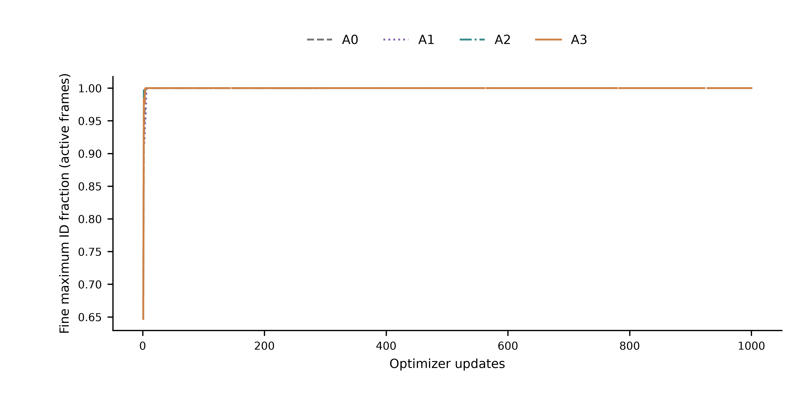
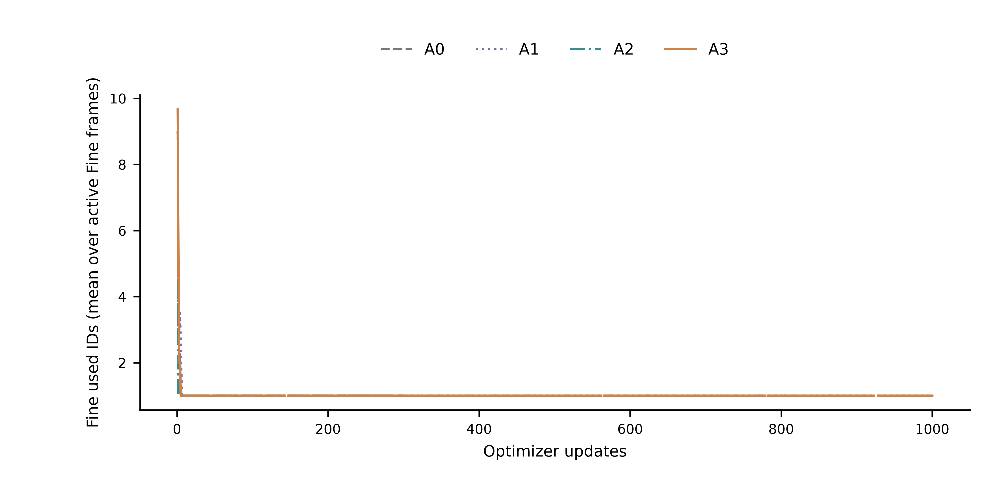
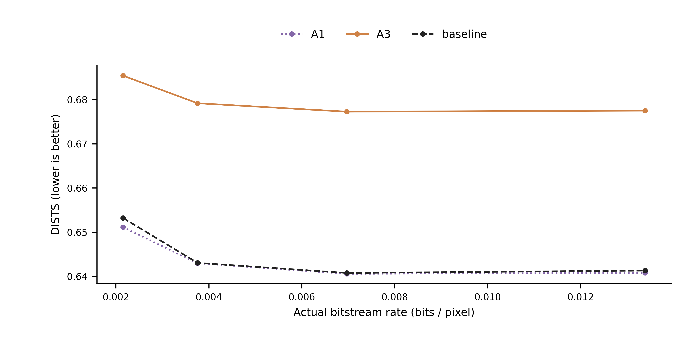
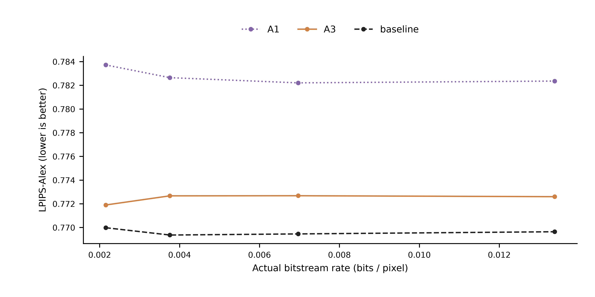
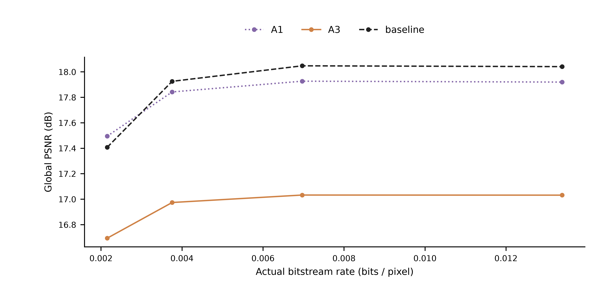
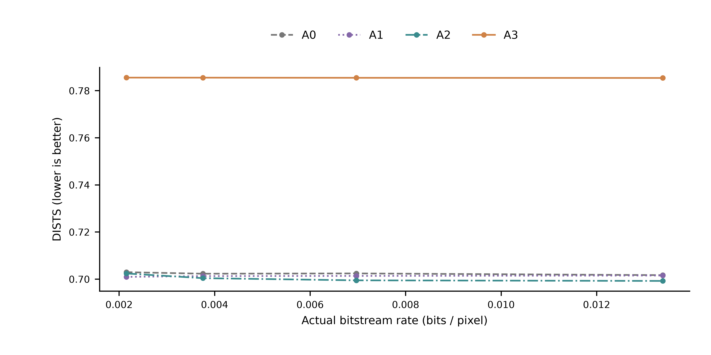
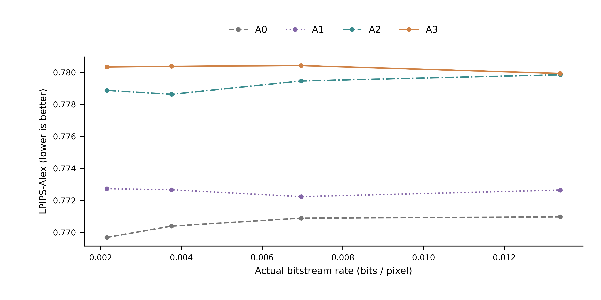
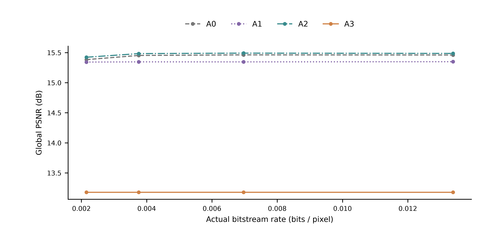
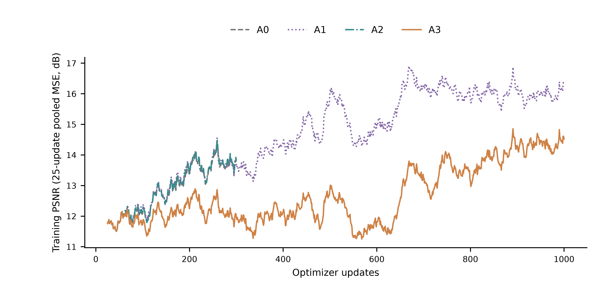
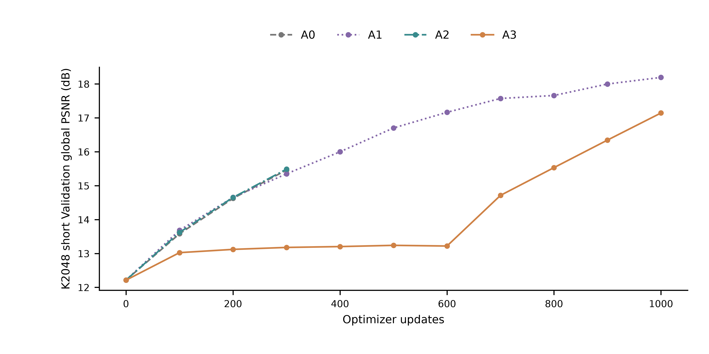

# AdapTok-HR Fine Token 恢复实验报告

结论：预算感知 VQ 与分层码本的受控对照未恢复 Fine 有效信息；按 1000 步停止条件保留负结果，没有扩大训练或增加 Decoder。

本报告由实际 JSON/JSONL 自动生成。尚未执行的阶段明确列为未执行；单种子 Pilot 不代表训练收敛。

## 实验身份与保护

基线 `cc87bd4`；分支 `experiment/adaptok-hr-fine-recovery`。数据身份 `267d520759c0b7b07e7075921fbe2c9ad5978906275d0eb47641ccdf7ce3ec82`。
旧 1000 步 Checkpoint SHA256：`e7ba64dfbdcb9178c87654294a372fba92228f957c49dfc7561894938032c0f5`。Train/Validation 原生 RGB 不缩放；未以旧 Test 或历史视频选择模型。

## E0：冻结模型的确定事实

本文件由原始 JSON 自动生成；全部旁路为 diagnostic_only，不是可传输率失真结果。

验证诊断的 16 个采样帧中，K2048 实际发送 22448 个 Fine ID，使用 1 个码字，最大占比 1.00000000。
量化前归一化空间方差 0.000446613707，位置余弦 0.992849115。

| 同历史干预 | MSE | 全局 PSNR | LPIPS | DISTS | 输出变化 MSE |
|---|---:|---:|---:|---:|---:|
| validation/vq | 0.0156304339 | 18.060290 | 0.7790846 | 0.6448759 | 0 |
| validation/continuous | 0.0151382897 | 18.199232 | 0.7776209 | 0.6430605 | 0.000447489214 |
| validation/fine_continuous | 0.0155151861 | 18.092430 | 0.7790468 | 0.6442671 | 7.33996886e-06 |
| validation/fine_constant | 0.0156304339 | 18.060290 | 0.7790846 | 0.6448759 | 0 |
| validation/fine_other_ids | 0.0156240848 | 18.062054 | 0.7794576 | 0.6449606 | 9.82476138e-06 |
| validation/fine_shuffle | 0.0156304339 | 18.060290 | 0.7790846 | 0.6448759 | 0 |
| validation/no_fine | 0.0155933805 | 18.070597 | 0.7787014 | 0.6441648 | 1.21893256e-05 |

确定事实：连续特征存在非零变化不等于它携带可用细节；用旁路损失、离散置换和梯度分别判断。
Fine 原始投影空间方差 0.0186065318，所以 Encoder 输出没有变成严格常量；归一化后的方向高度趋同。
量化前 Fine 存在非零变化，且 Fine 连续旁路的实际 MSE 小于 VQ 基线；这是当前样本上的弱有效性证据，不能称为可传输质量改善。帧间特征变化对比前一个采样诊断帧，并非全部相邻帧；真实码流历史始终逐帧推进。
VQ 后 Fine 在当前观测范围发生完全离散信息塌缩，常量替换及空间置换与原结果严格相同。
替换其他有效码字和移除 Fine 均改变输出，因此 Decoder 仍对 Fine 输入敏感；输出敏感性不等于细节恢复有效。
连续输入和离散 Decoder 输入梯度均非零，未观察到完全断开的支路；接近零必须连同 Base/Medium 的相对范数判断，不能凭非零就排除梯度不足。
推测边界：上述冻结模型干预不能单独证明塌缩的训练因果；预算损失范围和共享码本竞争需要匹配的 2×2 实验验证。
Decoder 输入梯度与量化前 Token 梯度（RGB MSE）见 gradients.json；非零梯度只证明局部敏感，不证明质量增益。

实际 STE 与 Decoder 恢复图梯度补充见 `evidence/E0/actual_ste_gradients.json`；连续旁路与真实离散前向梯度分开记录。

## E1/E2：实现与匹配条件

统一球面 VQ 产生逐 Token Codebook/Commitment Loss；active_prefix 对每个重建预算分别取前缀均值，再按重建的 1/2、1/2 权重混合；all_candidates 保留全候选对照。前向仍为真实码本 Embedding，STE 只改变反向。
保持旧损失的逐元素 MSE 尺度：每 Token 16 维先取均值，再归约 Token；没有同时改变 VQ 权重或增加均衡正则。训练行的 legacy quantization_mse 字段仍表示全部候选；实际发送的逐层误差和方差只读取 levels，完整诊断按 all_candidates/active_K* 分开，绝不混用。
分层模式拥有三个独立 8192×16 码本，接收端依确定性位置表查表；包仍为 ATHR v1、13-bit ID、142-byte 帧头，无逐 Token 层级字段。哈希包含全部真实码本和配置，因此错误模型或旧包会被拒绝，没有身份兼容回退。
模型初始公共权重、数据计划和主/辅助预算序列逐条核对，证据为 matching_*.json。共同 seed=20261118、数据 seed=20261119、预算 seed=20261120；Batch=1、四帧展开、TBPTT2、AdamW 1e-4。除两个消融因素外训练权重一致，保留原单调性权重 0.1。

## E3：匹配 2×2 的实测结果

300 步筛选：每来源前 8 帧，共 24 帧；1000 步完整固定验证：每来源最多 64 帧，共 174 帧（blackswan 原片只有 50 帧、dog 60 帧、car-roundabout 64 帧）。这三个来源沿用旧实验预先固定的 Validation 子集，不是全部 21 个 Validation 来源。不同验证长度不直接作效果排名。
同状态 ΔPSNR = 当前完整 K2048 码流历史下 K2048−K1024；闭环指标为各预算各自推进真实码流。Fine 用量仅统计 K2048 实际发送的位置。

| 配置 | 更新/帧次 | 验证帧 | Fine 码字 / perplexity / 最大占比 | 同状态 ΔPSNR | 闭环 PSNR | LPIPS | DISTS | bpp |
|---|---:|---:|---:|---:|---:|---:|---:|---:|
| A0 | 300/1200 | 24 | 1 / 1.000 / 100.0000% | -0.00146 | 15.46018 | 0.770965 | 0.701666 | 0.01338735 |
| A1 | 300/1200 | 24 | 1 / 1.000 / 100.0000% | +0.00187 | 15.34873 | 0.772638 | 0.701501 | 0.01338735 |
| A1 | 1000/4000 | 174 | 1 / 1.000 / 100.0000% | -0.00149 | 17.91939 | 0.782357 | 0.640789 | 0.01338735 |
| A2 | 300/1200 | 24 | 1 / 1.000 / 100.0000% | -0.00273 | 15.48621 | 0.779843 | 0.699203 | 0.01338735 |
| A3 | 300/1200 | 24 | 1 / 1.000 / 100.0000% | -0.00046 | 13.17805 | 0.779926 | 0.785370 | 0.01338735 |
| A3 | 1000/4000 | 174 | 1 / 1.000 / 100.0000% | -0.00092 | 17.03140 | 0.772600 | 0.677505 | 0.01338735 |
| baseline | 1000/4000 | 174 | 1 / 1.000 / 100.0000% | -0.00564 | 18.04080 | 0.769639 | 0.641297 | 0.01338735 |

按预先固定规则续训：A1, A3。其余两组保留 300 步结果，不拿 300 步与 1000 步跨步数作结构优劣结论。

## 冻结快照的梯度与方向集中诊断

仅同一 Train bear 首帧、同一 I 帧状态、K2048，冻结 0/100/300 步快照，无优化器更新。不是 Validation 排名，也不是训练因果证明。重建目标为 MSE+L1+0.1 LPIPS；VQ 编码侧梯度包含实际 0.25 commitment 权重。

| 配置 | 步 | Fine 码字 | Fine 位置余弦 | Fine 归一化空间方差 | VQ/重建梯度范数比 | Fine/Base 重建梯度比 |
|---|---:|---:|---:|---:|---:|---:|
| A0 | 0 | 8 | 0.982327 | 0.0011037685 | 1.4897 | 0.2051 |
| A0 | 100 | 1 | 0.992385 | 0.00047557143 | 0.2719 | 0.1054 |
| A0 | 300 | 1 | 0.994042 | 0.00037212617 | 0.1433 | 0.1284 |
| A1 | 0 | 8 | 0.982327 | 0.0011037685 | 1.9531 | 0.2051 |
| A1 | 100 | 1 | 0.984721 | 0.00095425762 | 0.6479 | 0.0744 |
| A1 | 300 | 1 | 0.982665 | 0.0010827042 | 0.2832 | 0.0902 |
| A2 | 0 | 9 | 0.982327 | 0.0011037685 | 1.4367 | 0.1940 |
| A2 | 100 | 1 | 0.991312 | 0.00054264412 | 0.3194 | 0.1184 |
| A2 | 300 | 1 | 0.993440 | 0.00040968985 | 0.1235 | 0.0979 |
| A3 | 0 | 9 | 0.982327 | 0.0011037685 | 1.8836 | 0.1940 |
| A3 | 100 | 1 | 0.997404 | 0.00016211532 | 0.8695 | 0.2270 |
| A3 | 300 | 1 | 0.999127 | 5.4517935e-05 | 0.9808 | 0.2371 |

事实：初始 Fine 方向已经很集中；这一个固定帧的四条分支到 100 步均使用单码，分层码本也发生塌缩。不能把共享竞争或 all_candidates 当作本设置下塌缩的必要条件。
推测：初始方向集中、量化吸引域和弱空间细节约束共同形成了塌缩反馈；当前证据尚不能分离三者的因果贡献。非零重建梯度不能保证可恢复空间码字，更不能用更长训练代替重新检查表示设计。
监督分配计数见 mechanism_audit.json：全部候选的 Base/Medium/Fine 容量分别为 135/510/2040；真实 K2048 为 135/510/1403。原 all_candidates 将约 76% 的 VQ Token 权重分配给 Fine，低预算却不一定重建 Fine。active_prefix 消除了未激活位置的损失，但没有自动恢复信息。

## 后续门槛

1000 步 Fine 信息门槛：`{"A1": false, "A3": false}`。
Fine 有效传递仍未恢复。本轮保留负结果并停止扩展训练。D1 Fine Residual、D2 Detail Loss、D3 二者组合均未执行；未新增 Decoder 参数或高频损失。未开展更大数据/16–32 帧正式训练或 30FPS 优化。D0 为四组实际使用的原 Decoder。
没有新的授权外部视频；复用原 manifest 导入接口和隔离规则，没有自动下载数据。新来源最终封存测试尚未建立、未执行。

## 连续闭环的早晚期质量

只列累计 1000 步、相同固定 Validation 的各预算独立闭环；early 为每视频帧 0–7，late 为 48 及之后。早晚帧内容不同，此表不能单独把差异归因于参考漂移；应同时比较旧权重在相同帧的结果。

| 配置 | K | 早期全局 PSNR | 晚期全局 PSNR | 早期 LPIPS | 晚期 LPIPS |
|---|---:|---:|---:|---:|---:|
| A1 | 256 | 17.75240 | 16.66364 | 0.781976 | 0.791970 |
| A1 | 512 | 18.11489 | 17.01396 | 0.780465 | 0.789811 |
| A1 | 1024 | 18.20476 | 17.12018 | 0.779834 | 0.788945 |
| A1 | 2048 | 18.19258 | 17.11556 | 0.780236 | 0.788934 |
| A3 | 256 | 16.78527 | 16.39527 | 0.770296 | 0.780942 |
| A3 | 512 | 17.08504 | 16.69732 | 0.770421 | 0.782292 |
| A3 | 1024 | 17.14127 | 16.76779 | 0.770355 | 0.783156 |
| A3 | 2048 | 17.14298 | 16.76861 | 0.770228 | 0.783145 |
| baseline | 256 | 17.72252 | 16.56025 | 0.766849 | 0.772320 |
| baseline | 512 | 18.31000 | 17.06930 | 0.765017 | 0.771870 |
| baseline | 1024 | 18.41673 | 17.21317 | 0.765316 | 0.772660 |
| baseline | 2048 | 18.41123 | 17.21096 | 0.765315 | 0.772951 |

## 连续 64 帧吞吐

下面均为 car-roundabout 原生连续 64 帧，独立收发端模型实例；包含发送端本地解码、打包、接收端解码。无感知网络常驻；排除读盘/H2D/指标/写盘/断言，不是 Encoder 单前向吞吐。

| Checkpoint | K | Encoder FPS | Sender FPS | Receiver FPS | 顺序联合 FPS | 联合 P50/P95 ms | 峰值 MiB | 参数 | bytes |
|---|---:|---:|---:|---:|---:|---:|---:|---:|---:|
| A0/300 | 256 | 123.23 | 46.50 | 75.07 | 28.72 | 34.790/35.021 | 492.0 | 1618137 | 35712 |
| A0/300 | 512 | 122.99 | 46.13 | 74.51 | 28.49 | 35.032/35.306 | 492.1 | 1618137 | 62336 |
| A0/300 | 1024 | 123.04 | 44.79 | 71.72 | 27.57 | 36.147/36.428 | 492.1 | 1618137 | 115584 |
| A0/300 | 2048 | 122.77 | 43.93 | 70.49 | 27.06 | 36.876/37.154 | 492.2 | 1618137 | 222080 |
| A1/300 | 256 | 123.15 | 46.46 | 74.96 | 28.68 | 34.830/35.046 | 492.0 | 1618137 | 35712 |
| A1/300 | 512 | 122.63 | 44.84 | 71.09 | 27.50 | 36.531/36.832 | 492.1 | 1618137 | 62336 |
| A1/300 | 1024 | 122.33 | 43.33 | 67.96 | 26.46 | 37.724/38.157 | 492.1 | 1618137 | 115584 |
| A1/300 | 2048 | 121.99 | 42.39 | 67.36 | 26.02 | 38.479/39.025 | 492.2 | 1618137 | 222080 |
| A1/1000 | 256 | 121.32 | 45.17 | 71.32 | 27.66 | 35.002/40.817 | 492.0 | 1618137 | 35712 |
| A1/1000 | 512 | 122.91 | 45.98 | 74.27 | 28.40 | 35.107/36.192 | 492.1 | 1618137 | 62336 |
| A1/1000 | 1024 | 122.69 | 44.67 | 71.50 | 27.49 | 36.215/37.643 | 492.1 | 1618137 | 115584 |
| A1/1000 | 2048 | 122.44 | 43.84 | 70.56 | 27.04 | 36.924/37.185 | 492.2 | 1618137 | 222080 |
| A2/300 | 256 | 119.88 | 43.79 | 69.23 | 26.82 | 36.668/39.966 | 494.0 | 1880281 | 35712 |
| A2/300 | 512 | 122.01 | 45.49 | 73.37 | 28.08 | 35.501/36.329 | 494.1 | 1880281 | 62336 |
| A2/300 | 1024 | 121.95 | 44.35 | 70.95 | 27.29 | 36.536/36.983 | 494.1 | 1880281 | 115584 |
| A2/300 | 2048 | 121.57 | 43.42 | 69.58 | 26.74 | 37.300/37.760 | 494.2 | 1880281 | 222080 |
| A3/300 | 256 | 120.33 | 44.23 | 70.20 | 27.14 | 36.434/38.555 | 494.0 | 1880281 | 35712 |
| A3/300 | 512 | 121.06 | 44.23 | 70.30 | 27.15 | 36.663/37.782 | 494.1 | 1880281 | 62336 |
| A3/300 | 1024 | 121.38 | 43.03 | 67.73 | 26.31 | 37.914/38.319 | 494.1 | 1880281 | 115584 |
| A3/300 | 2048 | 120.89 | 42.05 | 66.60 | 25.77 | 38.693/39.160 | 494.2 | 1880281 | 222080 |
| A3/1000 | 256 | 121.69 | 45.82 | 73.87 | 28.28 | 35.345/35.591 | 494.0 | 1880281 | 35712 |
| A3/1000 | 512 | 121.73 | 45.53 | 73.13 | 28.06 | 35.576/35.919 | 494.1 | 1880281 | 62336 |
| A3/1000 | 1024 | 121.39 | 44.09 | 70.12 | 27.07 | 36.792/37.349 | 494.1 | 1880281 | 115584 |
| A3/1000 | 2048 | 120.93 | 43.18 | 68.95 | 26.55 | 37.543/38.041 | 494.2 | 1880281 | 222080 |
| baseline/1000 | 256 | 122.65 | 45.82 | 73.48 | 28.22 | 35.363/35.799 | 492.0 | 1618137 | 35712 |
| baseline/1000 | 512 | 122.66 | 45.56 | 73.15 | 28.07 | 35.584/35.825 | 492.1 | 1618137 | 62336 |
| baseline/1000 | 1024 | 122.46 | 44.29 | 70.40 | 27.19 | 36.707/37.103 | 492.1 | 1618137 | 115584 |
| baseline/1000 | 2048 | 121.77 | 43.26 | 69.23 | 26.62 | 37.435/38.037 | 492.2 | 1618137 | 222080 |

## 测试、可复现性与交付

原始 JSON/JSONL、Checkpoint 元数据、环境与代码身份归档到 experiments/adaptok_hr/fine_recovery/evidence；权重保存在独立 checkpoints/adaptok_hr_fine_recovery 目录。运行命令见同目录 README。
测试 XML、逐位恢复、24 类行为变异的初次结果及修复后证据均保留。没有把第一次存活变异隐藏为首次通过。性能计时与覆盖率/Profiler 分离。
单种子、固定小规模 Train/Validation Pilot 的结果只说明该设置下是否恢复 Fine；不能证明更大数据或充分收敛后的上限。统计无独立种子置信区间，没有伪造误差条。

## 原始数据图

## 实际 1080p 重建示例

以下为同一原始 car-roundabout 第 0 帧与各预算真实 ID 解码，全部保留 1920×1080，未进行锐化或后处理。
人工检查该帧的 K2048 图：A1/A3 都仍明显模糊，A3 可见彩色周期纹理；这些纹理没有被当作细节恢复或感知改善。该观察只对应所展示帧。

- [A1: DAVIS2017_car-roundabout_0000_K1024.png](../experiments/adaptok_hr/fine_recovery/evidence/A1/validation_001000_64f/samples/DAVIS2017_car-roundabout_0000_K1024.png)
- [A1: DAVIS2017_car-roundabout_0000_K2048.png](../experiments/adaptok_hr/fine_recovery/evidence/A1/validation_001000_64f/samples/DAVIS2017_car-roundabout_0000_K2048.png)
- [A1: DAVIS2017_car-roundabout_0000_K256.png](../experiments/adaptok_hr/fine_recovery/evidence/A1/validation_001000_64f/samples/DAVIS2017_car-roundabout_0000_K256.png)
- [A1: DAVIS2017_car-roundabout_0000_K512.png](../experiments/adaptok_hr/fine_recovery/evidence/A1/validation_001000_64f/samples/DAVIS2017_car-roundabout_0000_K512.png)
- [A1: DAVIS2017_car-roundabout_0000_original.png](../experiments/adaptok_hr/fine_recovery/evidence/A1/validation_001000_64f/samples/DAVIS2017_car-roundabout_0000_original.png)
- [A3: DAVIS2017_car-roundabout_0000_K1024.png](../experiments/adaptok_hr/fine_recovery/evidence/A3/validation_001000_64f/samples/DAVIS2017_car-roundabout_0000_K1024.png)
- [A3: DAVIS2017_car-roundabout_0000_K2048.png](../experiments/adaptok_hr/fine_recovery/evidence/A3/validation_001000_64f/samples/DAVIS2017_car-roundabout_0000_K2048.png)
- [A3: DAVIS2017_car-roundabout_0000_K256.png](../experiments/adaptok_hr/fine_recovery/evidence/A3/validation_001000_64f/samples/DAVIS2017_car-roundabout_0000_K256.png)
- [A3: DAVIS2017_car-roundabout_0000_K512.png](../experiments/adaptok_hr/fine_recovery/evidence/A3/validation_001000_64f/samples/DAVIS2017_car-roundabout_0000_K512.png)
- [A3: DAVIS2017_car-roundabout_0000_original.png](../experiments/adaptok_hr/fine_recovery/evidence/A3/validation_001000_64f/samples/DAVIS2017_car-roundabout_0000_original.png)

## 自动验收

工程检查：`True`；实际测试 `70` 项，失败/错误/跳过 `0/0/0`；行为变异 `24` 类全部捕获 `True`。
修改的生产模块 CRAP 均低于 10，重复函数相似度均低于 0.8；完整审计另外保留 22 个本轮测试未覆盖充分的旧评估/报告函数，不把这些误报为已覆盖。
验收重新读取每个真实包并核对 13-bit ID、预算、帧号、码本哈希、字节数，检查存档同状态前缀完全一致；原始 Validation RGB 哈希与旧权重复测逐帧相等。所有检查点文件重新计算 SHA256 与侧车元数据一致。
工程检查通过不代表 Fine 恢复、质量门槛或 30 FPS 通过；研究停止决策单独记录。
