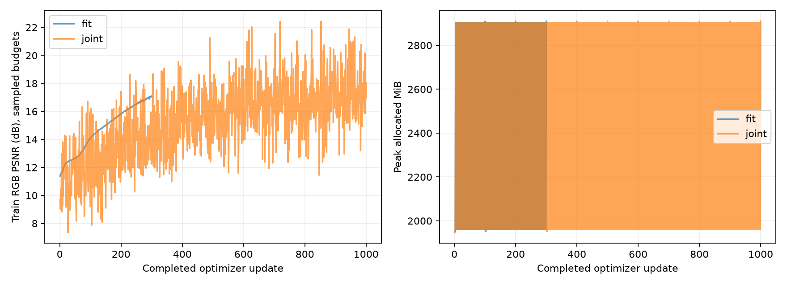
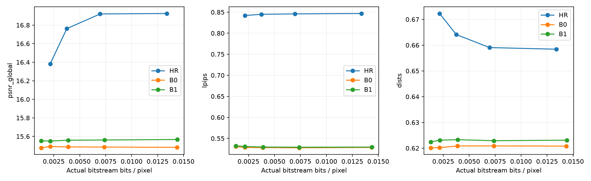

# AdapTok-HR 原生1080p实验报告

分支 experiment/adaptok-hr；生成时 Git `09816107c0ef5902a074524b7755f2346aaaa015`。所有数字由实际 JSON/JSONL 读取；完整运行命令见 experiments/adaptok_hr/README.md。

## 数据与实际训练

```json
{
  "train": {
    "sources": 54,
    "frames": 3827
  },
  "validation": {
    "sources": 21,
    "frames": 1323
  },
  "test": {
    "sources": 4,
    "frames": 261
  },
  "historical": {
    "sources": 3,
    "frames": 294
  }
}
```

索引只接收原生至少1920×1080的源，高分辨率仅裁剪，不上采样。新 HR Test 从旧 CP Test 索引中排除已用于历史1080p对照的 cows/goat/parkour；不是全新独立数据集。固定短Validation用于进度记录，完整64帧评估另列。

| 实验 | 实际完成更新 | 实际帧次 | 更新计算秒 | 最大allocated MiB |
| --- | --- | --- | --- | --- |
| fit | 300 | 1200 | 90.583 | 2909.53 |
| joint | 1000 | 4000 | 314.391 | 2909.53 |
| strict_smoke | 1 | 4 | 2.157 | 1943.52 |

工程探测每种展开长度独立做1次真实优化器更新，另计，不混入正式Pilot；TBPTT2。

```json
{
  "1": {
    "peak_gpu_mib": 1077.96533203125,
    "update_seconds": 2.1085465789656155
  },
  "4": {
    "peak_gpu_mib": 1965.39794921875,
    "update_seconds": 0.3022630200139247
  },
  "16": {
    "peak_gpu_mib": 2250.54638671875,
    "update_seconds": 1.1129745009820908
  },
  "32": {
    "peak_gpu_mib": 2612.978515625,
    "update_seconds": 2.201002679008525
  }
}
```

33帧独立收发端状态逐帧相同，第33帧I重置与空参考重建相同。工程测试含实际VQ、真实二进制与反向。

单Train片段拟合的独立真实码流诊断（不是泛化指标）：

```json
{
  "environment": {
    "time": "2026-11-17T23:28:36.755806+08:00",
    "timezone": "Asia/Shanghai",
    "git": "7edf48aee038d0aebbcad2722b293907a9fe9ff7",
    "branch": "experiment/adaptok-hr",
    "python": "3.12.13",
    "torch": "2.9.1+cu130",
    "cuda": "13.0",
    "gpu": "NVIDIA H100 PCIe",
    "driver": "580.159.03"
  },
  "before": {
    "mse": 0.07296297326683998,
    "edge_mse": 0.01731735421344638,
    "output_spatial_std": 0.07660506293177605
  },
  "after": {
    "mse": 0.01932103419676423,
    "edge_mse": 0.005733247729949653,
    "output_spatial_std": 0.09892120212316513
  },
  "initialization": "reconstructed from recorded seed/config; not a historical pre-training measurement",
  "completed_steps": 300,
  "training_frames": 1200,
  "rgb_mse_improved": true,
  "edge_mse_improved": true,
  "scope": "four Train bear frames, real VQ2048 with reconstructed history; no generalization claim"
}
```



## 已定位的表示瓶颈

| 层（K2048实际传输） | Code数 | Perplexity | 最大Code占比 |
| --- | --- | --- | --- |
| Base | 1314 | 170.134 | 6.990% |
| Medium | 745 | 73.411 | 8.503% |
| Fine_transmitted_prefix | 1 | 1.000 | 100.000% |

该统计来自完整Validation中K2048实际码流，Fine层在这些样本上没有传递内容变化。额外同状态前缀重建见 token_diagnostics.json；辅助分支不更新参考。不能把独立预算闭环的差值全部当作当前帧量化效应。

## 300更新后完整Validation

| K/完整帧 | 帧数 | PSNR全局MSE | PSNR逐帧均值 | LPIPS-Alex | DISTS | 实际bpp | 实际bytes | Code使用率 |
| --- | --- | --- | --- | --- | --- | --- | --- | --- |
| 256 | 174 | 15.5207 | 15.7215 | 0.79445 | 0.70664 | 0.00215278 | 97092 | 5.7251% |
| 512 | 174 | 15.5958 | 15.7973 | 0.79512 | 0.70477 | 0.00375772 | 169476 | 5.7251% |
| 1024 | 174 | 15.6201 | 15.8244 | 0.79544 | 0.70590 | 0.00696759 | 314244 | 5.6885% |
| 2048 | 174 | 15.6218 | 15.8256 | 0.79581 | 0.70582 | 0.01338735 | 603780 | 5.7251% |

逐帧、I/P、GOP早期1–7/晚期24–31、运动阈值0.01/0.03分组，以及传输Code直方图见 `results/adaptok_hr/validation_300`。每条不足64帧的源明确保存 at_least_64_contiguous_frames=false；不补帧计数。

## 1000更新后完整Validation

| K/完整帧 | 帧数 | PSNR全局MSE | PSNR逐帧均值 | LPIPS-Alex | DISTS | 实际bpp | 实际bytes | Code使用率 |
| --- | --- | --- | --- | --- | --- | --- | --- | --- |
| 256 | 174 | 17.4068 | 17.6496 | 0.76998 | 0.65321 | 0.00215278 | 97092 | 21.4600% |
| 512 | 174 | 17.9254 | 18.1365 | 0.76936 | 0.64304 | 0.00375772 | 169476 | 23.4009% |
| 1024 | 174 | 18.0472 | 18.2600 | 0.76946 | 0.64076 | 0.00696759 | 314244 | 23.9502% |
| 2048 | 174 | 18.0408 | 18.2548 | 0.76964 | 0.64130 | 0.01338735 | 603780 | 23.8037% |

逐帧、I/P、GOP早期1–7/晚期24–31、运动阈值0.01/0.03分组，以及传输Code直方图见 `results/adaptok_hr/validation_1000`。每条不足64帧的源明确保存 at_least_64_contiguous_frames=false；不补帧计数。

## 已知历史视频绝对质量

| K/完整帧 | 帧数 | PSNR全局MSE | PSNR逐帧均值 | LPIPS-Alex | DISTS | 实际bpp | 实际bytes | Code使用率 |
| --- | --- | --- | --- | --- | --- | --- | --- | --- |
| 256 | 192 | 16.3821 | 16.4933 | 0.84205 | 0.67229 | 0.00215278 | 107136 | 24.0479% |
| 512 | 192 | 16.7623 | 16.8859 | 0.84492 | 0.66411 | 0.00375772 | 187008 | 24.7681% |
| 1024 | 192 | 16.9203 | 17.0446 | 0.84592 | 0.65906 | 0.00696759 | 346752 | 25.7690% |
| 2048 | 192 | 16.9252 | 17.0493 | 0.84681 | 0.65842 | 0.01338735 | 666240 | 26.0498% |

逐帧、I/P、GOP早期1–7/晚期24–31、运动阈值0.01/0.03分组，以及传输Code直方图见 `results/adaptok_hr/historical`。每条不足64帧的源明确保存 at_least_64_contiguous_frames=false；不补帧计数。

## 封存HR Test

| K/完整帧 | 帧数 | PSNR全局MSE | PSNR逐帧均值 | LPIPS-Alex | DISTS | 实际bpp | 实际bytes | Code使用率 |
| --- | --- | --- | --- | --- | --- | --- | --- | --- |
| 256 | 239 | 18.1834 | 18.9082 | 0.59450 | 0.67309 | 0.00215278 | 133362 | 20.4346% |
| 512 | 239 | 18.6904 | 19.4637 | 0.58961 | 0.66194 | 0.00375772 | 232786 | 21.4966% |
| 1024 | 239 | 18.8947 | 19.6867 | 0.58791 | 0.65776 | 0.00696759 | 431634 | 22.7783% |
| 2048 | 239 | 18.8800 | 19.6754 | 0.58802 | 0.65828 | 0.01338735 | 829330 | 22.7295% |

逐帧、I/P、GOP早期1–7/晚期24–31、运动阈值0.01/0.03分组，以及传输Code直方图见 `results/adaptok_hr/final_test`。每条不足64帧的源明确保存 at_least_64_contiguous_frames=false；不补帧计数。

## 独立性能与计算量

| K | 型 | Encoder FPS | Receiver FPS | Sender+Receiver FPS | 联合P50/P95 ms | 峰值 MiB |
| --- | --- | --- | --- | --- | --- | --- |
| 256 | I | 124.90 | 75.30 | 28.74 | 34.802/34.898 | 488.56 |
| 256 | P | 122.26 | 74.21 | 28.46 | 35.109/35.293 | 488.66 |
| 512 | I | 124.96 | 74.79 | 28.55 | 35.033/35.123 | 488.57 |
| 512 | P | 124.94 | 73.80 | 28.26 | 35.377/35.549 | 488.67 |
| 1024 | I | 125.09 | 72.29 | 27.71 | 36.094/36.166 | 488.60 |
| 1024 | P | 124.94 | 71.15 | 27.42 | 36.389/37.253 | 488.71 |
| 2048 | I | 125.00 | 71.01 | 27.20 | 36.769/36.853 | 488.67 |
| 2048 | P | 125.00 | 70.37 | 27.01 | 37.021/37.127 | 488.77 |

resident pixels, BF16 NN with FP32 VQ; synchronized wall; encoder excludes packing/local decode; decoder includes parse/lookup/state; joint includes encode+sender local decode+independent receiver decode+packing; excludes load,H2D,disk,metrics

I/首P各5预热、20重复，batch1。联合计算包含发送端本地解码与独立接收端，不能把Encoder FPS直接称端到端FPS；该表为固定状态微基准，连续视频另测。

参数量 `1618137`；I/P GFLOPs：I=9.7586, P=10.3603. PyTorch FlopCounterMode; multiply-add=2; counts supported conv/mm/SDPA operators; excludes interpolation,norm,activation,packing and CPU operations。FLOPs口径是一次Encoder+VQ+一次Decoder前向；不含接收端的额外一次Decoder，联合速度则实际计入这次解码。

Conv、window attention、token/VQ、lookup/scatter、低分辨率补全、高分辨率上采样、状态、13-bit packing/unpacking均独立保存；分量探测含同步开销，不相加冒充整机性能。

| K2048 首P组件 | Mean ms | P95 ms |
| --- | --- | --- |
| conv_encoder | 6.530 | 6.540 |
| encoder_window_attention | 0.272 | 0.274 |
| decoder_window_attention | 1.422 | 1.433 |
| all_window_attention_cuda | 1.695 | 1.708 |
| encoder_total_wall | 7.093 | 7.102 |
| token_generation | 0.470 | 0.480 |
| vq | 1.234 | 1.254 |
| token_lookup | 0.092 | 0.095 |
| token_scatter | 1.465 | 1.475 |
| decoder_low_fusion_attention | 4.362 | 4.385 |
| decoder_upsampling | 7.757 | 7.783 |
| state_update | 0.019 | 0.022 |
| ids_gpu_to_cpu | 0.108 | 0.111 |
| bit_packing_cpu | 0.458 | 0.480 |
| bit_unpacking_cpu | 0.363 | 0.369 |
| framing_including_pack_crc | 0.462 | 0.472 |
| parsing_including_unpack_crc | 0.370 | 0.377 |

## 封存Baseline

| 模型 | Token 单位 | PSNR逐帧均值 | LPIPS-Alex | DISTS |
| --- | --- | --- | --- | --- |
| B0 | 128/frame | 15.541 | 0.53091 | 0.62014 |
| B0 | 512/frame | 15.550 | 0.52813 | 0.62086 |
| B0 | 1024/frame | 15.549 | 0.52769 | 0.62086 |
| B0 | 2048/frame | 15.546 | 0.52855 | 0.62080 |
| B1 | 128/frame | 15.619 | 0.53247 | 0.62240 |
| B1 | 512/frame | 15.626 | 0.52951 | 0.62329 |
| B1 | 1024/frame | 15.629 | 0.52912 | 0.62290 |
| B1 | 2048/frame | 15.634 | 0.52942 | 0.62310 |
| Official stride128 | 512/tile/native-window | 21.911 | 0.27778 | 0.11311 |
| Official stride128 | 1024/tile/native-window | 23.841 | 0.21846 | 0.08842 |
| Official stride128 | 2048/tile/native-window | 24.681 | 0.19849 | 0.08066 |
| Official stride96 | 512/tile/native-window | 22.718 | 0.25212 | 0.10417 |
| Official stride96 | 1024/tile/native-window | 24.386 | 0.20463 | 0.08329 |
| Official stride96 | 2048/tile/native-window | 25.150 | 0.18701 | 0.07593 |

官方K为每Tile每16帧，HR为每完整帧。无重叠K2048约17280 Token/源帧，重叠约28160；不按相同K宣称同码率公平。官方 bpp=null；HR是真实固定13-bit流，包含帧头与CRC，没有熵模型。

## 继续训练决策与未完成项目

```json
{
  "status": "native_1080p_pilot_complete_targets_not_met",
  "completed_joint_steps": 1000,
  "training_frames": 4000,
  "selected_checkpoint": "/home/whisperliang/CP-AdapTok/checkpoints/adaptok_hr/joint/step_001000.pt",
  "checkpoint_sha256": "e7ba64dfbdcb9178c87654294a372fba92228f957c49dfc7561894938032c0f5",
  "selected_before_test": true,
  "run_5000_updates": false,
  "scorer_ready": false,
  "convergence_verified": false,
  "validation_k256_to_k2048_gain_db": 0.6339859950800779,
  "validation_k1024_to_k2048_gain_db": -0.006422012658404697,
  "k2048_lpips": 0.7696391621540333,
  "k2048_dists": 0.6412970930680462,
  "k2048_perplexity": 8.938990224142506,
  "reason": "Stop after the bounded 1000-update pilot: perceptual quality remains poor, the final doubled prefix does not improve aggregate validation PSNR, and Fine-code usage is concentrated. Diagnose VQ/level contribution and decoder detail before committing a 5000-update or Scorer run.",
  "next_experiment": "controlled Train/Validation study of per-level codebook initialization/diversity and decoder spatial-detail capacity, with matching compute/data splits; larger licensed dataset still needed",
  "ablations_completed": false,
  "phase2_formal_training_completed": false
}
```

Conv-only / local attention / temporal、fixed/nested可通过配置运行匹配消融；未运行的消融不产生质量数字。Scorer支持冻结Tokenizer与同状态真实ID标签，只有稳定性门槛通过后才进行正式训练，不把单元测试称为Scorer实验。

## 验收与证据

```json
{
  "code_and_native_1080p_pilot_complete": true,
  "all_tests_pass": true,
  "tests": {
    "tests": 46,
    "failures": 0,
    "errors": 0,
    "skipped": 0,
    "properties": {
      "tbptt4_peak_gpu_mib": "2067.86865234375"
    }
  },
  "mutations_all_killed": true,
  "mutations": 14,
  "crap_over_10": 0,
  "duplicate_functions_over_08": 0,
  "optimizer_log_sequence_equal": true,
  "training_frame_count_equal": true,
  "completed_joint_steps": 1000,
  "training_frames": 4000,
  "actual_binary_bytes": {
    "validation_300/k256": {
      "frames": 174,
      "bytes": 97092
    },
    "validation_300/k512": {
      "frames": 174,
      "bytes": 169476
    },
    "validation_300/k1024": {
      "frames": 174,
      "bytes": 314244
    },
    "validation_300/k2048": {
      "frames": 174,
      "bytes": 603780
    },
    "validation_1000/k256": {
      "frames": 174,
      "bytes": 97092
    },
    "validation_1000/k512": {
      "frames": 174,
      "bytes": 169476
    },
    "validation_1000/k1024": {
      "frames": 174,
      "bytes": 314244
    },
    "validation_1000/k2048": {
      "frames": 174,
      "bytes": 603780
    },
    "historical/k256": {
      "frames": 192,
      "bytes": 107136
    },
    "historical/k512": {
      "frames": 192,
      "bytes": 187008
    },
    "historical/k1024": {
      "frames": 192,
      "bytes": 346752
    },
    "historical/k2048": {
      "frames": 192,
      "bytes": 666240
    },
    "final_test/k256": {
      "frames": 239,
      "bytes": 133362
    },
    "final_test/k512": {
      "frames": 239,
      "bytes": 232786
    },
    "final_test/k1024": {
      "frames": 239,
      "bytes": 431634
    },
    "final_test/k2048": {
      "frames": 239,
      "bytes": 829330
    }
  },
  "rgb_parity_frames": 192,
  "continuous_64_frame_benchmark": {
    "256": {
      "frames": 64,
      "native_rgb_equal": true,
      "sender_receiver_equal": true,
      "joint_fps": 26.896787608519624
    },
    "512": {
      "frames": 64,
      "native_rgb_equal": true,
      "sender_receiver_equal": true,
      "joint_fps": 27.81507904158613
    },
    "1024": {
      "frames": 64,
      "native_rgb_equal": true,
      "sender_receiver_equal": true,
      "joint_fps": 26.22027113276434
    },
    "2048": {
      "frames": 64,
      "native_rgb_equal": true,
      "sender_receiver_equal": true,
      "joint_fps": 26.747590139944293
    }
  },
  "metric_identity": {
    "weights_equal": true,
    "sha256_by_filename": {
      "weights.pt": "f5e65c96230b7f6ca995691647d482237e4cab8a50c5c4a5784f219ef0748218",
      "alex.pth": "df73285e35b22355a2df87cdb6b70b343713b667eddbda73e1977e0c860835c0",
      "alexnet-owt-7be5be79.pth": "7be5be791159472b1fbf3c69796f7cb30dca7ad8466c2df70058c37116cdee02",
      "vgg16-397923af.pth": "397923af8e79cdbb6a7127f12361acd7a2f83e06b05044ddf496e83de57a5bf0"
    }
  },
  "protected_inputs": {
    "cp_manifests_unchanged": true,
    "official_weights_unchanged": true,
    "official_source_unchanged": true,
    "cp_and_official_paths_unchanged": true,
    "sealed_cp_checkpoint_sha256": {
      "B0": "df88cbec23291a41c83cefc3784e40834552ef732d98af2bda7543a42a608942",
      "B1": "3d7e6785d96bcb13fae001a43614814969e715ccbc6e9ce053c4711030146822"
    }
  },
  "gop33_native_roundtrip_pass": true,
  "final_test_sealed": true,
  "final_test_complete": true,
  "joint_1080p30_all_conditions_met": false,
  "quality_ready_for_scaling": false,
  "fine_representation_effective": false,
  "scorer_formal_training_complete": false,
  "full_training_ablations_complete": false,
  "interpretation": "engineering implementation and bounded pilot accepted; research quality/progressive-Fine/30FPS targets not achieved; no 5000-step or Phase2 claim",
  "engineering_acceptance": true
}
```

测试覆盖、复杂度/重复审计和行为变异结果见 evidence；crapper/dryer/mutator专用工具未安装，替代工具明确记录。源数据与大Checkpoint保存在本地忽略目录，身份、配置、完整训练JSONL与小型结果证据随Git提交。

所有质量指标在原生float32 RGB计算，样图显示量化不参与指标。单训练种子、小数据/短程Pilot，不据此宣称训练已收敛、同码率领先或1080p30部署完成。

## 连续64帧独立吞吐

| K | 连续帧数 | Sender FPS | Receiver FPS | 联合FPS | 联合P50/P95 ms | 峰值 MiB |
| --- | --- | --- | --- | --- | --- | --- |
| 256 | 64 | 42.93 | 72.02 | 26.90 | 36.769/40.698 | 485.31 |
| 512 | 64 | 44.57 | 74.00 | 27.82 | 35.494/38.721 | 485.33 |
| 1024 | 64 | 41.91 | 70.03 | 26.22 | 38.034/42.387 | 485.36 |
| 2048 | 64 | 43.17 | 70.30 | 26.75 | 37.261/37.935 | 485.43 |

固定Validation car-roundabout，逐预算单遍连续64帧（2个I、62个P），预热5对I/P；双方独立状态逐帧逐位相等。每帧同步墙钟包括发送端本地解码、实际打包和接收端解码；不加载感知网络，排除读盘、H2D、指标、写盘与相等断言，无流水并行。I/P、GOP早/晚期完整计时分组见 sequence_benchmark.json。该结果与固定状态微基准均未达到联合1080p30。

## 按实际bytes的率失真记录



三条曲线仅用同样192帧原生RGB。HR固定13-bit包含142-byte帧头，CP复用封存rANS实际bpp；位置/历史语义不同，不按相同K比较。官方分块无真实bpp，未放入RD图。HR在该样本上的PSNR与感知指标取舍不同，不能仅凭PSNR宣称整体更优。

原图左、实际ID解码右；DAVIS2017:car-roundabout 第0帧，完整1080p：


原图左、实际ID解码右；DAVIS2017:parkour 第31帧，完整1080p：


原图左、实际ID解码右；DAVIS2017:mbike-trick 第31帧，完整1080p：


## 数值模式补充核验

固定1000步权重、同一3×8帧短Validation，在严格确定性模式下重测。相对早期短Validation，最大预算级平均MSE绝对差为 `1.6282817e-05`。该检查只覆盖这些样本，未宣称早期与新模式逐位相同；新模式的中断恢复零容差测试另列。
