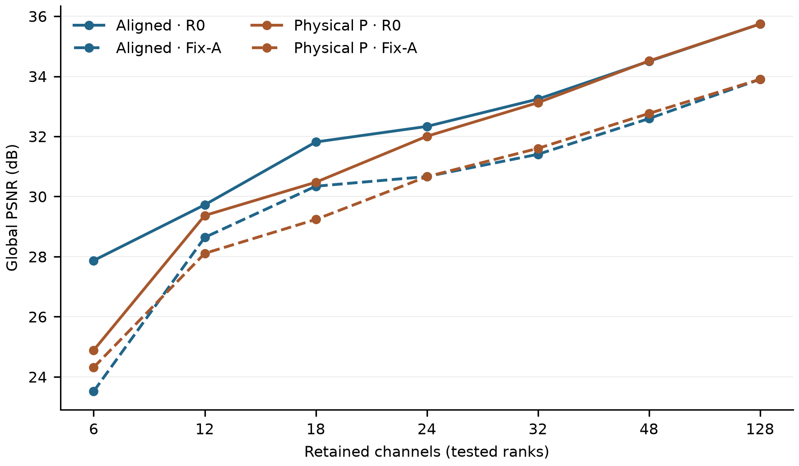
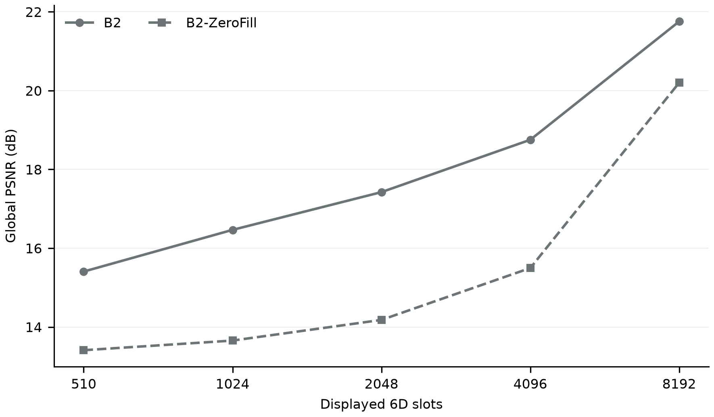
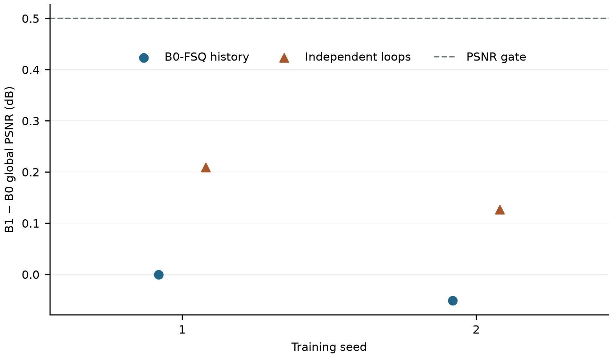

# AIP-VTok C1 实验报告

基线为 `3cb3641`。冻结 DMCI / DMC-LD、I 帧 256→128 白化 PCA、P 帧对角标准化和 Gate 0 W128 投影。
原始数据为 1920×1080，潜在网格为 68×120，QP32、GOP32。封存 Test 图像读取数为零。
174 帧验证集曾用于同一研究的历史开发。本文将它作为固定验证队列，五个候选校准视频来自 Train。

B0/B1 使用 K=32,640 做稠密通道诊断。B2/B3 使用 K=510、1024、2048、4096、8192 做稀疏重建。
全局 PSNR 从跨帧平均 RGB MSE 计算。LPIPS-Alex、DISTS 和 BT.709 Cb/Cr 在完整图像上计算。

| 阶段 | 结论 |
| --- | --- |
| Diag-0.5 | 完成，达到 C1-B 的前置门槛 |
| C1-A | 双种子证据未达门槛 |
| C1-B | 门控停止，训练 0 步 |

## Phase 1 · Train 校准和扫描表

P 帧锁为 **aligned**，扫描表 **S3**，核宽 **σ=1.5**。I 帧始终使用封存 PCA 对齐坐标。
候选按 I/P × 两种参考历史 × 五档 K 的 FSQ B2 全局 PSNR 等权平均排名。优胜得分为 21.598 dB，Train 校准的 Fix-A 历史 P510 插值收益为 +2.583 dB。
拟合遍历 30 个训练视频。另预留 5 个训练视频做候选筛选，它们也与 Gate 0 PCA 拟合视频互斥。
S1 先填满 G0。S2a 首档给 G0，S2b 首档按同坐标成对交错 G0/G1，后续按终点剩余配额交错。S3 以 I/P 等权归一化后的 Train 敏感度能量固定配额，共用一个扫描表。
Halton 离散坐标保留首次命中，尝试 16,320 个样本后按行主序补齐。

| K | G0 | G1 | G2 | G3 |
| --- | --- | --- | --- | --- |
| 510 | 465 | 28 | 11 | 6 |
| 1024 | 934 | 56 | 23 | 11 |
| 2048 | 1867 | 112 | 47 | 22 |
| 4096 | 3734 | 225 | 93 | 44 |
| 8192 | 7467 | 450 | 187 | 88 |

| P 坐标 | 扫描表 | 最佳 σ | 校准均分 / dB | 同历史 P510 对零填充 / dB |
| --- | --- | --- | --- | --- |
| aligned | S3 | 1.5 | 21.598 | +2.583 |
| p_native | S1 | 1.5 | 21.500 | +3.246 |
| aligned | S1 | 1.5 | 21.473 | +2.538 |
| aligned | S2a | 1.5 | 21.094 | +2.538 |
| p_native | S3 | 1.5 | 21.032 | +2.681 |
| p_native | S2a | 1.5 | 20.946 | +3.246 |
| aligned | S2b | 1.5 | 20.770 | +2.307 |
| p_native | S2b | 1.5 | 20.580 | +2.154 |

[扫描表、拟合统计与视频清单](../results/aip_vtok/c1/scan_lock.json) · [候选排名与校准原始 JSON](../results/aip_vtok/c1/diag05/calibration.json) · [校准 CSV](../results/aip_vtok/c1/diag05/calibration.csv)

### D0.5-A · 原生 P 旁路与 Top-24 画质差

复用 Diag-0 的 60 个上下文。P 原生潜在直接取自 DMC-LD 编码器，敏感度梯度为 `dL/dY_native = (dL/dY_aligned) / p_std`。连续 128D 往返 FP32 最大绝对误差为 **3.81e-06**。
连续与 FSQ 各扫七档秩。下表给出连续 Top-24 对完整 128D 的同历史差。FSQ 128D 最后一个 6D 组的四个补位只参加量化成组。

| 历史 | 帧型 | 坐标 | 补值 | Top-24 / dB | 128D / dB | Δ / dB |
| --- | --- | --- | --- | --- | --- | --- |
| r0_aligned | I | aligned | zero_fill | 34.167 | 37.118 | -2.950 |
| r0_aligned | I | aligned | train_mean_fill | 34.151 | 37.118 | -2.966 |
| r0_aligned | P | aligned | zero_fill | 32.333 | 35.741 | -3.408 |
| r0_aligned | P | aligned | train_mean_fill | 32.285 | 35.741 | -3.456 |
| r0_aligned | P | p_native | zero_fill | 32.005 | 35.741 | -3.736 |
| r0_aligned | P | p_native | train_mean_fill | 32.002 | 35.741 | -3.739 |
| fix_a_low_reference | I | aligned | zero_fill | 34.167 | 37.118 | -2.950 |
| fix_a_low_reference | I | aligned | train_mean_fill | 34.151 | 37.118 | -2.966 |
| fix_a_low_reference | P | aligned | zero_fill | 30.665 | 33.901 | -3.236 |
| fix_a_low_reference | P | aligned | train_mean_fill | 30.508 | 33.901 | -3.393 |
| fix_a_low_reference | P | p_native | zero_fill | 30.660 | 33.901 | -3.241 |
| fix_a_low_reference | P | p_native | train_mean_fill | 30.650 | 33.901 | -3.252 |

图中各点为该历史下 24 个 P 帧的全局 MSE PSNR，曲线描述固定帧队列。

### D0.5-B · 稠密通道截断

| 历史 | 帧型 | 坐标 | 方法 | 帧数 | 全局 PSNR / dB | 帧均 PSNR / dB | LPIPS-Alex | DISTS | CbCr 方差 % | CbCr MSE | CbCr 均值绝对偏差 |
| --- | --- | --- | --- | --- | --- | --- | --- | --- | --- | --- | --- |
| r0_aligned | I | aligned | B0-cont | 6 | 34.167 | 34.447 | 0.2377 | 0.1577 | 91.1 | 0.000036 | 0.000083 |
| r0_aligned | I | aligned | B0-fsq | 6 | 26.079 | 26.144 | 0.3699 | 0.1963 | 124.6 | 0.000156 | 0.002684 |
| r0_aligned | P | aligned | B0-cont | 24 | 32.333 | 32.860 | 0.2317 | 0.1426 | 94.1 | 0.000035 | 0.000203 |
| r0_aligned | P | aligned | B0-fsq | 24 | 29.516 | 29.999 | 0.2469 | 0.1425 | 94.9 | 0.000046 | 0.000253 |
| fix_a_low_reference | I | aligned | B0-cont | 6 | 34.167 | 34.447 | 0.2377 | 0.1577 | 91.1 | 0.000036 | 0.000083 |
| fix_a_low_reference | I | aligned | B0-fsq | 6 | 26.079 | 26.144 | 0.3699 | 0.1963 | 124.6 | 0.000156 | 0.002684 |
| fix_a_low_reference | P | aligned | B0-cont | 24 | 30.665 | 31.038 | 0.3005 | 0.1761 | 82.8 | 0.000084 | 0.001060 |
| fix_a_low_reference | P | aligned | B0-fsq | 24 | 26.809 | 27.075 | 0.3547 | 0.1980 | 88.4 | 0.000262 | 0.003263 |

按帧宏平均的 B0-FSQ 码分布。饱和率按量化前实际 tanh 导数小于 0.05 定义，熵单位为 bit。

| 历史 | 帧型 | 组 | 边界码 | tanh 饱和 | 各维熵 |
| --- | --- | --- | --- | --- | --- |
| r0_aligned | I | 0 | 1.18% | 0.03% | 2.40 / 1.51 / 1.71 / 0.99 / 1.44 / 0.97 |
| r0_aligned | I | 1 | 1.20% | 0.07% | 1.41 / 1.65 / 1.49 / 0.97 / 1.00 / 0.87 |
| r0_aligned | I | 2 | 1.03% | 0.09% | 1.47 / 1.30 / 1.21 / 0.71 / 0.74 / 0.79 |
| r0_aligned | I | 3 | 0.31% | 0.01% | 1.05 / 1.25 / 1.03 / 0.53 / 0.55 / 0.45 |
| r0_aligned | P | 0 | 1.51% | 0.08% | 1.34 / 1.81 / 1.75 / 1.26 / 1.21 / 1.21 |
| r0_aligned | P | 1 | 1.44% | 0.08% | 1.71 / 1.61 / 1.92 / 1.21 / 0.66 / 1.07 |
| r0_aligned | P | 2 | 1.87% | 0.14% | 1.94 / 1.85 / 1.76 / 1.15 / 1.25 / 1.14 |
| r0_aligned | P | 3 | 1.49% | 0.02% | 1.70 / 1.77 / 1.64 / 1.07 / 0.87 / 1.04 |
| fix_a_low_reference | I | 0 | 1.18% | 0.03% | 2.40 / 1.51 / 1.71 / 0.99 / 1.44 / 0.97 |
| fix_a_low_reference | I | 1 | 1.20% | 0.07% | 1.41 / 1.65 / 1.49 / 0.97 / 1.00 / 0.87 |
| fix_a_low_reference | I | 2 | 1.03% | 0.09% | 1.47 / 1.30 / 1.21 / 0.71 / 0.74 / 0.79 |
| fix_a_low_reference | I | 3 | 0.31% | 0.01% | 1.05 / 1.25 / 1.03 / 0.53 / 0.55 / 0.45 |
| fix_a_low_reference | P | 0 | 2.49% | 0.15% | 2.37 / 2.12 / 2.07 / 1.46 / 1.47 / 1.39 |
| fix_a_low_reference | P | 1 | 7.73% | 1.05% | 2.00 / 2.20 / 2.12 / 1.29 / 1.58 / 1.17 |
| fix_a_low_reference | P | 2 | 2.50% | 0.25% | 2.01 / 1.88 / 1.84 / 1.23 / 1.31 / 1.23 |
| fix_a_low_reference | P | 3 | 0.86% | 0.04% | 1.01 / 1.21 / 1.62 / 1.11 / 0.66 / 1.03 |

[全部秩、补值与质量指标](../results/aip_vtok/c1/diag05/rank.json) · [秩 CSV](../results/aip_vtok/c1/diag05/rank.csv) · [B0 JSON](../results/aip_vtok/c1/diag05/dense.json) · [B0 CSV](../results/aip_vtok/c1/diag05/dense.csv)

### D0.5-C · 0 字节扫描表与低预算独立闭环

两条独立 64 帧闭环均按 I2048/P510 提交，发送端与接收端参考特征、记忆及潜在逐帧相等。P510 上 B2 比 B2-ZeroFill 高 **+1.992 dB**，门槛为 Train 同历史和 64 帧独立闭环各 ≥0.5 dB。
接收端逐组插值并硬保留实收值。连续与 FSQ 同历史对照覆盖锁定扫描的全部档位。

| 方法 | 显示 K | 帧数 | 全局 PSNR / dB | 帧均 PSNR / dB | LPIPS-Alex | DISTS | CbCr 方差 % | CbCr MSE | CbCr 均值绝对偏差 |
| --- | --- | --- | --- | --- | --- | --- | --- | --- | --- |
| B2-ZeroFill | 510 | 64 | 13.410 | 13.418 | 0.7666 | 0.6438 | 1.0 | 0.001112 | 0.006608 |
| B2-ZeroFill | 1024 | 64 | 13.655 | 13.662 | 0.7284 | 0.5913 | 1.4 | 0.001107 | 0.006508 |
| B2-ZeroFill | 2048 | 64 | 14.179 | 14.187 | 0.7043 | 0.5263 | 2.1 | 0.001097 | 0.006297 |
| B2-ZeroFill | 4096 | 64 | 15.496 | 15.505 | 0.6985 | 0.4318 | 3.5 | 0.001074 | 0.005883 |
| B2-ZeroFill | 8192 | 64 | 20.201 | 20.220 | 0.5592 | 0.2769 | 5.5 | 0.001024 | 0.005257 |
| B2 | 510 | 64 | 15.406 | 15.422 | 0.6688 | 0.3802 | 35.5 | 0.001099 | 0.004470 |
| B2 | 1024 | 64 | 16.465 | 16.479 | 0.6461 | 0.3399 | 50.1 | 0.001010 | 0.003090 |
| B2 | 2048 | 64 | 17.423 | 17.438 | 0.6144 | 0.2937 | 58.9 | 0.000890 | 0.001767 |
| B2 | 4096 | 64 | 18.752 | 18.768 | 0.5741 | 0.2777 | 54.9 | 0.000726 | 0.001283 |
| B2 | 8192 | 64 | 21.755 | 21.778 | 0.4782 | 0.2413 | 48.6 | 0.000586 | 0.000922 |

| 方法 | 种子 | P 参考潜在 MSE | 帧 31 RMS | 帧 63 RMS | 晚期帧均 PSNR / dB | 晚期减早期 / dB |
| --- | --- | --- | --- | --- | --- | --- |
| B2 | — | 1.0867 | 0.2812 | 0.2867 | 14.942 | -0.674 |
| B2-ZeroFill | — | 1.0897 | 0.0676 | 0.0697 | 13.127 | -0.288 |

P 帧相邻显示档的 PSNR 回退如下。严格的整数 FSQ 前缀一致性逐帧核对。质量回退按自然输出统计，完整记录也含 LPIPS 和 DISTS。

| 方法 | 帧型 | K 变化 | PSNR 回退次数 / 比较数 | 回退比例 | 最大回退 / dB |
| --- | --- | --- | --- | --- | --- |
| B2-ZeroFill | P | 510→1024 | 0/62 | 0.0% | 0.000 |
| B2-ZeroFill | P | 1024→2048 | 0/62 | 0.0% | 0.000 |
| B2-ZeroFill | P | 2048→4096 | 0/62 | 0.0% | 0.000 |
| B2-ZeroFill | P | 4096→8192 | 0/62 | 0.0% | 0.000 |
| B2 | P | 510→1024 | 0/62 | 0.0% | 0.000 |
| B2 | P | 1024→2048 | 0/62 | 0.0% | 0.000 |
| B2 | P | 2048→4096 | 0/62 | 0.0% | 0.000 |
| B2 | P | 4096→8192 | 0/62 | 0.0% | 0.000 |

图中各线包含同一段 car-roundabout 的 64 帧，统计量为全局 MSE PSNR。

扫描表提前共享，每帧 0 字节。账本为 16 B 帧头、每包 8 B 头、每 ID 2 B，包最多 128 个 ID，各档在包边界结束。I 帧显示 K 小于 2048 时，实际接收仍含 2048 个槽位。
原始字段分别列出显示与实际接收的未压缩 bpp，以及逐帧 ID 经验熵估算加包头的 bpp。

[同历史连续与 FSQ](../results/aip_vtok/c1/diag05/matched_sparse.json) · [同历史 CSV](../results/aip_vtok/c1/diag05/matched_sparse.csv) · [闭环与包头账本](../results/aip_vtok/c1/diag05/closed.json) · [闭环 CSV](../results/aip_vtok/c1/diag05/closed.csv)

## Phase 2 · C1-A 稠密通道补全

两种种子均从零输出头开始，输入为量化后的稠密 Top-24，网络只写入缺失通道。P 帧的条件输入取自接收端已有的冻结因果上下文。
训练使用 RGB L1/MSE、BT.709 多尺度 Cb/Cr、四个局部裁剪加全局 LPIPS-Alex、同历史敏感度加权潜在锚定和同历史原生特征监督。参考在每帧提交时截断梯度。
原生特征目标由同一接收历史下的完整潜在解码而来，I 帧使用 256D，P 帧使用标准化前的 128D。参考损失经冻结 W128 投影器回传至恢复网络，下一帧读取独立保存的 detached clone。
损失权重为 RGB L1 1.0、RGB MSE 1.0、Cb/Cr 0.2、LPIPS 0.15、潜在锚定 0.05、参考 0.15。冻结 Decoder 的梯度路径使用 BF16 autocast 与非重入检查点，参考生成和验证使用 FP32。

| 种子 | 已完成步数 | 目标步数 | 展开 | 更新时间 / s | 步 / s | 峰值分配 / MiB | Train 视频 | GOP 窗口相位 |
| --- | --- | --- | --- | --- | --- | --- | --- | --- |
| 1 | 1000 | 1000 | rollout_4f_detached_ref | 477.8 | 2.093 | 5371 | 35 | [0] |
| 2 | 1000 | 1000 | rollout_4f_detached_ref | 477.9 | 2.092 | 5371 | 35 | [0] |

晋级依据为两个种子在相同 B0-FSQ 历史和各自独立闭环上均改善至少 0.5 dB，且 LPIPS 均下降。B1-cont-diag 使用连续输入做额外诊断。

| 种子 | 历史 | ΔPSNR / dB | LPIPS 改善 | DISTS 改善 | 通过 |
| --- | --- | --- | --- | --- | --- |
| 1 | same_context_b0_fsq_history | -0.001 | +0.0736 | +0.0323 | 否 |
| 2 | same_context_b0_fsq_history | -0.051 | +0.0701 | +0.0330 | 否 |
| 1 | independent_closed | +0.209 | +0.0568 | +0.0253 | 否 |
| 2 | independent_closed | +0.126 | +0.0619 | +0.0286 | 否 |

| 历史 | 方法 | 种子 | 帧数 | 全局 PSNR / dB | 帧均 PSNR / dB | LPIPS-Alex | DISTS | CbCr 方差 % | CbCr MSE | CbCr 均值绝对偏差 |
| --- | --- | --- | --- | --- | --- | --- | --- | --- | --- | --- |
| same_context_b0_fsq_history | B0-fsq | — | 174 | 27.610 | 27.913 | 0.3256 | 0.1758 | 81.2 | 0.000125 | 0.001247 |
| independent_closed | B0-fsq | — | 174 | 27.610 | 27.913 | 0.3256 | 0.1758 | 81.2 | 0.000125 | 0.001247 |
| same_context_b0_fsq_history | B0-cont | — | 174 | 31.217 | 31.877 | 0.2851 | 0.1681 | 83.7 | 0.000070 | 0.000644 |
| same_context_b0_fsq_history | B1-fsq | 1 | 174 | 27.609 | 27.854 | 0.2520 | 0.1435 | 88.9 | 0.000120 | 0.001104 |
| same_context_b0_fsq_history | B1-cont-diag | 1 | 174 | 31.363 | 31.987 | 0.1976 | 0.1137 | 92.6 | 0.000069 | 0.000569 |
| same_context_b0_fsq_history | B1-fsq | 2 | 174 | 27.559 | 27.801 | 0.2555 | 0.1428 | 88.0 | 0.000119 | 0.001132 |
| same_context_b0_fsq_history | B1-cont-diag | 2 | 174 | 31.266 | 31.858 | 0.1970 | 0.1102 | 91.7 | 0.000069 | 0.000543 |
| independent_closed | B1-fsq | 1 | 174 | 27.819 | 28.067 | 0.2689 | 0.1505 | 95.7 | 0.000126 | 0.001104 |
| independent_closed | B1-fsq | 2 | 174 | 27.737 | 27.975 | 0.2637 | 0.1472 | 96.0 | 0.000125 | 0.000948 |

图中每个符号为一个种子在 174 帧队列上的全局 PSNR 差。两种符号对应两种参考历史。

[174 帧逐帧验证](../results/aip_vtok/c1/c1a/validation.json) · [验证 CSV](../results/aip_vtok/c1/c1a/validation.csv)

### 门控停靠点

同历史下，稠密 B0 的 FSQ 输入比连续输入低 **3.607 dB**。恢复网络保留实收 FSQ 值，两个种子改善了 LPIPS 与 DISTS，像素误差的改善幅度低于预定门槛。
稀疏端的独立闭环显示，高斯插值在 P510 比零填充高 **1.992 dB**。这项证据来自固定插值基线，属于空间采样和重建诊断。
实验停在 C1-A。C1-B 训练步数为 0。

[双种子门控原始记录](../results/aip_vtok/c1/c1a/decision.json) · [C1-B 入口拒绝记录](../results/aip_vtok/c1/c1b_gate.log)

## 原生 DMC-LD 实际码流

封存的 car-roundabout 64 帧原生 SPS/IP 码流为 **30.239 dB @ 0.04253 bpp**，共 705,482 B。C1 的未压缩账本和经验熵估算使用各自的率标签。

[封存的原生逐帧字节账本](../results/aip_vtok/native_bitstream_control.json)
