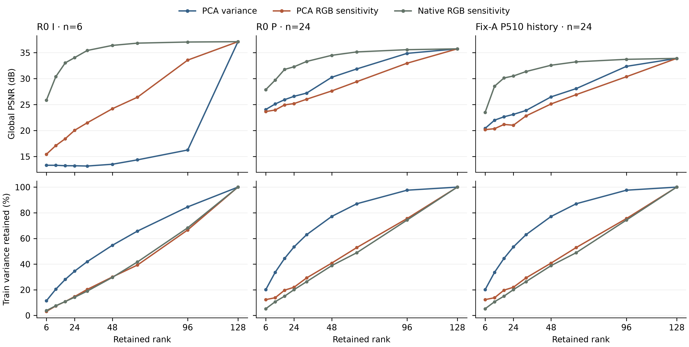
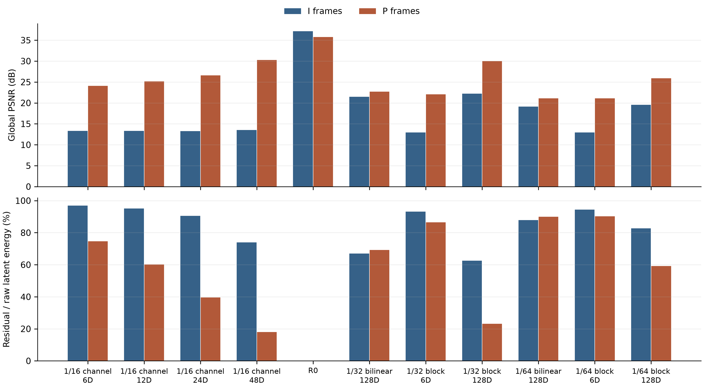
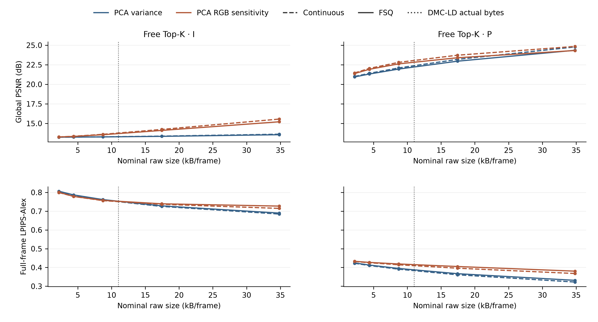
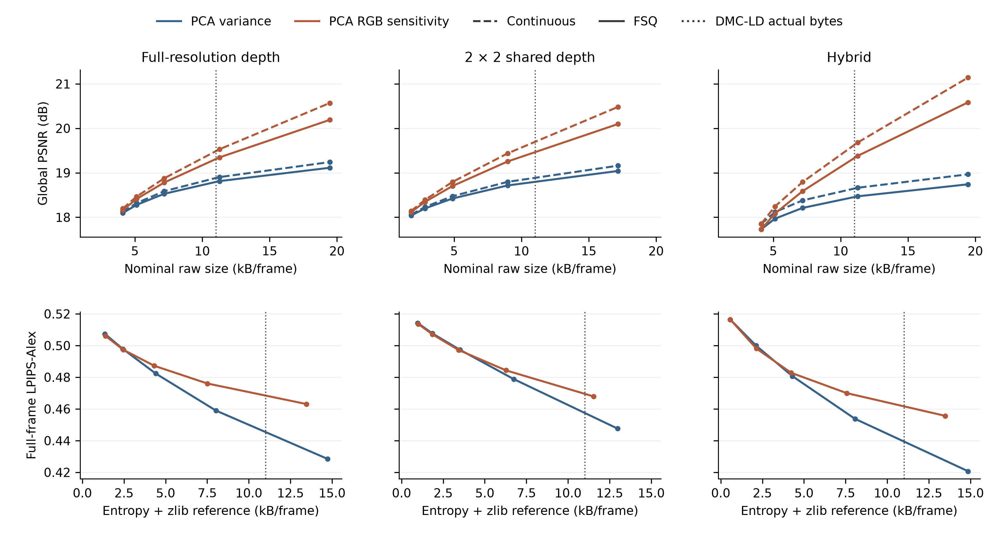
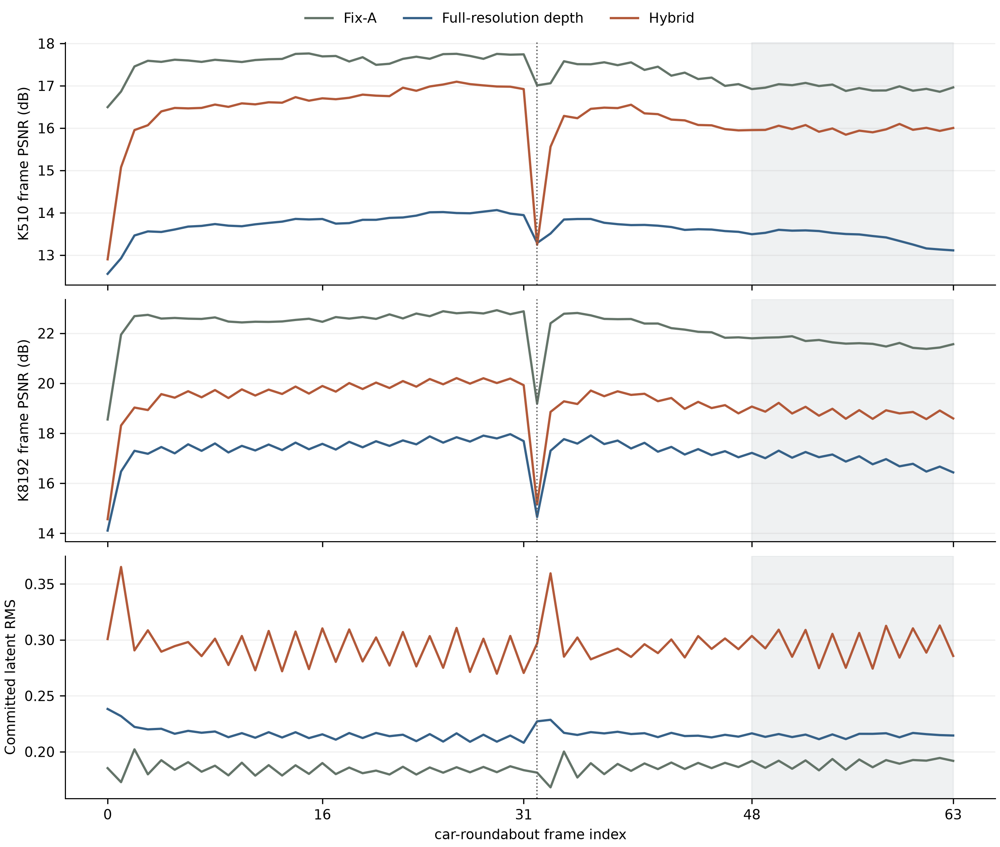
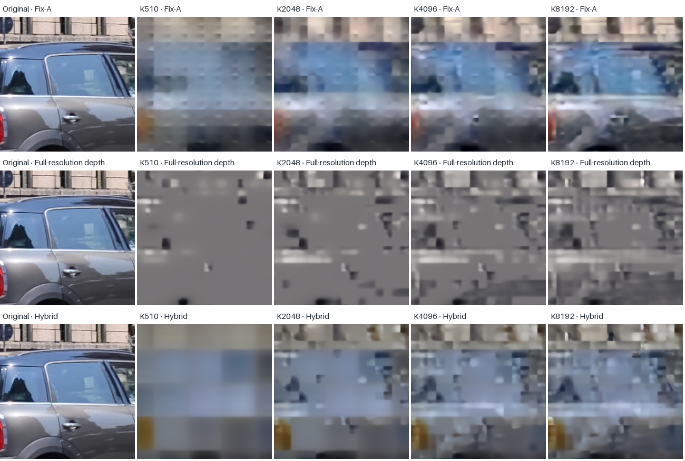

# AIP-VTok Diag-0 冻结潜在空间诊断

基线提交 `caae55ba0fec780c6f32bee6b9c4fa1ef5998421`。QP32、GOP32、原生 1920×1080，单卡 H100。本仓库的 I 帧为 DMCI，沿用 Gate 0 的 256→128 白化 PCA。P 帧使用 `video_model_ld.DMC` 的单参考低延迟路径，对原生 128 通道做可逆逐通道标准化。所有探针沿用冻结的 I/P Decoder 与对齐权重。RGB 潜在梯度只用于闭式通道排序。

训练统计来自 35 个训练视频的四帧窗口，共 140 帧。每种帧型取 12 帧计算 RGB MSE 输入梯度平方均值。I/P 通道 PCA 及块 PCA 分别用完整训练窗口的 FP64 流式协方差和精确特征分解。FSQ 尺度取训练绝对值第 99.5 百分位除以 1.5，以已解量化的锚点残差另行校准 Hybrid。训练更新与封存 Test 像素读取均为 0。

A–D 共用 30 帧 R0 对齐直通冻结历史及原 Fix-A 同历史 6 帧。A 另在这 30 帧对应的 Fix-A I2048/P510 冻结历史复测。下表每个视频的首两帧构成原六帧 I/P 诊断集。

| 验证视频 | 原生帧索引 |
| --- | --- |
| DAVIS2017:blackswan | 0, 1, 8, 16, 31, 32, 33, 40, 48, 49 |
| DAVIS2017:car-roundabout | 0, 1, 8, 16, 31, 32, 33, 40, 48, 63 |
| DAVIS2017:dog | 0, 1, 8, 16, 31, 32, 33, 40, 48, 59 |

官方 DMC-LD 原生实际码流为 **0.04253 bpp**，约 **88.2 kbit/帧**，64 帧全局 PSNR **30.239 dB**。来源为 Gate 0 在相同视频/GOP/QP 的封存 SPS/IP 字节测量。LPIPS-Alex 与 DISTS 按整幅原生 1080p 计算并逐帧平均。色度为 Gate 1-Fix 的 BT.709 Cb/Cr 方差保留率、MSE 和均值绝对偏差。全局 PSNR 由帧均 MSE 计算，帧均 PSNR 先对每帧换算再平均。

Gate 0 `projector_w128` 运行前后 SHA256 均为 `3b1bd715427bd177393e9552a99576e614ab7dd1ed307155129cf62896d5eb94`。[配置、检查点 SHA256、完整性与拟合样本](../results/aip_vtok/diag0/provenance.json)

## Q1 · 块容量、空间和 lift

同一 Fix-A 六帧上，冻结 lift 连续最小二乘保留 **97.30%** 原始能量，封存结果为 **97.30%**。训练最优的 1/64 块 6D 保留 **93.00%**，同口径少 **4.30 个百分点**。以训练块均值中心化后，该 6D 在六帧上仍剩 **90.94%**。训练 PCA 回收了部分冻结 lift 的损失，剩余误差仍主要来自低秩块表示容量。块 PCA 相对冻结 lift 的 RGB PSNR 变化为 **-0.252 dB**。闭式 PCA 优化的是潜在平方误差，此结果刻画训练最优基底迁移到六帧时的误差。

| 路径 | 残余/原始能量 % | 残余/训练中心化能量 % | 潜在 MSE | PSNR | 帧均 PSNR | LPIPS | DISTS |
| --- | --- | --- | --- | --- | --- | --- | --- |
| 1/16 通道 PCA 6D | 88.99 | — | 0.818 | 15.518 | 16.846 | 0.723 | 0.573 |
| 1/16 通道 PCA 12D | 78.41 | — | 0.721 | 15.716 | 17.499 | 0.661 | 0.522 |
| 1/16 通道 PCA 24D | 65.05 | — | 0.598 | 15.812 | 18.046 | 0.584 | 0.420 |
| 1/16 通道 PCA 48D | 43.72 | — | 0.402 | 16.627 | 20.102 | 0.506 | 0.291 |
| R0 直通 | 0.00 | — | 0.000 | 36.770 | 36.805 | 0.183 | 0.129 |
| 1/32 双线性 128C | 66.91 | — | 0.615 | 21.078 | 21.583 | 0.592 | 0.412 |
| 1/32 块 PCA 6D | 90.75 | 88.74 | 0.834 | 15.377 | 16.571 | 0.770 | 0.515 |
| 1/32 块 PCA 128D | 43.75 | 42.78 | 0.402 | 24.082 | 25.364 | 0.436 | 0.234 |
| 1/64 双线性 128C | 87.63 | — | 0.806 | 18.876 | 19.472 | 0.634 | 0.459 |
| 1/64 块 PCA 6D | 93.00 | 90.94 | 0.855 | 15.200 | 16.070 | 0.779 | 0.567 |
| 1/64 块 PCA 128D | 72.16 | 70.55 | 0.663 | 20.979 | 21.987 | 0.619 | 0.383 |
| Fix-A 冻结 lift 连续最小二乘 | 97.30 | — | 0.894 | 15.451 | 15.882 | 0.773 | 0.585 |
| Fix-A 实际 Pass 0 / K510 | 94.56 | — | 0.869 | 18.853 | 19.288 | 0.682 | 0.449 |
| Fix-A 实际三段 / K8192 | 85.55 | — | 0.786 | 21.980 | 22.615 | 0.581 | 0.308 |

同历史复测的完整缺口为 **14.790 dB**。下面沿同一序列逐项替换，损失列可加总到该缺口。第一个约束保持低分辨率网格并给每块 128 个系数，双线性 128C 与全分辨率通道截断的独立对照见上表。替换 lift 的差额包含仿射中心，实际 Pass 0 的差额包含编码器、FSQ 和 Fusion。后续阶段追回画质时，可使前一步损失占最终缺口的比例超过 100%。

| 依序替换的路径 | 全局 PSNR / dB | 本步损失 / dB | 占完整缺口 |
| --- | --- | --- | --- |
| R0 对齐直通 | 36.770 | — | — |
| 1/64 块空间约束与 128D 带宽 | 20.979 | +15.791 | +106.8% |
| 同网格 128D→6D | 15.200 | +5.779 | +39.1% |
| 替换为 Fix-A 冻结 lift 与其偏置 | 15.451 | -0.252 | -1.7% |
| 实际 Pass 0 编码、FSQ 与 Fusion | 18.853 | -3.401 | -23.0% |
| 追加 Pass 1/2 直至 K8192 | 21.980 | -3.127 | -21.1% |

### R0 冻结历史的 I 帧空间与通道对照

| 路径 | 残余/原始能量 % | 残余/训练中心化能量 % | 潜在 MSE | PSNR | 帧均 PSNR | LPIPS | DISTS |
| --- | --- | --- | --- | --- | --- | --- | --- |
| 1/16 通道 PCA 6D | 96.92 | — | 0.575 | 13.330 | 13.387 | 0.864 | 0.795 |
| 1/16 通道 PCA 12D | 95.08 | — | 0.564 | 13.324 | 13.381 | 0.863 | 0.775 |
| 1/16 通道 PCA 24D | 90.44 | — | 0.537 | 13.234 | 13.270 | 0.810 | 0.635 |
| 1/16 通道 PCA 48D | 73.93 | — | 0.439 | 13.525 | 13.609 | 0.768 | 0.444 |
| R0 直通 | 0.00 | — | 0.000 | 37.118 | 37.122 | 0.201 | 0.152 |
| 1/32 双线性 128C | 67.02 | — | 0.398 | 21.453 | 21.939 | 0.553 | 0.432 |
| 1/32 块 PCA 6D | 93.13 | 92.60 | 0.553 | 12.920 | 13.029 | 0.836 | 0.612 |
| 1/32 块 PCA 128D | 62.59 | 62.23 | 0.371 | 22.225 | 22.818 | 0.616 | 0.329 |
| 1/64 双线性 128C | 87.87 | — | 0.521 | 19.119 | 19.735 | 0.609 | 0.502 |
| 1/64 块 PCA 6D | 94.46 | 93.92 | 0.560 | 12.940 | 13.184 | 0.826 | 0.660 |
| 1/64 块 PCA 128D | 82.73 | 82.25 | 0.491 | 19.556 | 20.171 | 0.725 | 0.504 |

### R0 冻结历史的 P 帧空间与通道对照

| 路径 | 残余/原始能量 % | 残余/训练中心化能量 % | 潜在 MSE | PSNR | 帧均 PSNR | LPIPS | DISTS |
| --- | --- | --- | --- | --- | --- | --- | --- |
| 1/16 通道 PCA 6D | 74.70 | — | 0.420 | 24.069 | 25.094 | 0.373 | 0.182 |
| 1/16 通道 PCA 12D | 60.18 | — | 0.339 | 25.125 | 26.217 | 0.321 | 0.165 |
| 1/16 通道 PCA 24D | 39.61 | — | 0.223 | 26.600 | 27.647 | 0.270 | 0.147 |
| 1/16 通道 PCA 48D | 17.98 | — | 0.101 | 30.263 | 31.152 | 0.217 | 0.130 |
| R0 直通 | 0.00 | — | 0.000 | 35.741 | 35.947 | 0.189 | 0.129 |
| 1/32 双线性 128C | 69.23 | — | 0.390 | 22.682 | 23.793 | 0.392 | 0.202 |
| 1/32 块 PCA 6D | 86.53 | 89.97 | 0.487 | 22.045 | 23.107 | 0.441 | 0.214 |
| 1/32 块 PCA 128D | 23.17 | 24.09 | 0.130 | 29.991 | 30.855 | 0.228 | 0.132 |
| 1/64 双线性 128C | 89.97 | — | 0.506 | 21.105 | 22.432 | 0.403 | 0.201 |
| 1/64 块 PCA 6D | 90.25 | 93.84 | 0.508 | 21.081 | 22.337 | 0.443 | 0.231 |
| 1/64 块 PCA 128D | 59.13 | 61.49 | 0.333 | 25.903 | 26.831 | 0.350 | 0.174 |

## Q2 · I/P 有效通道与历史偏移

FP32 128D 往返覆盖 180 个帧与排序组合，最大潜在绝对误差 **3.815e-06**，与 R0 的最大单帧 PSNR 差 **1.001e-06 dB**。RGB 敏感度来自训练 RGB MSE 在 PCA 或原生坐标的梯度平方均值。下面各数值按方差 PCA / RGB 敏感度 PCA / 原生 RGB 敏感度列出。

保留 24 个方向时，PCA 内改用 RGB 敏感排序对全局 PSNR 的影响如下。R0 I 为 +6.830 dB（原生敏感坐标 34.052 dB），R0 P 为 -1.395 dB（原生敏感坐标 32.286 dB），Fix-A P 为 -2.083 dB（原生敏感坐标 30.512 dB）。

### R0 I（6 帧）

| 秩 | 训练解释方差 % | PSNR / dB | 帧均 PSNR / dB | 潜在 MSE | LPIPS | DISTS |
| --- | --- | --- | --- | --- | --- | --- |
| 6 | 11.4 / 3.1 / 3.7 | 13.330 / 15.449 / 25.852 | 13.387 / 15.747 / 26.026 | 0.575 / 0.562 / 0.555 | 0.864 / 0.749 / 0.513 | 0.795 / 0.419 / 0.246 |
| 12 | 20.5 / 7.4 / 7.6 | 13.324 / 17.124 / 30.392 | 13.381 / 17.475 / 30.934 | 0.564 / 0.527 / 0.509 | 0.863 / 0.714 / 0.324 | 0.775 / 0.376 / 0.180 |
| 18 | 28.1 / 10.8 / 10.8 | 13.240 / 18.439 / 33.043 | 13.279 / 18.776 / 33.364 | 0.550 / 0.499 / 0.470 | 0.813 / 0.673 / 0.262 | 0.651 / 0.350 / 0.163 |
| 24 | 34.5 / 14.7 / 14.2 | 13.234 / 20.064 / 34.052 | 13.270 / 20.468 / 34.344 | 0.537 / 0.463 / 0.449 | 0.810 / 0.614 / 0.243 | 0.635 / 0.308 / 0.159 |
| 32 | 41.9 / 20.3 / 18.9 | 13.180 / 21.505 / 35.423 | 13.199 / 21.846 / 35.536 | 0.512 / 0.422 / 0.416 | 0.800 / 0.565 / 0.227 | 0.587 / 0.273 / 0.155 |
| 48 | 54.7 / 30.0 / 29.6 | 13.525 / 24.211 / 36.402 | 13.609 / 24.533 / 36.415 | 0.439 / 0.334 / 0.360 | 0.768 / 0.459 / 0.214 | 0.444 / 0.207 / 0.156 |
| 64 | 65.7 / 39.3 / 41.7 | 14.370 / 26.429 / 36.840 | 14.542 / 26.656 / 36.844 | 0.343 / 0.241 / 0.281 | 0.697 / 0.355 / 0.207 | 0.365 / 0.162 / 0.154 |
| 96 | 84.6 / 66.6 / 68.3 | 16.269 / 33.573 / 37.052 | 16.580 / 33.723 / 37.056 | 0.155 / 0.092 / 0.152 | 0.511 / 0.217 / 0.202 | 0.248 / 0.143 / 0.153 |
| 128 | 100.0 / 100.0 / 100.0 | 37.118 / 37.118 / 37.118 | 37.122 / 37.122 / 37.122 | 0.000 / 0.000 / 0.000 | 0.201 / 0.201 / 0.201 | 0.152 / 0.152 / 0.152 |

以该组方差 PCA 的实测 24D 为参照，同时达到其 PSNR、LPIPS 和 DISTS 的最小已测秩为 方差 24、RGB 敏感度 6、原生敏感度 6。

### R0 P（24 帧）

| 秩 | 训练解释方差 % | PSNR / dB | 帧均 PSNR / dB | 潜在 MSE | LPIPS | DISTS |
| --- | --- | --- | --- | --- | --- | --- |
| 6 | 20.1 / 12.3 / 5.2 | 24.069 / 23.668 / 27.888 | 25.094 / 24.642 / 28.796 | 0.420 / 0.463 / 0.509 | 0.373 / 0.391 / 0.325 | 0.182 / 0.190 / 0.177 |
| 12 | 33.6 / 13.8 / 10.7 | 25.125 / 23.966 / 29.725 | 26.217 / 24.917 / 30.399 | 0.339 / 0.456 / 0.481 | 0.321 / 0.385 / 0.288 | 0.165 / 0.188 / 0.162 |
| 18 | 44.4 / 19.7 / 15.0 | 25.957 / 24.951 / 31.780 | 27.032 / 25.911 / 32.286 | 0.273 / 0.422 / 0.451 | 0.288 / 0.360 / 0.250 | 0.153 / 0.177 / 0.152 |
| 24 | 53.4 / 22.0 / 20.1 | 26.600 / 25.204 / 32.286 | 27.647 / 26.147 / 32.805 | 0.223 / 0.412 / 0.429 | 0.270 / 0.353 / 0.234 | 0.147 / 0.175 / 0.143 |
| 32 | 62.9 / 29.2 / 26.3 | 27.219 / 26.040 / 33.311 | 28.236 / 26.992 / 33.708 | 0.174 / 0.371 / 0.390 | 0.255 / 0.331 / 0.217 | 0.142 / 0.168 / 0.138 |
| 48 | 77.1 / 40.8 / 38.8 | 30.263 / 27.636 / 34.492 | 31.152 / 28.596 / 34.748 | 0.101 / 0.307 / 0.328 | 0.217 / 0.291 / 0.204 | 0.130 / 0.155 / 0.134 |
| 64 | 87.0 / 52.9 / 48.9 | 31.876 / 29.425 / 35.149 | 32.454 / 30.183 / 35.361 | 0.055 / 0.238 / 0.273 | 0.201 / 0.259 / 0.196 | 0.125 / 0.143 / 0.132 |
| 96 | 97.6 / 75.5 / 74.3 | 34.870 / 32.974 / 35.578 | 35.149 / 33.383 / 35.785 | 0.009 / 0.116 / 0.136 | 0.187 / 0.209 / 0.191 | 0.125 / 0.130 / 0.130 |
| 128 | 100.0 / 100.0 / 100.0 | 35.741 / 35.741 / 35.741 | 35.947 / 35.947 / 35.947 | 0.000 / 0.000 / 0.000 | 0.189 / 0.189 / 0.189 | 0.129 / 0.129 / 0.129 |

以该组方差 PCA 的实测 24D 为参照，同时达到其 PSNR、LPIPS 和 DISTS 的最小已测秩为 方差 24、RGB 敏感度 64、原生敏感度 24。

### Fix-A P510 历史 P（24 帧）

| 秩 | 训练解释方差 % | PSNR / dB | 帧均 PSNR / dB | 潜在 MSE | LPIPS | DISTS |
| --- | --- | --- | --- | --- | --- | --- |
| 6 | 20.1 / 12.3 / 5.2 | 20.433 / 20.187 / 23.521 | 20.716 / 20.473 / 23.765 | 0.699 / 0.763 / 0.870 | 0.564 / 0.609 / 0.498 | 0.317 / 0.348 / 0.273 |
| 12 | 33.6 / 13.8 / 10.7 | 22.009 / 20.371 / 28.543 | 22.423 / 20.662 / 29.005 | 0.528 / 0.752 / 0.741 | 0.452 / 0.603 / 0.375 | 0.257 / 0.339 / 0.205 |
| 18 | 44.4 / 19.7 / 15.0 | 22.658 / 21.185 / 30.135 | 23.062 / 21.448 / 30.457 | 0.443 / 0.703 / 0.705 | 0.407 / 0.552 / 0.326 | 0.235 / 0.305 / 0.187 |
| 24 | 53.4 / 22.0 / 20.1 | 23.122 / 21.039 / 30.512 | 23.482 / 21.329 / 30.850 | 0.377 / 0.684 / 0.689 | 0.384 / 0.540 / 0.310 | 0.225 / 0.301 / 0.179 |
| 32 | 62.9 / 29.2 / 26.3 | 23.873 / 22.824 / 31.368 | 24.266 / 23.159 / 31.667 | 0.305 / 0.586 / 0.623 | 0.357 / 0.470 / 0.279 | 0.211 / 0.258 / 0.167 |
| 48 | 77.1 / 40.8 / 38.8 | 26.496 / 25.131 / 32.584 | 26.892 / 25.524 / 32.817 | 0.196 / 0.474 / 0.537 | 0.304 / 0.403 / 0.257 | 0.184 / 0.225 / 0.163 |
| 64 | 87.0 / 52.9 / 48.9 | 28.088 / 26.925 / 33.240 | 28.422 / 27.198 / 33.492 | 0.102 / 0.372 / 0.461 | 0.253 / 0.352 / 0.245 | 0.158 / 0.197 / 0.159 |
| 96 | 97.6 / 75.5 / 74.3 | 32.370 / 30.376 / 33.722 | 32.569 / 30.541 / 34.012 | 0.016 / 0.192 / 0.227 | 0.227 / 0.272 / 0.235 | 0.148 / 0.162 / 0.155 |
| 128 | 100.0 / 100.0 / 100.0 | 33.901 / 33.901 / 33.901 | 34.209 / 34.209 / 34.209 | 0.000 / 0.000 / 0.000 | 0.231 / 0.231 / 0.231 | 0.153 / 0.153 / 0.153 |

以该组方差 PCA 的实测 24D 为参照，同时达到其 PSNR、LPIPS 和 DISTS 的最小已测秩为 方差 24、RGB 敏感度 64、原生敏感度 12。

方差在相同 P 帧的低预算历史下，6D 的全局 PSNR 变化为 -3.636 dB、24D 的全局 PSNR 变化为 -3.477 dB、128D 的全局 PSNR 变化为 -1.840 dB。

RGB 敏感度在相同 P 帧的低预算历史下，6D 的全局 PSNR 变化为 -3.481 dB、24D 的全局 PSNR 变化为 -4.165 dB、128D 的全局 PSNR 变化为 -1.840 dB。

原生敏感度在相同 P 帧的低预算历史下，6D 的全局 PSNR 变化为 -4.367 dB、24D 的全局 PSNR 变化为 -1.774 dB、128D 的全局 PSNR 变化为 -1.840 dB。

## Q3 · 自由槽位、连续组前缀与真实 FSQ

每个 I/P 独立 PCA 基底使用前 126 个有序坐标，分成 21 组，每帧共 171,360 个槽位。方差序用槽位平方能量，敏感度序用训练梯度方差加权能量。前缀布局按单位 Token 的边际收益逐步升级，固定预算里程碑保留较低预算的全部槽位和 ID。Hybrid 在 1/64 上先付 510 个锚点，再为同一锚点的残差分配全分辨率深度。真实 FSQ 使用 `[8,8,8,5,5,5]` 和离散 `codes → ids → codes`，反量化使用固定 tanh 分箱中心的逆变换。逐组 tanh 饱和率和从计数池化的六维熵见 D0-C/D0-D JSON。

质量列为连续 / FSQ，Δ 为 FSQ 全局 PSNR 减去连续值。所有值使用 R0 同上下文的 30 帧。

- 自由 Top-K（RGB 敏感度序）FSQ 在 K510、K8192 分别达到 18.164、20.462 dB，K8192 连续值为 20.866 dB。自由槽位的位置按原始坐标开销计费。
- 全分辨率前缀（RGB 敏感度序）FSQ 在 K510、K8192 分别达到 18.164、20.190 dB，K8192 连续值为 20.569 dB。两档原始侧信息分别为 75.1% 和 15.8%，熵参考侧信息分别为 42.8% 和 11.8%。
- 2×2 共享深度（RGB 敏感度序）FSQ 在 K510、K8192 分别达到 18.115、20.097 dB，K8192 连续值为 20.482 dB。两档原始侧信息分别为 43.6% 和 4.6%，熵参考侧信息分别为 19.9% 和 2.7%。
- Hybrid（RGB 敏感度序）FSQ 在 K510、K8192 分别达到 17.730、20.585 dB，K8192 连续值为 21.143 dB。两档原始侧信息分别为 75.1% 和 15.8%，熵参考侧信息分别为 8.8% 和 11.9%。

| 布局 | 排序 | K | PSNR / dB | LPIPS | DISTS | 潜在 MSE | Δ / dB | FSQ 饱和 % |
| --- | --- | --- | --- | --- | --- | --- | --- | --- |
| 自由 Top-K | 方差 | 510 | 17.999 / 17.980 | 0.499 / 0.501 | 0.304 / 0.306 | 0.514 / 0.518 | -0.019 | 4.95 |
| 自由 Top-K | 方差 | 1024 | 18.162 / 18.130 | 0.485 / 0.488 | 0.288 / 0.289 | 0.489 / 0.495 | -0.033 | 3.41 |
| 自由 Top-K | 方差 | 2048 | 18.432 / 18.378 | 0.465 / 0.468 | 0.268 / 0.269 | 0.452 / 0.460 | -0.053 | 2.20 |
| 自由 Top-K | 方差 | 4096 | 18.844 / 18.756 | 0.434 / 0.439 | 0.245 / 0.246 | 0.396 / 0.408 | -0.088 | 1.36 |
| 自由 Top-K | 方差 | 8192 | 19.445 / 19.295 | 0.395 / 0.403 | 0.218 / 0.220 | 0.319 / 0.337 | -0.151 | 0.80 |
| 自由 Top-K | RGB 敏感度 | 510 | 18.195 / 18.164 | 0.505 / 0.506 | 0.298 / 0.299 | 0.533 / 0.535 | -0.031 | 1.03 |
| 自由 Top-K | RGB 敏感度 | 1024 | 18.463 / 18.407 | 0.496 / 0.497 | 0.281 / 0.283 | 0.521 / 0.524 | -0.056 | 0.71 |
| 自由 Top-K | RGB 敏感度 | 2048 | 18.889 / 18.791 | 0.483 / 0.486 | 0.261 / 0.263 | 0.503 / 0.507 | -0.098 | 0.58 |
| 自由 Top-K | RGB 敏感度 | 4096 | 19.606 / 19.414 | 0.464 / 0.472 | 0.242 / 0.245 | 0.472 / 0.480 | -0.191 | 0.55 |
| 自由 Top-K | RGB 敏感度 | 8192 | 20.866 / 20.462 | 0.437 / 0.450 | 0.223 / 0.228 | 0.419 / 0.432 | -0.404 | 0.52 |
| 全分辨率前缀 | 方差 | 510 | 18.123 / 18.095 | 0.506 / 0.507 | 0.331 / 0.330 | 0.525 / 0.527 | -0.027 | 1.25 |
| 全分辨率前缀 | 方差 | 1024 | 18.319 / 18.279 | 0.496 / 0.498 | 0.321 / 0.321 | 0.507 / 0.510 | -0.040 | 0.92 |
| 全分辨率前缀 | 方差 | 2048 | 18.586 / 18.527 | 0.479 / 0.482 | 0.305 / 0.305 | 0.478 / 0.484 | -0.059 | 0.74 |
| 全分辨率前缀 | 方差 | 4096 | 18.903 / 18.813 | 0.453 / 0.459 | 0.283 / 0.284 | 0.433 / 0.444 | -0.090 | 0.60 |
| 全分辨率前缀 | 方差 | 8192 | 19.240 / 19.113 | 0.420 / 0.429 | 0.255 / 0.257 | 0.370 / 0.387 | -0.127 | 0.45 |
| 全分辨率前缀 | RGB 敏感度 | 510 | 18.195 / 18.164 | 0.505 / 0.506 | 0.298 / 0.299 | 0.534 / 0.535 | -0.031 | 0.86 |
| 全分辨率前缀 | RGB 敏感度 | 1024 | 18.466 / 18.412 | 0.496 / 0.497 | 0.281 / 0.283 | 0.523 / 0.525 | -0.054 | 0.50 |
| 全分辨率前缀 | RGB 敏感度 | 2048 | 18.876 / 18.781 | 0.484 / 0.487 | 0.261 / 0.264 | 0.508 / 0.511 | -0.095 | 0.30 |
| 全分辨率前缀 | RGB 敏感度 | 4096 | 19.528 / 19.345 | 0.469 / 0.476 | 0.244 / 0.247 | 0.488 / 0.494 | -0.183 | 0.22 |
| 全分辨率前缀 | RGB 敏感度 | 8192 | 20.569 / 20.190 | 0.453 / 0.463 | 0.229 / 0.233 | 0.456 / 0.466 | -0.379 | 0.24 |
| 2×2 共享深度 | 方差 | 510 | 18.058 / 18.038 | 0.514 / 0.514 | 0.335 / 0.334 | 0.532 / 0.534 | -0.020 | 0.95 |
| 2×2 共享深度 | 方差 | 1024 | 18.231 / 18.198 | 0.507 / 0.508 | 0.326 / 0.325 | 0.517 / 0.520 | -0.033 | 0.72 |
| 2×2 共享深度 | 方差 | 2048 | 18.474 / 18.422 | 0.496 / 0.497 | 0.312 / 0.311 | 0.491 / 0.497 | -0.052 | 0.56 |
| 2×2 共享深度 | 方差 | 4096 | 18.796 / 18.715 | 0.475 / 0.479 | 0.292 / 0.291 | 0.450 / 0.460 | -0.081 | 0.45 |
| 2×2 共享深度 | 方差 | 8192 | 19.159 / 19.041 | 0.441 / 0.448 | 0.262 / 0.263 | 0.387 / 0.403 | -0.118 | 0.37 |
| 2×2 共享深度 | RGB 敏感度 | 510 | 18.140 / 18.115 | 0.513 / 0.514 | 0.304 / 0.305 | 0.539 / 0.540 | -0.024 | 0.62 |
| 2×2 共享深度 | RGB 敏感度 | 1024 | 18.390 / 18.344 | 0.506 / 0.507 | 0.287 / 0.288 | 0.530 / 0.532 | -0.045 | 0.39 |
| 2×2 共享深度 | RGB 敏感度 | 2048 | 18.795 / 18.703 | 0.495 / 0.497 | 0.268 / 0.269 | 0.516 / 0.519 | -0.092 | 0.24 |
| 2×2 共享深度 | RGB 敏感度 | 4096 | 19.437 / 19.255 | 0.479 / 0.484 | 0.249 / 0.251 | 0.496 / 0.502 | -0.182 | 0.15 |
| 2×2 共享深度 | RGB 敏感度 | 8192 | 20.482 / 20.097 | 0.457 / 0.468 | 0.230 / 0.234 | 0.467 / 0.477 | -0.385 | 0.17 |
| Hybrid | 方差 | 510 | 17.851 / 17.730 | 0.520 / 0.516 | 0.317 / 0.311 | 0.518 / 0.523 | -0.121 | 0.02 |
| Hybrid | 方差 | 1024 | 18.117 / 17.968 | 0.501 / 0.500 | 0.302 / 0.297 | 0.493 / 0.499 | -0.149 | 0.67 |
| Hybrid | 方差 | 2048 | 18.379 / 18.209 | 0.480 / 0.481 | 0.286 / 0.283 | 0.461 / 0.470 | -0.170 | 0.64 |
| Hybrid | 方差 | 4096 | 18.663 / 18.471 | 0.451 / 0.454 | 0.265 / 0.264 | 0.417 / 0.429 | -0.192 | 0.59 |
| Hybrid | 方差 | 8192 | 18.966 / 18.741 | 0.415 / 0.421 | 0.241 / 0.241 | 0.354 / 0.373 | -0.225 | 0.46 |
| Hybrid | RGB 敏感度 | 510 | 17.851 / 17.730 | 0.520 / 0.516 | 0.317 / 0.311 | 0.518 / 0.523 | -0.121 | 0.02 |
| Hybrid | RGB 敏感度 | 1024 | 18.244 / 18.084 | 0.497 / 0.498 | 0.281 / 0.280 | 0.501 / 0.506 | -0.159 | 0.46 |
| Hybrid | RGB 敏感度 | 2048 | 18.792 / 18.587 | 0.478 / 0.483 | 0.259 / 0.261 | 0.483 / 0.489 | -0.205 | 0.29 |
| Hybrid | RGB 敏感度 | 4096 | 19.682 / 19.381 | 0.461 / 0.470 | 0.240 / 0.243 | 0.462 / 0.471 | -0.301 | 0.21 |
| Hybrid | RGB 敏感度 | 8192 | 21.143 / 20.585 | 0.444 / 0.456 | 0.226 / 0.229 | 0.430 / 0.444 | -0.558 | 0.23 |

### D0-D 逐项字节账本

原始 token 按 **2K B** 计费。共享深度每次消耗 4 个 Token，上限可能留空。经验六维零阶边际熵是假设已知每帧概率表的理论熵下界，未计概率表字节。深度图对 `{0,1,2,4,8,12}` 编号做固定 3-bit 打包后，用 zlib level 9 计无损参考长度。Hybrid 在 K510 同样计入全零深度图。帧头为固定估算。自由 Top-K 的坐标另按每槽 18 bit 估算。连续路径的原始字节是与对应 FSQ 共享的槽位记账口径，连续系数本身未编码。两种估算 bpp 均为实验账本，官方 DMC-LD 一行使用实际码流。比例是逐帧侧信息分数的平均。

| 布局 | 排序 | K | 已用 | Token 原始 B | Token 熵 B | 深度原始 B | 深度 zlib B | 深度熵 B | 帧头 B | 总原始 B | 总参考 B | bpp 原始 | bpp 熵参考 | 侧信息原始 % | 侧信息熵参考 % |
| --- | --- | --- | --- | --- | --- | --- | --- | --- | --- | --- | --- | --- | --- | --- | --- |
| 全分辨率前缀 | 方差 | 510 | 510 | 1020.0 | 834.4 | 3060.0 | 492.1 | 321.0 | 24.0 | 4104.0 | 1350.5 | 0.01583 | 0.00521 | 75.1 | 39.1 |
| 全分辨率前缀 | 方差 | 1024 | 1024 | 2048.0 | 1664.4 | 3060.0 | 745.6 | 520.7 | 24.0 | 5132.0 | 2434.0 | 0.01980 | 0.00939 | 60.1 | 32.7 |
| 全分辨率前缀 | 方差 | 2048 | 2048 | 4096.0 | 3296.4 | 3060.0 | 1082.1 | 807.7 | 24.0 | 7180.0 | 4402.5 | 0.02770 | 0.01698 | 43.0 | 26.3 |
| 全分辨率前缀 | 方差 | 4096 | 4096 | 8192.0 | 6508.2 | 3060.0 | 1488.7 | 1186.0 | 24.0 | 11276.0 | 8020.9 | 0.04350 | 0.03094 | 27.4 | 19.9 |
| 全分辨率前缀 | 方差 | 8192 | 8192 | 16384.0 | 12780.7 | 3060.0 | 1917.7 | 1622.6 | 24.0 | 19468.0 | 14722.5 | 0.07511 | 0.05680 | 15.8 | 14.0 |
| 全分辨率前缀 | RGB 敏感度 | 510 | 510 | 1020.0 | 798.5 | 3060.0 | 565.2 | 344.6 | 24.0 | 4104.0 | 1387.7 | 0.01583 | 0.00535 | 75.1 | 42.8 |
| 全分辨率前缀 | RGB 敏感度 | 1024 | 1024 | 2048.0 | 1576.0 | 3060.0 | 857.3 | 559.7 | 24.0 | 5132.0 | 2457.3 | 0.01980 | 0.00948 | 60.1 | 36.3 |
| 全分辨率前缀 | RGB 敏感度 | 2048 | 2048 | 4096.0 | 3073.9 | 3060.0 | 1224.4 | 846.9 | 24.0 | 7180.0 | 4322.3 | 0.02770 | 0.01668 | 43.0 | 29.3 |
| 全分辨率前缀 | RGB 敏感度 | 4096 | 4096 | 8192.0 | 5954.3 | 3060.0 | 1531.2 | 1116.9 | 24.0 | 11276.0 | 7509.6 | 0.04350 | 0.02897 | 27.4 | 21.1 |
| 全分辨率前缀 | RGB 敏感度 | 8192 | 8192 | 16384.0 | 11869.4 | 3060.0 | 1556.8 | 1144.1 | 24.0 | 19468.0 | 13450.2 | 0.07511 | 0.05189 | 15.8 | 11.8 |
| 2×2 共享深度 | 方差 | 510 | 508 | 1020.0 | 803.1 | 765.0 | 148.7 | 77.9 | 24.0 | 1809.0 | 975.8 | 0.00698 | 0.00376 | 43.6 | 19.3 |
| 2×2 共享深度 | 方差 | 1024 | 1024 | 2048.0 | 1609.2 | 765.0 | 211.6 | 126.6 | 24.0 | 2837.0 | 1844.8 | 0.01095 | 0.00712 | 27.8 | 14.3 |
| 2×2 共享深度 | 方差 | 2048 | 2048 | 4096.0 | 3192.6 | 765.0 | 294.8 | 197.0 | 24.0 | 4885.0 | 3511.5 | 0.01885 | 0.01355 | 16.2 | 10.4 |
| 2×2 共享深度 | 方差 | 4096 | 4096 | 8192.0 | 6318.5 | 765.0 | 400.4 | 290.6 | 24.0 | 8981.0 | 6742.9 | 0.03465 | 0.02601 | 8.8 | 7.1 |
| 2×2 共享深度 | 方差 | 8192 | 8192 | 16384.0 | 12437.0 | 765.0 | 513.7 | 394.4 | 24.0 | 17173.0 | 12974.7 | 0.06625 | 0.05006 | 4.6 | 4.5 |
| 2×2 共享深度 | RGB 敏感度 | 510 | 508 | 1020.0 | 805.0 | 765.0 | 172.4 | 85.9 | 24.0 | 1809.0 | 1001.3 | 0.00698 | 0.00386 | 43.6 | 19.9 |
| 2×2 共享深度 | RGB 敏感度 | 1024 | 1024 | 2048.0 | 1587.1 | 765.0 | 245.3 | 139.8 | 24.0 | 2837.0 | 1856.4 | 0.01095 | 0.00716 | 27.8 | 14.8 |
| 2×2 共享深度 | RGB 敏感度 | 2048 | 2048 | 4096.0 | 3075.4 | 765.0 | 327.6 | 210.6 | 24.0 | 4885.0 | 3427.0 | 0.01885 | 0.01322 | 16.2 | 10.5 |
| 2×2 共享深度 | RGB 敏感度 | 4096 | 4096 | 8192.0 | 5860.7 | 765.0 | 388.1 | 270.2 | 24.0 | 8981.0 | 6272.8 | 0.03465 | 0.02420 | 8.8 | 6.7 |
| 2×2 共享深度 | RGB 敏感度 | 8192 | 8192 | 16384.0 | 11225.2 | 765.0 | 295.4 | 194.0 | 24.0 | 17173.0 | 11544.6 | 0.06625 | 0.04454 | 4.6 | 2.7 |
| Hybrid | 方差 | 510 | 510 | 1020.0 | 524.3 | 3060.0 | 25.0 | 0.0 | 24.0 | 4104.0 | 573.3 | 0.01583 | 0.00221 | 75.1 | 8.8 |
| Hybrid | 方差 | 1024 | 1024 | 2048.0 | 1614.8 | 3060.0 | 489.1 | 313.2 | 24.0 | 5132.0 | 2127.9 | 0.01980 | 0.00821 | 60.1 | 24.4 |
| Hybrid | 方差 | 2048 | 2048 | 4096.0 | 3366.1 | 3060.0 | 917.1 | 655.4 | 24.0 | 7180.0 | 4307.2 | 0.02770 | 0.01662 | 43.0 | 22.3 |
| Hybrid | 方差 | 4096 | 4096 | 8192.0 | 6667.5 | 3060.0 | 1372.7 | 1069.7 | 24.0 | 11276.0 | 8064.2 | 0.04350 | 0.03111 | 27.4 | 17.9 |
| Hybrid | 方差 | 8192 | 8192 | 16384.0 | 13002.3 | 3060.0 | 1833.3 | 1538.9 | 24.0 | 19468.0 | 14859.6 | 0.07511 | 0.05733 | 15.8 | 13.2 |
| Hybrid | RGB 敏感度 | 510 | 510 | 1020.0 | 524.3 | 3060.0 | 25.0 | 0.0 | 24.0 | 4104.0 | 573.3 | 0.01583 | 0.00221 | 75.1 | 8.8 |
| Hybrid | RGB 敏感度 | 1024 | 1024 | 2048.0 | 1549.3 | 3060.0 | 568.9 | 346.7 | 24.0 | 5132.0 | 2142.2 | 0.01980 | 0.00826 | 60.1 | 27.9 |
| Hybrid | RGB 敏感度 | 2048 | 2048 | 4096.0 | 3142.1 | 3060.0 | 1065.9 | 722.1 | 24.0 | 7180.0 | 4232.0 | 0.02770 | 0.01633 | 43.0 | 26.1 |
| Hybrid | RGB 敏感度 | 4096 | 4096 | 8192.0 | 6057.0 | 3060.0 | 1484.5 | 1081.2 | 24.0 | 11276.0 | 7565.6 | 0.04350 | 0.02919 | 27.4 | 20.3 |
| Hybrid | RGB 敏感度 | 8192 | 8192 | 16384.0 | 11886.8 | 3060.0 | 1571.9 | 1159.8 | 24.0 | 19468.0 | 13482.7 | 0.07511 | 0.05202 | 15.8 | 11.9 |

## Q4 · car-roundabout 64 帧自回归参考

闭环候选为 全分辨率前缀（RGB 敏感度序）、Hybrid（RGB 敏感度序） 与封存 Fix-A。两类新方案各自在 D0-D 内按 I/P、五个 K、PSNR、LPIPS、DISTS 与潜在 MSE 的平均名次选出。每个候选单独推进 GOP32。两个接收闭环分别显示到 K2048 与 K8192 并提交 I2048/P510，逐帧对比潜在、投影特征和时序记忆，所有张量逐位相等。I 帧在低显示档仍接收 I2048 用于提交。

Fix-A K8192 复跑与封存逐帧记录的最大差为 RGB MSE `0.000e+00`、参考 RMS `0.000e+00`、原生潜在 RMS `0.000e+00`。

纯前缀 P510 平均显式覆盖 **6.25%** 的潜在位置。晚期帧均 PSNR 为 **13.419 dB**，较自身早期变化 **-0.231 dB**，帧 31/63 的参考 RMS 为 **0.208/0.215**。其全程 P 参考 RMS 在 **0.208–0.232** 之间，闭环主要问题表现为持续低画质。Hybrid 晚期为 **15.973 dB**，Fix-A 同档为 **16.952 dB**。Hybrid 显示扩展到 K4096/K8192 后，全局 PSNR 相对 K510 的增量分别为 **+2.137、+2.919 dB**，沿用相同 P510 提交。

| 布局 | 显示 K | 全局 PSNR | 帧均 PSNR | LPIPS | DISTS | CbCr 方差保留 % | CbCr MSE | CbCr 均值偏差 | 48–63 帧均 PSNR | RMS 帧 31 | RMS 帧 63 |
| --- | --- | --- | --- | --- | --- | --- | --- | --- | --- | --- | --- |
| Fix-A | 510 | 17.344 | 17.357 | 0.627 | 0.476 | 43.7 | 0.000513 | 0.004364 | 16.952 | 0.184 | 0.192 |
| Fix-A | 1024 | 18.283 | 18.300 | 0.609 | 0.410 | 51.1 | 0.000431 | 0.003598 | 17.839 | 0.184 | 0.192 |
| Fix-A | 2048 | 19.622 | 19.642 | 0.572 | 0.367 | 59.9 | 0.000347 | 0.002763 | 19.214 | 0.184 | 0.192 |
| Fix-A | 4096 | 20.548 | 20.581 | 0.536 | 0.315 | 63.4 | 0.000319 | 0.002951 | 20.079 | 0.184 | 0.192 |
| Fix-A | 8192 | 22.116 | 22.194 | 0.461 | 0.256 | 70.1 | 0.000296 | 0.003765 | 21.626 | 0.184 | 0.192 |
| 全分辨率前缀 | 510 | 13.633 | 13.642 | 0.734 | 0.578 | 0.9 | 0.001059 | 0.003949 | 13.419 | 0.208 | 0.215 |
| 全分辨率前缀 | 1024 | 14.001 | 14.014 | 0.705 | 0.518 | 1.2 | 0.001047 | 0.003943 | 13.781 | 0.208 | 0.215 |
| 全分辨率前缀 | 2048 | 14.765 | 14.788 | 0.675 | 0.450 | 1.6 | 0.001029 | 0.003933 | 14.541 | 0.208 | 0.215 |
| 全分辨率前缀 | 4096 | 15.894 | 15.934 | 0.653 | 0.390 | 2.3 | 0.001010 | 0.003936 | 15.677 | 0.208 | 0.215 |
| 全分辨率前缀 | 8192 | 17.192 | 17.245 | 0.597 | 0.347 | 3.5 | 0.000973 | 0.003800 | 16.917 | 0.208 | 0.215 |
| Hybrid | 510 | 16.196 | 16.264 | 0.814 | 0.547 | 35.3 | 0.000597 | 0.003704 | 15.973 | 0.270 | 0.286 |
| Hybrid | 1024 | 16.675 | 16.770 | 0.736 | 0.435 | 35.5 | 0.000593 | 0.003651 | 16.431 | 0.270 | 0.286 |
| Hybrid | 2048 | 17.374 | 17.502 | 0.684 | 0.375 | 36.1 | 0.000584 | 0.003568 | 17.127 | 0.270 | 0.286 |
| Hybrid | 4096 | 18.332 | 18.488 | 0.637 | 0.336 | 37.4 | 0.000568 | 0.003468 | 18.101 | 0.270 | 0.286 |
| Hybrid | 8192 | 19.115 | 19.243 | 0.590 | 0.312 | 40.1 | 0.000520 | 0.003424 | 18.836 | 0.270 | 0.286 |

### P510 参考与晚期变化

| 布局 | P 实用参考 Token | P 位置覆盖 % | P 全局 PSNR | P LPIPS | P DISTS | P 参考潜在 MSE | RMS/同历史原生 帧 31 | RMS/同历史原生 帧 63 | 晚期减早期 PSNR / dB |
| --- | --- | --- | --- | --- | --- | --- | --- | --- | --- |
| Fix-A | 510 | 100.00 | 17.365 | 0.624 | 0.477 | 1.012 | 0.186 | 0.172 | -0.616 |
| 全分辨率前缀 | 510 | 6.25 | 13.658 | 0.733 | 0.577 | 1.033 | 0.212 | 0.190 | -0.231 |
| Hybrid | 510 | 100.00 | 16.346 | 0.816 | 0.544 | 0.989 | 0.271 | 0.251 | -0.427 |

早期为第 1–16 帧，晚期为第 48–63 帧。RMS 与参考潜在误差同时衡量幅度和失真，该长期比较覆盖一个验证视频。

## Q5 · 决策矩阵

**建议走情景 C。** 优先评估情景 C 的可逆通道变换和空间重建，随后再评估骨干微调的必要性。 本次执行截至 Diag-0。

| 布局 | 闭环 P510 PSNR | K510 晚期帧均 PSNR | K8192 PSNR | K8192 LPIPS | K8192 DISTS | K8192 潜在 MSE | RMS 帧 31 | RMS 帧 63 | K8192 同历史侧信息熵参考 % |
| --- | --- | --- | --- | --- | --- | --- | --- | --- | --- |
| 全分辨率前缀 | 13.658 | 13.419 | 17.192 | 0.597 | 0.347 | 0.881 | 0.208 | 0.215 | 11.76 |
| Hybrid | 16.346 | 15.973 | 19.115 | 0.590 | 0.312 | 0.832 | 0.270 | 0.286 | 11.88 |
| Fix-A | 17.365 | 16.952 | 22.116 | 0.461 | 0.256 | 0.769 | 0.184 | 0.192 | — |

| 情景 | 实测证据 |
| --- | --- |
| A · 保留三段式 6D | 冻结 R0 历史的 1/64 块 6D 为 17.851 dB、潜在 MSE 0.5184。K8192 连续上限中全局 PSNR 最高的路径为 Hybrid（RGB 敏感度序），21.143 dB、潜在 MSE 0.4302。 |
| B · Hybrid 锚点与稀疏增强 | Hybrid 相对纯前缀将 P510 参考潜在 MSE 从 1.0335 变为 0.9890，晚期 K510 帧均 PSNR 变化 +2.555 dB。K8192 对纯前缀与 Fix-A 分别改善 4 / 0 个质量指标（各 4 项）。 |
| C · 先改表示与空间重建 | 最佳 K8192 连续路径距 R0 直通仍有 14.841 dB，LPIPS 为 0.444 对 0.191，DISTS 为 0.226 对 0.133。 |

选择依据包括 P510 的参考误差与晚期质量、K8192 的四项重建指标，以及同历史侧信息与参考 RMS 的实测代价。闭环视频也参加了同历史候选比较，长程结果来自这条 64 帧序列。

## 图表、原始数据与复现













- D0-A [d0_a_pca_and_sensitivity.json](../results/aip_vtok/diag0/d0_a_pca_and_sensitivity.json) · [逐帧 CSV](../results/aip_vtok/diag0/d0_a_pca_and_sensitivity.csv)
- D0-B [d0_b_spatial_vs_channel.json](../results/aip_vtok/diag0/d0_b_spatial_vs_channel.json) · [逐帧 CSV](../results/aip_vtok/diag0/d0_b_spatial_vs_channel.csv)
- D0-C [d0_c_oracle_free_topk.json](../results/aip_vtok/diag0/d0_c_oracle_free_topk.json) · [逐帧 CSV](../results/aip_vtok/diag0/d0_c_oracle_free_topk.csv)
- D0-D [d0_d_oracle_depth_prefix.json](../results/aip_vtok/diag0/d0_d_oracle_depth_prefix.json) · [逐帧 CSV](../results/aip_vtok/diag0/d0_d_oracle_depth_prefix.csv)
- D0-E [d0_e_closed_loop_64f.json](../results/aip_vtok/diag0/d0_e_closed_loop_64f.json) · [逐帧 CSV](../results/aip_vtok/diag0/d0_e_closed_loop_64f.csv)

[训练拟合参数](../results/aip_vtok/diag0/train_fit.pt) · [机器决策](../results/aip_vtok/diag0/decision.json) · [完整测试](../results/aip_vtok/diag0/verification.json) · [工作记录](../results/aip_vtok/diag0/work_log.md)

```bash
OMP_NUM_THREADS=4 .venv-native/bin/python scripts/aip_vtok/run_diag0.py
```
