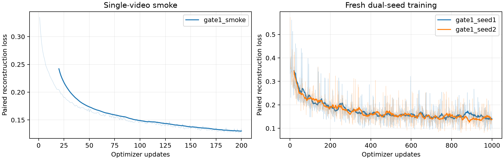
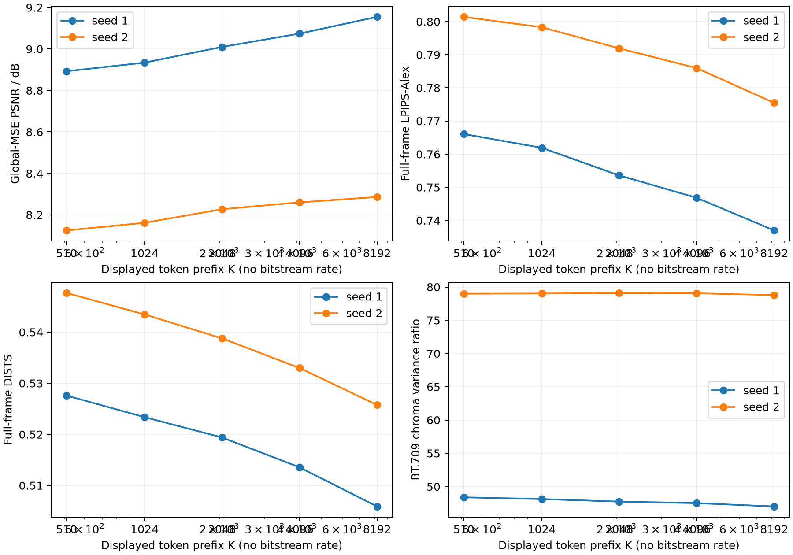
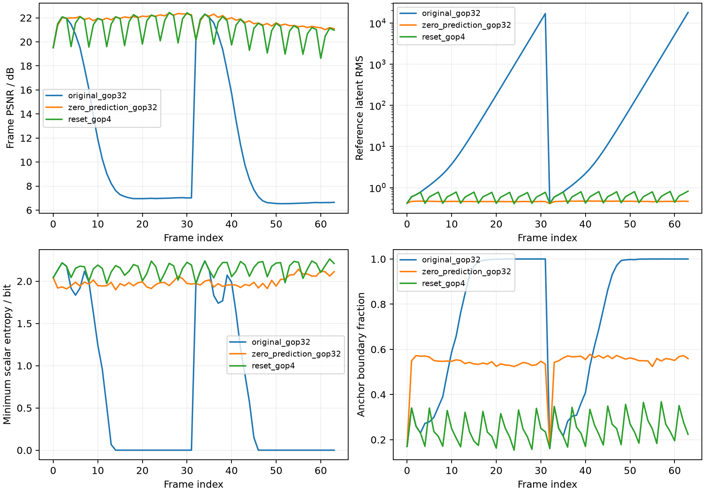
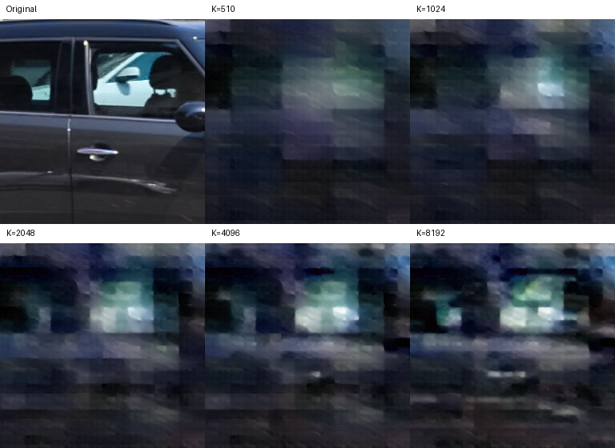

# AIP-VTok 实测技术报告

<!-- Generated by python -m aip_vtok.evaluation.report; do not edit numbers. -->

当前状态：**Gate 0 通过；Gate 1 熔断，Gate 2/3 未启动**。尚未启用完整渐进二进制编解码器。

基线提交 `630e8146ab8b10e0d7593e019d2c8d8782ed142f`，开发分支 `experiment/aip-vtok`。官方源码与旧生产包无差异。

数据：`DAVIS2017:car-roundabout`，原生 `[1080, 1920]`，连续 `64` 帧，QP `32`，GOP `32`。训练、校准仅使用 manifest 的 train；封存测试仅检查元数据，未读取图像。该结果不代表完整验证集。

## Q1：尺度、对齐与参考闭环

DMCI 连续直通保留 `q_scale_y_enc × q_scale_y_dec`。原生连续 R0 和对齐 R0 均绕过量化与熵编码；官方实际码流单列，三者不混用。P 帧全部在本路径自己的闭环历史下编码。

| 路径 | PSNR 全局 MSE / dB | 逐帧 PSNR 均值 / dB |
|---|---:|---:|
| 官方实际码流 | 30.239152 | 30.337709 |
| r0_native | 34.309345 | 34.372360 |
| r0_aligned | 34.306777 | 34.367702 |
| projector_w128 | 33.984931 | 34.124581 |

I 的 PCA 保留训练集方差比例 `0.999904455`。256→128→256 仅对子空间可逆，不能宣称任意输入无损；原生验证误差已计入对齐 R0。

| 投影器 | 相对对齐 R0 掉点 / dB | I 均值 / ms | P 均值 / ms | P P95 / ms |
|---|---:|---:|---:|---:|
| projector_w128 | 0.321846 | 0.784675 | 0.844679 | 0.848451 |

延迟为 H100 上 FP32 eager / channels_last，CUDA Events、独立 I/P 头预热后计时。这只是参考投影模块的延迟，不能换算成完整编解码 FPS。

投影训练使用自己提交的历史。监督目标来自同一个 frozen context 下的官方 Decoder 参考特征，没有异历史 P-latent 蒸馏。I 头输出 192 通道，P 头输出 256 通道；评估每帧仅一次 RGB 重建，提交投影参考不再执行 Decoder。

门槛及判定：

```json
{
  "r0_passed": true,
  "reference_passed": true,
  "passed": true,
  "limits": {
    "minimum_r0_psnr_db": 32.0,
    "maximum_ref_drop_db": 0.5,
    "maximum_projector_ms": 1.0
  }
}
```

## Q2：FSQ 与多预算单调性

单视频冒烟判定 `allow_dual_seed_pilot`；前后窗口平均损失 `0.269534 → 0.129911`。训练帧冒烟不等同于正式验证。

验证帧数 `174`，训练更新 `1000`；独立闭环与同状态配对最大 RGB 误差 `0.0`。

### seed=1

| K | PSNR 全局 MSE | PSNR 帧均值 | LPIPS-Alex | DISTS |
|---:|---:|---:|---:|---:|
| 510 | 8.892638 | 11.212950 | 0.766065 | 0.527584 |
| 1024 | 8.934108 | 11.448752 | 0.761910 | 0.523370 |
| 2048 | 9.009802 | 11.827215 | 0.753574 | 0.519391 |
| 4096 | 9.074049 | 12.106926 | 0.746815 | 0.513558 |
| 8192 | 9.154527 | 12.549674 | 0.736980 | 0.505906 |

| Pass | 最少 ID 数 | 最低 ID 熵 / bit | 最低逐维熵 / bit |
|---:|---:|---:|---:|
| 0 | 2 | 0.201229 | -0.000000 |
| 1 | 4 | 0.218421 | -0.000000 |
| 2 | 12 | 0.900917 | -0.000000 |

验证帧数 `174`，训练更新 `1000`；独立闭环与同状态配对最大 RGB 误差 `0.0`。

### seed=2

| K | PSNR 全局 MSE | PSNR 帧均值 | LPIPS-Alex | DISTS |
|---:|---:|---:|---:|---:|
| 510 | 8.125108 | 10.890973 | 0.801404 | 0.547657 |
| 1024 | 8.161702 | 11.129004 | 0.798294 | 0.543454 |
| 2048 | 8.227392 | 11.514921 | 0.791922 | 0.538770 |
| 4096 | 8.260376 | 11.791923 | 0.785956 | 0.532981 |
| 8192 | 8.286296 | 12.200672 | 0.775476 | 0.525757 |

| Pass | 最少 ID 数 | 最低 ID 熵 / bit | 最低逐维熵 / bit |
|---:|---:|---:|---:|
| 0 | 2 | 0.020462 | -0.000000 |
| 1 | 14 | 0.671610 | -0.000000 |
| 2 | 10 | 0.841065 | -0.000000 |

逐项判定：

```json
{
  "1": {
    "training_complete": true,
    "exact_independent_loops": true,
    "healthy_fsq": false,
    "content_interventions": true,
    "paired_174_frames": true,
    "paired_monotonic_core_gains": false,
    "paired_absolute_quality": false,
    "paired_chroma": true,
    "independent_174_frames": true,
    "independent_monotonic_core_gains": false,
    "independent_absolute_quality": false,
    "independent_chroma": true
  },
  "2": {
    "training_complete": true,
    "exact_independent_loops": true,
    "healthy_fsq": false,
    "content_interventions": true,
    "paired_174_frames": true,
    "paired_monotonic_core_gains": false,
    "paired_absolute_quality": false,
    "paired_chroma": true,
    "independent_174_frames": true,
    "independent_monotonic_core_gains": false,
    "independent_absolute_quality": false,
    "independent_chroma": true
  }
}
```

所有预算均由每个实验路径单次编码得到的同一 1D 序列截取。I 参考固定使用 2048 Token，P 参考固定使用 510 Token；I 的低显示预算仍需收到参考前缀才能提交。独立路径实际重建 RGB 后检查逐元素误差为零时才复用相同指标值。

### 后缀干预

| Seed | 干预 | 平均 MSE 增量 | 按视频重采样 95% CI |
|---:|---|---:|---|
| 1 | pass1_shuffle | 0.00457440 | [0.00373337, 0.00518637] |
| 1 | pass1_cross_video | 0.00509960 | [0.00474761, 0.00556883] |
| 1 | pass2_shuffle | 0.00394796 | [0.00340174, 0.00444976] |
| 1 | pass2_cross_video | 0.00414318 | [0.00384135, 0.00435108] |
| 2 | pass1_shuffle | 0.00445508 | [0.00350450, 0.00522486] |
| 2 | pass1_cross_video | 0.00503754 | [0.00297178, 0.00764758] |
| 2 | pass2_shuffle | 0.00321933 | [0.00242477, 0.00405010] |
| 2 | pass2_cross_video | 0.00231095 | [0.00162475, 0.00293283] |

区间以独立视频为重采样单位；不把同视频连续帧当成独立样本。

## Q3：保色

色度保留率定义为每帧 BT.709 Cb/Cr 空间方差比的均值；方差比不能独立证明颜色正确，因此同时报告色度 MSE 与有符号均值的绝对偏差。

| Seed | K | 方差保留率 / % | 色度 MSE | 均值偏差 |
|---:|---:|---:|---:|---:|
| 1 | 510 | 4838.0691 | 0.02388707 | 0.05365770 |
| 1 | 1024 | 4811.8138 | 0.02368231 | 0.05334144 |
| 1 | 2048 | 4773.9670 | 0.02333285 | 0.05225541 |
| 1 | 4096 | 4750.8372 | 0.02315562 | 0.05167661 |
| 1 | 8192 | 4700.9693 | 0.02307634 | 0.05269282 |
| 2 | 510 | 7899.5987 | 0.03993849 | 0.07600790 |
| 2 | 1024 | 7902.1923 | 0.03984125 | 0.07549887 |
| 2 | 2048 | 7910.3609 | 0.03974370 | 0.07478926 |
| 2 | 4096 | 7905.6398 | 0.03961585 | 0.07417289 |
| 2 | 8192 | 7877.9648 | 0.03930876 | 0.07291946 |

判定表的 chroma 项只检查预先设定的方差比下界；远大于一的比值不代表颜色正确。需结合色度 MSE、均值偏差与原尺寸图检查过饱和和伪色。

## 熔断定位

以下为 `DAVIS2017:car-roundabout` 的 `8192` Token 诊断，各模式分别单次编码，I2048/P510 参考规则保持固定。未更新任何模型参数。

| 模式 | 全局 PSNR / dB | 48–63 帧 PSNR / dB | 第63帧参考潜在 RMS |
|---|---:|---:|---:|
| original_gop32 | 8.681925 | 6.591556 | 18083.599779 |
| zero_prediction_gop32 | 21.720114 | 21.290671 | 0.463257 |
| reset_gop4 | 20.997895 | 20.401134 | 0.818864 |

原路径第 `3` 帧参考潜在 RMS `0.777424`，第 `31` 帧增至 `17031.063924`，第 `32` 帧 GOP 重置回 `0.411245`。第 `31` 帧 Anchor 标量达到边界的比例为 `100.0000%`，最低逐维熵 `-0.000000` bit。

关闭时序预测或提前重置均显著缓解后期失稳，支持预测反馈累积导致状态幅度发散、继而使 FSQ 饱和的解释。4帧训练窗口内健康的符号分布不能保证GOP32长期稳定；发送与接收同步也不等于递推本身稳定。GOP4和零预测结果仅用于定位，不替代原协议或质量门槛。

相同历史下的前两帧/视频诊断共 `6` 帧：直通 `36.680481` dB，FSQ路径 `22.408779` dB。该预算的原始/融合潜在 MSE 为 `1.223655` / `2.632189`。当前表示与原生潜在空间仍有大偏差；RGB损失改善不保证参考投影所需的潜在分布一致性。投影器的前缀分布适配是待单独检验的原因，不能据此声称唯一归因。

种子2初次执行会话在主流程输出完成后报告退出码 `143`。独立复跑比较 `1740` 行，CSV全部字段相等 `True`，汇总JSON相等 `True`。保留两套原始证据。

## 工程复核与限制

历史训练未启用严格 CUDA 确定性；相同输入/RNG 的参数重放最大差异实测为 `8.456408978e-06`。新增训练运行时统一配置确定性算法、cuDNN 和 cuBLAS 工作区，并以等价的固定采样替换感知损失全局视图的非确定性插值反传。

修复后真实原生 GPU 更新重放：参数最大误差 `0.0`，损失误差 `0.0`，四流 RNG 一致 `True`，原检查点未改变 `True`。这验证新的续训运行时，不把旧训练追认为从零开始逐位可复现。

参考前缀在 append 中直接复用新增 Token 的升维结果执行增量 scatter；不再在到达参考边界时整幅求和。修复前后64帧所有诊断值相等，见 `reference_cache_equivalence.json`。

Stage 1 当前在参考提交时 detach；4帧为数值闭环采样长度，不能等同于4帧跨时域梯度。Stage 2 的 TBPTT=2、真正 rANS 分包、Stage 3 的完整实时路径尚未实施。









## Q4：真实码流

官方基线实际 SPS/IP 码流为 `0.042527609` bpp。AIP-VTok 已使用真实 FSQ ID 与 Tier 扫描，rANS 二进制封包尚未启用，其 bpp、Tier 占比、BD-Rate 均为未测，未制造空白 CSV 冒充已完成实验。

## Q5：端到端速度

未运行 Gate 3，Sender/Receiver/顺序联合 FPS 和完整模块分解均未测。

## 复现与证据

```bash
bash scripts/aip_vtok/run_gate0.sh
```

主证据：`results/aip_vtok/gate0_backbone_and_ref.json`；逐帧数据在 `r0_*/rollout.json`、`projector_w*/evaluation.json`；训练日志和可恢复 checkpoint 均保留。完整原尺寸 PNG 与局部裁剪在对应路径目录。

测试与隔离审计：`results/aip_vtok/tests/`、`results/aip_vtok/audit.json`。未通过的质量 Gate 不会被代码测试通过替代。

<!-- BEGIN GENERATED GATE 1-FIX -->

## Gate 1-Fix

**Fix-A 触发止损，Gate 2 暂缓。**

Fix-A 使用当前闭环的 DCVC 对齐潜在作为锚定目标，取消外部 TemporalPredictor。同一未融合的 I2048/P510 前缀同时用于监督与实际提交。参考损失穿过冻结 Projector 回传，下一帧通过已截断梯度的提交状态展开。Fusion 沿用 130 通道零初始化残差结构。

### Fix-A 单视频过拟合

`DAVIS2017:bear` 原生 1080p、4 帧逐帧提交、200 次更新。K8192 训练片段 PSNR 从 13.592 提升到 20.764 dB，首末 10 步平均总损失由 1.6071 降至 1.3775。GPU 峰值分配 5714 MiB。 [逐步训练记录](../results/aip_vtok/gate1_fix/fix_a/smoke/training.json)

真实 tanh 饱和比例均值 1.83%、P95 3.31%、最大 4.09%。预设严重饱和提示值 25%。

下表取各检查步 I 帧低预算的未加权分项值与加权梯度范数。RGB 项与融合锚定在融合潜在处取梯度，原始锚定在未融合潜在处取梯度，参考项在固定参考前缀处取梯度。冻结 Projector 的参数梯度为零。

| 步 | 分项 | 损失 | 加权梯度范数 |
|---:|---|---:|---:|
| 1 | l1 | 0.170825 | 2.039e-03 |
| 1 | mse | 0.041349 | 8.911e-04 |
| 1 | chroma | 0.039070 | 1.474e-04 |
| 1 | lpips | 0.804688 | 8.823e-03 |
| 1 | latent_raw | 0.805142 | 4.892e-04 |
| 1 | latent_fused | 0.805142 | 9.784e-04 |
| 1 | reference | 0.067209 | 3.367e-04 |
| 50 | l1 | 0.100553 | 1.466e-03 |
| 50 | mse | 0.018606 | 4.471e-04 |
| 50 | chroma | 0.036667 | 1.614e-04 |
| 50 | lpips | 0.582031 | 5.343e-03 |
| 50 | latent_raw | 0.807357 | 4.892e-04 |
| 50 | latent_fused | 0.827108 | 9.785e-04 |
| 50 | reference | 0.055736 | 3.181e-04 |
| 100 | l1 | 0.118762 | 1.632e-03 |
| 100 | mse | 0.026089 | 6.070e-04 |
| 100 | chroma | 0.036483 | 1.490e-04 |
| 100 | lpips | 0.628906 | 4.546e-03 |
| 100 | latent_raw | 0.800897 | 4.891e-04 |
| 100 | latent_fused | 0.824215 | 9.784e-04 |
| 100 | reference | 0.054667 | 3.177e-04 |
| 150 | l1 | 0.091041 | 1.349e-03 |
| 150 | mse | 0.015678 | 3.684e-04 |
| 150 | chroma | 0.032741 | 1.544e-04 |
| 150 | lpips | 0.500000 | 5.798e-03 |
| 150 | latent_raw | 0.806226 | 4.892e-04 |
| 150 | latent_fused | 0.820332 | 9.785e-04 |
| 150 | reference | 0.051580 | 3.082e-04 |
| 200 | l1 | 0.113035 | 1.602e-03 |
| 200 | mse | 0.023106 | 5.540e-04 |
| 200 | chroma | 0.033991 | 1.517e-04 |
| 200 | lpips | 0.601562 | 4.838e-03 |
| 200 | latent_raw | 0.801893 | 4.891e-04 |
| 200 | latent_fused | 0.808490 | 9.784e-04 |
| 200 | reference | 0.048509 | 2.996e-04 |

### Fix-A 与 Fix-B 的归因对照

| 实验 | 训练步 | 同历史 K8192 PSNR / dB | 融合潜在 MSE | Δ Fusion MSE | 174 帧 K8192 PSNR / dB | 64 帧 K8192 PSNR / dB | 晚期 PSNR / dB | 晚期参考 L1 | 31 / 63 帧参考潜在 RMS |
|---|---:|---:|---:|---:|---:|---:|---:|---:|---|
| 508a97e 原始外环 | — | 22.409 | 2.6322 | +1.4085 | — | 8.682 | — | — | — |
| 508a97e 零外环预测回放 | — | — | — | — | — | 21.720 | — | — | — |
| Fix-A 冒烟 | 200 | 19.033 | 0.8376 | -0.0753 | — | 19.939 | 19.530 | 0.03028 | 0.184 / 0.193 |
| Fix-A | 1000 | 21.980 | 0.7864 | -0.0753 | 23.898 | 22.116 | 21.624 | 0.02797 | 0.184 / 0.192 |
| B0 冻结 | 未运行 | — | — | — | — | — | — | — | — |
| B1 联合微调 | 未运行 | — | — | — | — | — | — | — | — |

Fix-A 覆盖 35 个原生 1080p 训练视频，判定为止损。同历史 K8192 PSNR 相对历史变化 -0.429 dB，融合潜在 MSE 为历史值的 29.9%。预设判据要求 PSNR 增益至少 0.5 dB，融合 MSE 至多为历史值的 75%。64 帧 K8192 PSNR 相对历史零预测回放变化 +0.396 dB。第 31/63 帧同历史原生对齐潜在 RMS 为 0.987 / 1.117。

### Fix-C 双种子验收

| 随机种子 | 五预算正式验收 |
|---|---|
| 1 | 上游止损，未运行 |
| 2 | 上游止损，未运行 |

#### Fix-A 冒烟 · 同历史直通与三段 FSQ

每个验证视频取前两帧。原生对齐潜在直通为 36.722 dB，K8192 FSQ 为 19.033 dB。缺口 17.690 dB，历史缺口 14.272 dB，较历史扩大 3.418 dB。以历史直通 36.680 dB 为固定参照，当前缺口为 17.648 dB。

| 累计阶段 | K | PSNR / dB | 未融合 MSE | 融合 MSE | Δ Fusion MSE | 相对上一阶段 PSNR / dB |
|---|---:|---:|---:|---:|---:|---:|
| Pass 0 | 510 | 16.749 | 0.93803 | 0.91272 | -0.02531 | — |
| Pass 1 | 2448 | 18.762 | 0.94096 | 0.89368 | -0.04729 | +2.014 |
| Pass 2 | 8192 | 19.033 | 0.91294 | 0.83762 | -0.07532 | +0.270 |

Pass 1/2 累计后仍保留 Pass 0 融合潜在误差的 91.8%。 [同历史逐帧对照](../results/aip_vtok/gate1_fix/fix_a/smoke/diagnostics.json)

#### Fix-A · 174 帧同状态配对

| K | 全局 PSNR / dB | 帧均 PSNR / dB | LPIPS-Alex | DISTS | 色方差保留率 | 色度 MSE | 色度均值偏差 |
|---:|---:|---:|---:|---:|---:|---:|---:|
| 510 | 19.4541 | 20.0306 | 0.60130 | 0.45140 | 65.37% | 0.000478 | 0.007061 |
| 1024 | 20.3144 | 20.8441 | 0.59537 | 0.39151 | 67.12% | 0.000388 | 0.005799 |
| 2048 | 21.5845 | 22.0895 | 0.58214 | 0.35552 | 68.39% | 0.000295 | 0.004164 |
| 4096 | 22.5222 | 23.0420 | 0.54887 | 0.30536 | 71.17% | 0.000273 | 0.004012 |
| 8192 | 23.8976 | 24.3433 | 0.48274 | 0.25496 | 77.55% | 0.000258 | 0.004225 |

[原生逐帧 CSV](../results/aip_vtok/gate1_fix/fix_a/seed1/frame_metrics.csv) · [64 帧漂移曲线原始数据](../results/aip_vtok/gate1_fix/fix_a/seed1/horizon.json)

#### Fix-A · FSQ 全验证集分布

先聚合 174 帧的离散计数再计算熵与有效 ID 数。单帧分位数按帧计算，分开记录离散边界码与真实 tanh 饱和。

| Pass | 边界码 | tanh 饱和（聚合 / P95 / 最大） | 有效 ID（聚合 / P05 / 最小） | 各维熵 bit（聚合） | 各维熵 bit（帧 P05） | 各维熵 bit（帧最小） |
|---|---:|---|---|---|---|---|
| 0 | 10.99% | 0.05% / 0.23% / 0.26% | 1053.43 / 93.54 / 34.78 | 2.229 / 2.447 / 2.558 / 1.976 / 2.194 / 2.141 | 1.689 / 1.628 / 2.086 / 1.438 / 1.325 / 1.050 | 1.472 / 1.514 / 1.619 / 0.886 / 0.823 / 0.486 |
| 1 | 5.18% | 0.22% / 0.63% / 1.29% | 4059.86 / 471.50 / 304.30 | 2.377 / 2.439 / 2.377 / 1.963 / 1.907 / 1.837 | 1.759 / 2.060 / 2.073 / 1.583 / 1.510 / 1.310 | 1.607 / 1.831 / 1.564 / 1.356 / 1.316 / 1.050 |
| 2 | 9.31% | 0.76% / 1.93% / 2.59% | 10197.94 / 875.94 / 150.33 | 2.636 / 2.619 / 2.697 / 2.112 / 1.996 / 2.040 | 2.040 / 2.084 / 2.152 / 1.767 / 1.534 / 1.578 | 1.419 / 1.192 / 1.497 / 1.187 / 1.077 / 0.928 |

[FSQ 原始计数](../results/aip_vtok/gate1_fix/fix_a/seed1/health.json)

#### Fix-A · 同历史直通与三段 FSQ

每个验证视频取前两帧。原生对齐潜在直通为 36.770 dB，K8192 FSQ 为 21.980 dB。缺口 14.790 dB，历史缺口 14.272 dB，较历史扩大 0.518 dB。以历史直通 36.680 dB 为固定参照，当前缺口为 14.700 dB。

| 累计阶段 | K | PSNR / dB | 未融合 MSE | 融合 MSE | Δ Fusion MSE | 相对上一阶段 PSNR / dB |
|---|---:|---:|---:|---:|---:|---:|
| Pass 0 | 510 | 18.853 | 0.90885 | 0.86923 | -0.03962 | — |
| Pass 1 | 2448 | 20.978 | 0.90204 | 0.84295 | -0.05909 | +2.125 |
| Pass 2 | 8192 | 21.980 | 0.86170 | 0.78642 | -0.07528 | +1.002 |

Pass 1/2 累计后仍保留 Pass 0 融合潜在误差的 90.5%。 [同历史逐帧对照](../results/aip_vtok/gate1_fix/fix_a/seed1/diagnostics.json)

同历史下，逐一把每个 Pass 的 FSQ 值替换为当前冻结 lift 的无范围限制最优六维系数。评估该 Pass 时沿用前面各 Pass 的实测 FSQ 表示及原有提交历史。

| Pass | 潜在覆盖 | Pass 前 MSE | 实际 FSQ 后 MSE | 连续六维最小 MSE |
|---|---:|---:|---:|---:|
| 0 | 100.0% | 0.91929 | 0.90885 | 0.89448 |
| 1 | 95.0% | 0.90885 | 0.90204 | 0.88339 |
| 2 | 70.4% | 0.90204 | 0.86170 | 0.83376 |

Pass 0 的连续投影保留 97.3% 的原始潜在误差。冻结 lift 后，优化 Pass 2 的六维系数仍保留其实测量化后误差的 96.8%。在实测前两段条件下，Pass 2 的已学习六维子空间与采样覆盖限制了剩余残差的表达。 [六帧最小二乘原始记录](../results/aip_vtok/gate1_fix/fix_a/seed1/tokenizer_oracle.json)

### 原尺寸重建与固定窗口裁剪

- Fix-A。[全尺寸 PNG 与 256×256 裁剪](../results/aip_vtok/gate1_fix/fix_a/seed1/images) · [第 63 帧原图裁剪](../results/aip_vtok/gate1_fix/fix_a/seed1/images/car-roundabout_f063_original_crop.png) · [第 63 帧 K8192 裁剪](../results/aip_vtok/gate1_fix/fix_a/seed1/images/car-roundabout_f063_k8192_crop.png)
- Fix-A。[第 63 帧五档预算像素等比对照](../results/aip_vtok/gate1_fix/figures/fix_a_car-roundabout_f063_crop_comparison.png)

[64 帧参考 RMS 与逐帧 PSNR 曲线](../results/aip_vtok/gate1_fix/figures/horizon.png)

### 隔离校验

Gate 0 原始 Projector SHA256 `3b1bd715427bd177393e9552a99576e614ab7dd1ed307155129cf62896d5eb94`，与运行前及 508a97e 封存清单一致的核验结果为 `True`。 [完整审计](../results/aip_vtok/gate1_fix/integrity.json)

联合回归 235 项，失败 0 项，错误 0 项，跳过 0 项。 [测试核验](../results/aip_vtok/gate1_fix/tests/verification.json)

<!-- END GENERATED GATE 1-FIX -->
