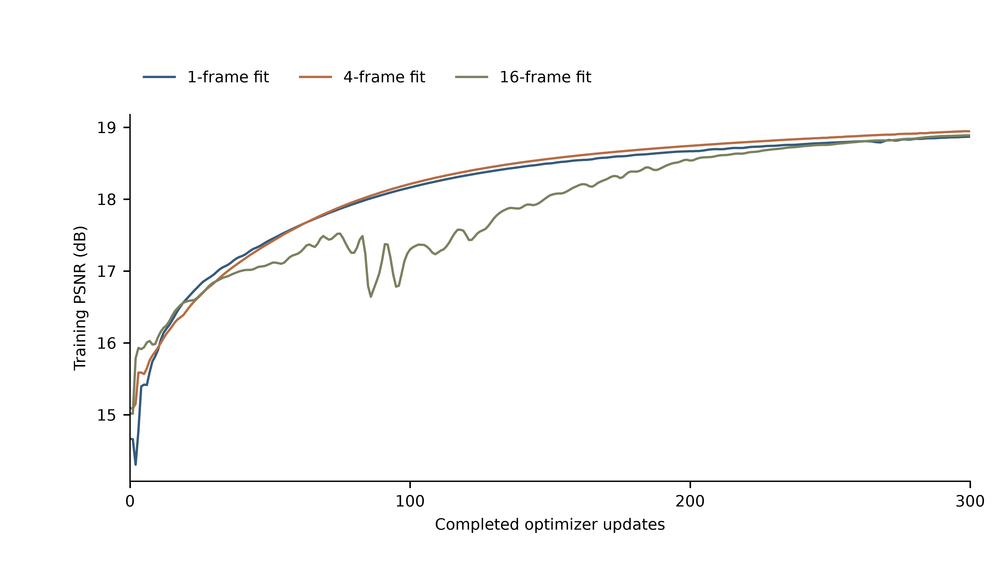
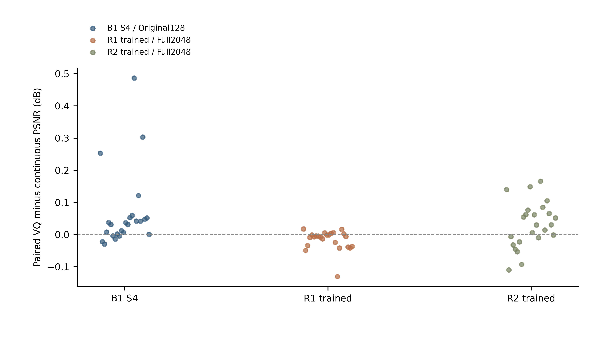
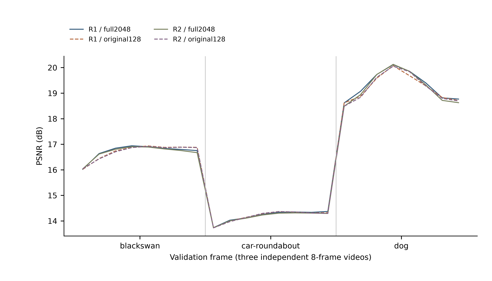

# CP-AdapTok 固定2048 Token 原生1080p重建与瓶颈定位

日期：2026-11-17，Asia/Shanghai。分支：`experiment/fixed2048-reconstruction`，基于 main `534696b`。

本报告仅使用实际运行文件。所有本专项结果均为 `experiment_type: reconstruction_diagnostic`、`real_bitstream: false`、`bpp: null`。
没有网络传输、实际码流或率项；没有改动生产Codec、S0–S4训练、原始B0/B1权重、Manifest或历史Final Test。

**封存结果未达到改善绝对质量的目标。** R1全局MSE PSNR=13.42755dB，原B1匹配首帧I对照=14.84200dB，差-1.41445dB。短窗口验证的小幅提高没有泛化到64帧。当前证据不支持直接追加大规模训练。
封存评估代码Git：`d89c25c0db172fbcb95764215067225148fc5c1a`。封存后没有更新、校准或重新选择Checkpoint；第8节48帧诊断是明确标记的测试后解释性Validation分析。

## 1. 目的、版本与权重

目标是分离当前帧表示损失、量化损失、空间Grid和历史参考退化，不把无量化路径称为真实压缩性能或严格数学上界。
源B1 S4 SHA256：`b940d90b964c506e48ccf0270cfb11a8c790f2b1585a26dfc9ddebb210ed82b7`。Checkpoint内部阶段计数4000、状态trained；历史66,000次主训练更新与本阶段计数分别记录。
Model Config：2048 Token、192D Feature、16D归一化连续投影、8192码本、Encoder KV=17×30、Decoder=17×30、QP32、float64注意力累积、原k_ref=128。
实际I/P Latent为[1,256,68,120]/[1,128,68,120]，padding至1088×1920，输出裁回1920×1080。
两组Backbone逐Tensor与官方DCVC权重相同；官方文件身份见`source_identity.json`。运行环境为H100 PCIe 80GB、PyTorch2.9.1+cu130。
上游DCVC固定commit cbdae87a5445114cdc7f48816da63ea80bdeac40。完整配置、源码哈希、GPU、Git和权重迁移ledger保留在每个run.json / inputs.json / Checkpoint metadata。

## 2. R0/R1/R2/R3与重要接口发现

R0原样复用Encoder y→对应Backbone Decoder；R0-spatial先17×30池化再bilinear恢复。
R1显式调用project_features/project_out，训练和eval都不访问Codebook。R2调用原模块的确定性最近邻及原STE/VQ Loss。
R3只将Decoder Grid改为34×60（2040个Grid Query，Token数仍为2048），Grid Query按二维bilinear插值，其余参数逐项复用并strict加载。
另做独立Encoder KV34控制（Decoder仍17×30）和独立raw192训练控制；从未将两个Grid改动合并归因。

**R0的I帧存在尺度接口差异。** 官方forward_prior_4x对原始y先乘q_scale_y_enc，重建后乘q_scale_y_dec。
直接跳过整个prior时，两组连续尺度仍须保留。按任务字面定义的R0没有这两组因子，bear首帧为7.79492dB；单独补连续尺度为34.50216dB。
该对照完全没有rounding、prior或码流，单列为R0-scale-control，未暗改原始R0或生产Adapter。
验证集正确尺度闭环：全局MSE PSNR **35.95771dB**，简单空间池化后为**19.60308dB**。
这证明不能用原始R0 I帧低分判断DCVC失效；也不能把空间池化结果当学习型Tokenizer的严格容量上界。
原始y与Decoder输入y_hat的I帧尺度不同，因此下表及训练日志中的原始Latent MSE不能直接当跨帧型容量排序；训练损失只有RGB MSE。

## 3. 同状态与独立闭环

同状态比较先建立一个FrozenFrameContext，Encoder只运行一次，Tokenizer输出只计算一次，R0/R1/R2都完成后才commit。
表A采用B1历史VQ128参考；训练后纯量化比较采用R1 Full2048历史，分别标记paired和paired_full2048。
独立Full2048则每条候选自行解码并将真实Decoder Feature提交给下一P帧，允许累积误差不同。
Original128显示完整2048重建，参考只由独立VQ128解码推进；显示结果不影响基础参考。它复现正式每32帧I周期；matched128额外固定仅首帧I。I-only每帧空状态并强制I。
所有视频独立状态；没有真实历史帧替代重建参考、未来帧参考或Teacher-forced主路径。

## 4. 数据、短程训练与恢复

Phase0/扩展诊断采用Validation的blackswan、car-roundabout、dog，各8帧；选模固定同三视频各4帧。
三项Pilot仅Train的bear前1/4/16帧，分别从B1独立初始化，各实际300更新。
正式短程路线预先固定：从B1 S4在原生1080p直接微调，Train中54条尺寸至少1080×1920的视频，超出部分中心裁剪，无上采样。
原Train共120条，其余720p源不用于冒充原生1080p微调；没有改变原Manifest。采样记录和输入逐帧SHA核验均保存。
AdamW、LR2e-5、BF16、clip1、TBPTT2、batch1、4帧窗口、300更新；Pilot LR1e-4。
Backbone冻结并保持eval；R1训练Tokenizer/两投影/Decoder，冻结码本。R2启用码本并保留原VQ Loss。没有感知、GAN、Rate或多预算目标。
R1/R3/Encoder-KV/raw192使用相同初始化来源、数据种子和更新数。R2继承R1验证权重，并仅用Train的4视频×8帧=65536特征执行8192中心、20轮K-means。

| Model | 实际更新 | 实际训练帧 | 更新计算秒 | 峰值MiB | Validation选中Step | 选模PSNR |
| --- | --- | --- | --- | --- | --- | --- |
| R1 | 300 | 1200 | 63.31439 | 8315.84326 | 200 | 16.13426 |
| R2 | 300 | 1200 | 64.79764 | 8317.99951 | 100 | 16.13961 |
| R3 | 300 | 1200 | 64.78206 | 8626.24756 | 300 | 15.68568 |
| Encoder KV34 | 300 | 1200 | 63.18596 | 8334.63428 | 300 | 15.28920 |
| raw192 | 300 | 1200 | 62.55852 | 8311.51465 | 300 | 14.67663 |

更新时间包含真实forward/backward/optimizer，不含数据读取、图像落盘和验证；更完整阶段状态见各completion.json。配置目标没有计作完成结果。
R1在100更新后真实退出进程，严格恢复optimizer/scheduler/全部RNG后完成到300；记录恰为1…300，无重复计数。单元测试还验证恢复下一更新逐Tensor等于连续运行。
各训练前保留Step0指标/重建；每100步保存验证、梯度范数、参数更新范数、输出方差、Latent MSE和PSNR；每步原始记录也保留。

## 5. 表A：已有B1权重、不训练、同状态诊断

所有PSNR列除特别标明外均为相应组**全局MSE对应PSNR**，不是逐帧PSNR均值。LPIPS为Alex；DISTS与MS-SSIM在原始1080p测量。

| Path | I PSNR | P PSNR | Overall PSNR | LPIPS | DISTS | Latent MSE | 逐帧PSNR均值 |
| --- | --- | --- | --- | --- | --- | --- | --- |
| R0 | 7.86001 | 35.06419 | 16.83343 | 0.32388 | 0.19280 | 0.00000 | 31.86469 |
| R0-spatial | 7.69238 | 19.28833 | 15.00679 | 0.78618 | 0.59654 | 2.63315 | 18.37876 |
| R1 | 15.39833 | 16.25158 | 16.13530 | 0.48611 | 0.59878 | 9.34327 | 16.59939 |
| R2 | 15.56569 | 16.28036 | 16.18432 | 0.48498 | 0.60002 | 9.31527 | 16.66388 |

384个初始逐帧重建记录包含所有I-only/同状态/独立闭环/历史128条件。由于R0的坏I帧，混合帧PSNR均值会掩盖全局MSE，二者必须同时查看。
MS-SSIM、I/P Relative RMSE、Latent形状和原始MSE均在frame_metrics.jsonl和summary.json，未省略原始观测。

## 6. 表B：单样本拟合

| Model | 实际 Steps | Train PSNR | Train Latent MSE | 末步 Validation PSNR |
| --- | --- | --- | --- | --- |
| R1 1-frame | 300 | 18.87117 | 60.87958 | 14.65358 |
| R1 4-frame | 300 | 18.94291 | 15.93971 | 14.79631 |
| R1 16-frame | 300 | 18.88698 | 4.55285 | 14.73723 |

三项MSE均显著下降、通过预先5%门槛。单I帧梯度和参数实际更新已核验；单样本泛化验证下降属于预期过拟合，未当模型最终改善。

## 7. 表C：固定2048消融（相同Validation 3×8帧）

| Model | Decoder Grid | Quantization | PSNR | LPIPS | DISTS |
| --- | --- | --- | --- | --- | --- |
| R1 | 17×30 | Continuous | 16.23871 | 0.69473 | 0.65555 |
| R2-initial | 17×30 | 原码本 VQ | 16.20138 | 0.69433 | 0.65593 |
| R2-trained | 17×30 | 校准+QAT VQ | 16.20012 | 0.74151 | 0.65767 |
| R3 | 34×60 | Continuous | 15.61984 | 0.76688 | 0.62536 |

R2-initial与R1完全同权重，但此表是各自独立完整闭环，不能把表内差全部归于当前帧量化。
真正同状态R1权重的纯量化全局PSNR差为 **-0.01214dB**；逐帧、Token MSE、Latent/RGB差见paired_quantization.json和Token统计。
R2-trained还保留该权重自己的连续路径，避免跨训练状态误判。码本使用数、perplexity和逐Code直方图保留在其原始Token记录。

| 权重 | 观测Token数 | 全局Code数 | 全局Perplexity | 每帧Code均值 | 每帧Perplexity均值 | 16D量化MSE | Tokenizer内容方差 |
| --- | --- | --- | --- | --- | --- | --- | --- |
| R1_weights | 49152 | 4129 | 2918.62057 | 1396.00000 | 1201.67241 | 0.00159 | 0.86712 |
| R2_trained_weights | 49152 | 7448 | 5794.69191 | 1821.75000 | 1739.64364 | 0.00096 | 0.86888 |

本表每组24帧、49152个Token，汇总与逐帧Perplexity分开定义。码本使用提升但画质未显著改善，不支持把当前全部失真归于码本塌缩。16个128-Token组的方差保留在token_statistics_summary.json。

独立raw192 PSNR=14.53079dB，R1 16D=16.23871dB，差值raw−16D=-1.70792dB。
该对照已独立训练，仍只测匹配300更新下的控制差异，不能称为16D不可逆信息损失的精确值或收敛容量结论。
Encoder KV34、Decoder17的PSNR=15.34888dB；与Decoder34实验分开报告。
R3相对R1为-0.61887dB，且迁移Step0已经下降，不能仅据此否定更大Grid的容量。

## 8. 表D：参考闭环

| Model | Reference | I PSNR | P PSNR | Overall PSNR |
| --- | --- | --- | --- | --- |
| R1 | i_only | 15.68862 | 不适用 | 15.68862 |
| R1 | full2048 | 15.68403 | 16.32406 | 16.23871 |
| R1 | original128 | 15.68403 | 16.30137 | 16.21923 |
| R2-trained | full2048 | 15.69136 | 16.27793 | 16.20012 |
| R2-trained | original128 | 15.69136 | 16.25880 | 16.18368 |

I-only的每帧都为I，其P列不适用；不能拿其I/P比例与闭环Overall直接当P帧因果效应。
原B1同状态下P帧R0明显高于R1/R2，说明相同历史下，当前帧表示链路已损失大量信息。
完整与128参考切换的变化应结合逐P帧、视频内轨迹看；不能因一个候选提前commit或不同历史输入造成差异就宣称纯量化损失。
内容敏感性为独立非正常诊断：正常、同位置常量（各Token同通道均值）、固定随机排列、同帧型前一帧Token。
Decoder位置向量和当前历史上下文保持固定，不提交这些异常输出。原始RGB/Latent输出差保留在sensitivity目录，未混入正式结果。
独立内容诊断逐项记录history_path、diagnostic_path和peer_frame，异常输出从不提交参考；以此独立记录为准，早期内嵌诊断仅作补充。

| 权重 | 诊断路径 | 帧型 | 常量RGB变化MSE | 打乱RGB变化MSE | 异帧RGB变化MSE | 正常目标MSE | 异帧变化/目标MSE<1%筛查 |
| --- | --- | --- | --- | --- | --- | --- | --- |
| R1 | R1 | I | 0.03549 | 0.00110 | 0.00046 | 0.02765 | 输出对内容有响应 |
| R1 | R1 | P | 0.00463 | 0.00044 | 0.00400 | 0.02346 | 输出对内容有响应 |
| R1 | R2 | I | 0.04610 | 0.00106 | 0.00050 | 0.02812 | 输出对内容有响应 |
| R1 | R2 | P | 0.00538 | 0.00042 | 0.00272 | 0.02354 | 输出对内容有响应 |
| R2 | R1 | I | 0.04015 | 0.00120 | 0.00055 | 0.02816 | 输出对内容有响应 |
| R2 | R1 | P | 0.00981 | 0.00074 | 0.01028 | 0.02357 | 输出对内容有响应 |
| R2 | R2 | I | 0.03790 | 0.00132 | 0.00054 | 0.02761 | 输出对内容有响应 |
| R2 | R2 | P | 0.00918 | 0.00065 | 0.00401 | 0.02335 | 输出对内容有响应 |

筛查阈值只用于标记信息利用不足风险，不是统计检验。异帧来自同视频相邻已解码帧，其视觉相似度是混杂因素；即使输出近似不变，也不能据此独自证明完全忽略内容。常量/打乱控制和重建误差必须联合看，不能用单项证明全部根因。

### 48帧解释性Validation诊断（测试后追加，不参与选模）

最终测试暴露了8帧诊断/4帧选模无法发现的长期退化。因此固定B1、R1选Step200、R2选Step100全部权重，在相同三条Validation视频前48帧追加纯MSE/PSNR诊断，不读取新Test、不训练、不改超参数，也不替换选中模型。
每个模型1152条记录，共3456条，4种参考×2条解码路径×3视频×48帧。以下列各模型的主要路径，全部路径原始记录保留。
同一FrozenFrameContext另解码尺度正确的原生Latent；这个直接路径的Feature从不提交参考。

| 权重/主路径 | 参考 | 48帧PSNR | 早P 1–7 | 晚P 40–47 | 同上下文晚P直接Latent | 晚P Feature RMS |
| --- | --- | --- | --- | --- | --- | --- |
| B1 | i_only | 15.61082 | 不适用 | 不适用 | 不适用 | 不适用 |
| B1 | full2048 | 15.39617 | 16.23799 | 14.72193 | 33.85760 | 0.07873 |
| B1 | matched128 | 15.78435 | 16.28036 | 15.15271 | 34.11085 | 0.07341 |
| B1 | original128 | 16.09275 | 16.28036 | 16.05992 | 34.22234 | 0.07579 |
| R1 | i_only | 15.70446 | 不适用 | 不适用 | 不适用 | 不适用 |
| R1 | full2048 | 15.15067 | 16.32406 | 14.23595 | 33.06654 | 0.08161 |
| R1 | matched128 | 15.41497 | 16.30137 | 14.58496 | 33.44540 | 0.07824 |
| R1 | original128 | 15.88366 | 16.30137 | 15.83204 | 33.66576 | 0.07721 |
| R2 | i_only | 15.70610 | 不适用 | 不适用 | 不适用 | 不适用 |
| R2 | full2048 | 14.51241 | 16.27793 | 13.37681 | 32.37468 | 0.08861 |
| R2 | matched128 | 14.81137 | 16.25880 | 13.92510 | 32.87075 | 0.08359 |
| R2 | original128 | 15.41721 | 16.25880 | 15.32191 | 33.34120 | 0.08082 |

R1 Full2048早P为16.32406dB、晚P为14.23595dB；晚P同上下文直接Latent仍为33.06654dB。
在相同晚P帧区间，matched128为14.58496dB，GOP32历史参考为15.83204dB。说明当前表示链路有巨大条件差距，历史预算/重置也有实质作用。
早晚帧内容也在变化，因此不将早晚差全部当累积误差；同帧区间的参考策略比较支持闭环贡献。PSNR差不可加性分摊成根因百分比。Feature RMS没有数值爆炸，不能据单项范数断言机制。
这项分析属于后验解释，不能冒充预注册的确认性验证，也没有用于改选模型。

## 9. 原生1080p推理与计算量

| Model | 帧型 | Encoder ms | Tokenizer ms | VQ ms | Token→Latent ms | DCVC Decoder ms | 全程 ms | 显存 MiB | GFLOPs |
| --- | --- | --- | --- | --- | --- | --- | --- | --- | --- |
| R1 | I | 17.93850 | 1.37269 | 0.22119 | 0.93425 | 33.49300 | 53.98916 | 1167.21709 | 1407.85054 |
| R1 | P | 3.61263 | 1.44991 | 0.23243 | 0.94397 | 6.23507 | 22.09731 | 910.19277 | 315.37878 |
| R2 | I | 17.89386 | 1.32878 | 1.15102 | 0.90134 | 33.48790 | 54.79160 | 1167.24834 | 1408.38742 |
| R2 | P | 3.56725 | 1.66485 | 1.13835 | 0.89103 | 6.22315 | 23.08695 | 910.22402 | 315.91565 |
| R3 | I | 17.83787 | 1.29993 | 0.20440 | 1.17046 | 33.33956 | 53.88197 | 1169.18203 | 1411.61420 |
| R3 | P | 3.61679 | 1.36064 | 0.21114 | 1.18106 | 6.23479 | 22.23250 | 912.06846 | 319.14243 |

每个I/P条件3次预热、10次真实1080p测量，单独进程、无感知指标网络；GPU显存为torch最大allocated MiB。
专用探测使用固定Validation视频的第0帧I和第1帧（I后首个P）的真实历史；重复测量不是独立视频样本，也未覆盖全部P时刻。64帧评估的逐帧组件时间另保留在frame_metrics.jsonl，不把首P探测外推为所有P的平均速度。
全程包含参考上下文准备，其余列未单列该开销；不含磁盘/指标/异常Token诊断。GFLOPs采用PyTorch FlopCounterMode，乘加计2，不支持的非算术操作未计，非完整硬件指令数。
训练峰值另见训练表；evaluation.run.json显存包含LPIPS/DISTS网络，不能与无指标推理峰值混用。

## 10. 封存Test与原B0/B1同样本绝对质量

所有模型在读取Test像素前固定SHA和协议，封存见final_test/seal.json；封存后拒绝训练与码本校准。
沿用cpat_test.json中原始尺寸1920×1080的cows/goat/parkour，各64帧，共192帧。没有根据Test重新选择模型或参数。
B0/B1为原S4模型以历史VQ128闭环、每32帧I重建显示2048，保留接收端语义，但不生成码流、bpp仍为空。另为B1提供matched128（仅首帧I），与本专项I/P比例一致；下文R1−B1采用此匹配对照。

| Model | 全局MSE PSNR | LPIPS | DISTS | 逐帧PSNR均值 | 视频均值的均值 |
| --- | --- | --- | --- | --- | --- |
| 原 B0 | 15.49024 | 0.52874 | 0.62110 | 15.55417 | 15.55417 |
| 原 B1，历史GOP32 | 15.57008 | 0.52799 | 0.62336 | 15.63570 | 15.63570 |
| B1，仅首帧I匹配对照 | 14.84200 | 0.54701 | 0.62097 | 14.96755 | 14.96755 |
| R1 | 13.42755 | 0.76431 | 0.65161 | 13.71079 | 13.71079 |
| R2-initial | 13.49656 | 0.75938 | 0.65410 | 13.74915 | 13.74915 |
| R2-trained | 12.65703 | 0.83473 | 0.65390 | 13.06028 | 13.06028 |
| R3 | 12.55503 | 0.84602 | 0.60622 | 12.91740 | 12.91740 |

R1与原B1的全局MSE PSNR差为-1.41445dB。各视频均值及逐帧结果完全保留，不把单视频或单种子提升当普适收敛证据。
历史正式测试结果只读保留，未用本次数字覆盖。原归档权重与本次S4的重建参数逐Tensor相同，仅Entropy/Scorer不同；两者SHA和差异清单见historical_comparison_provenance.json。
本次使用原VQ前向的浮点STE等价表达和dense Decoder，历史使用ID查表/Prefix Cache；不是逐位相同的数值路径。因此本次历史模式逐帧PSNR均值B0=15.55417、B1=15.63570，与归档15.54632、15.63426的微差不视为新质量收益，更没有覆盖归档结果。

## 11. 重建图像与证据边界

以下均为保存的真实1920×1080 RGB，没有局部增强或调整对比度；报告显示缩放不参与指标计算。

原始Validation blackswan首帧：

用户字面R0原始y直通（I尺度缺失对照）：

单列官方连续尺度对照：

R1选定权重的完整Token重建：

每帧RGB MSE/PSNR、LPIPS、DISTS、MS-SSIM可追溯；图表均读取真实JSON而非手填。只有一个训练种子、3条诊断视频、短程训练；未声称已测收敛上限或所有根因。

## 12. 最终问题与最小下一步

**Q1：DCVC-UF原生Latent直接重建正常吗？** P帧原始y在同状态下可高质量重建。I帧字面R0异常来自漏掉官方连续尺度；独立尺度对照恢复到37.21788dB。不能把裸y直通称正常、也不能据此宣称Backbone坏了。

**Q2：2048连续Token能否合理重建1080p？** 当前实现/短程训练未达到：虽然可拟合单样本并改善短窗口验证，封存64帧只有13.42755dB。该失败不能作为2048连续Token理论容量不足的证明。

**Q3：16D连续投影与VQ分别损失多少？** 同权重同状态下VQ相对连续为-0.01214dB。raw192−16D的匹配训练控制为-1.70792dB，不能把独立优化差异全部当16D不可逆损失；纯16D容量损失尚不能精确识别。

**Q4：Decoder Grid34是否明显提高画质？** 在匹配300更新/迁移方案下没有；Validation差-0.61887dB，最终Test也未改善。迁移Step0分布变化和短程未收敛限制容量结论；Encoder KV已单独测试。

**Q5：P帧差来自本帧还是历史？** 两者均有证据。同上下文晚P直接Latent约33.06654dB，而完整Token约14.23595dB，证明本帧表示链路仍有大损失。仅改历史预算/重置，晚P又可恢复到15.83204dB，证明长期闭环也有实质作用。不能唯一归因或给出可加性贡献百分比。

**Q6：继续训练连续表示比原多预算更易改善绝对质量吗？** 本次没有获得这种结果。4帧选模改善，封存64帧反而比匹配原B1低1.41445dB。没有匹配新增300步的多预算训练对照，不能作普遍优化效率判断。

**Q7：优先修改哪一环？** 先处理参考闭环的长期训练/验证分布缺口：训练仅4帧，实际评估64帧，Full2048未显示更稳定。下一独立实验最小改动是保持K、16D、Backbone和现有结构，使用16/32帧训练展开（TBPTT仍2），并把48帧因果Validation作为必要选模门槛；先做可恢复短Pilot，不追加本次封存权重训练。
结构方面，当前证据只把巨大条件损失定位到Tokenizer→Token-to-Latent链路，尚不能单独指认某层。若长期稳定性门槛通过后此差距仍在，最小结构候选是给Token内容与Decoder Grid加入显式二维空间对应/局部读取，其他因素保持固定。码本使用已经充分，扩大Decoder/Encoder Grid短程均未改善，没有证据优先扩大它们。
不建议直接再跑66,000步。先让长闭环验证和同状态空间表达诊断同时通过，再决定训练规模。

工程验证和精确检查数见acceptance.json、pytest_final.txt、quality_audit.json、mutation_check.json；全部操作/原因与已知限制见docs/fixed2048_work_log.md。源码和原始数据均保留，不通过降低断言或静默fallback掩盖失败。
