# HLA-Tok T0 架构

HLA-Tok 在整帧上提取共享空间特征，在局部区域内生成有序整数 Token，再拼接局部特征并一次解码原生 RGB。T0 的公开接口逐帧接收 RGB 或整数序列，状态只存在于当前帧的发送端 Query 缓存。

```mermaid
flowchart LR
    RGB["1920×1080 RGB"] --> ENC["Reflect padding 和共享卷积编码"]
    ENC --> REG["1/8 和 1/16 特征按 128×128 像素分区"]
    REG --> LOCAL["共享局部 Query"]
    LOCAL --> VQ["共享 8192 词表 VQ"]
    VQ --> ORD["Rank-Major 整数前缀"]
    ORD --> RX["整数查表和局部空间 Query"]
    RX --> GRID["拼接 72×120 特征图"]
    GRID --> OUT["全图融合和 PixelShuffle"]
    OUT --> CROP["裁回 1920×1080 RGB"]
```

## 空间尺度

1080p RGB 仅在底部反射补齐 72 行。编码器依次处理 48×288×480、96×144×240、128×72×120 特征，保留后两种尺度。每个区域对应 128×128 源像素和 8×8 粗尺度特征，细尺度经过 PixelUnshuffle(2) 对齐。区域按行优先编号，共 9×15 个区域。训练 Crop 保持相同区域尺度，预算按区域数与 135 的比例取整。正式质量指标在裁回后的 1920×1080 RGB 上计算。

## 整数序列

区域共享 512 个有序 Query、两层四头局部交叉注意力以及一套 8192×32 标准 VQ。编码 Query 的计算块固定为 32 个 Rank，包含预算末尾不足一块的情形。VQ 关闭自动混合精度后分块比较平方 L2 距离，相同距离取最小索引。追加调用保留准备阶段的精度、局部 K/V 和已经量化的 Rank 块。

Rank 优先交织后，序列位置除以区域总数得到 Rank，余数得到区域 ID。`K4096` 对前 46 区各发 31 个 ID，对其余各发 30 个。`encode_frame()` 默认可返回 69,120 个物理位置，正式预算上限为 65,280。

解码器按实际接收长度把区域分成至多两组，每组交叉注意力键值只包含收到的 Token。码本查表、解码 Rank embedding 和 64 个空间 Query 恢复局部特征。全图卷积融合读取区域两侧的特征，最后用 sigmoid 输出 RGB。

## 公开入口

| 接口 | 输入与作用 |
|---|---|
| `prepare_frame(rgb)` | 保存当前帧局部 K/V 和执行精度 |
| `encode_frame(rgb, budget)` | 单次调用得到指定整数前缀 |
| `encode_prefix(sender, budget)` | 从当前帧缓存开始计算前缀 |
| `extend_prefix(sender, budget)` | 计算新增 Rank 块并返回目标前缀 |
| `encode_regions(sender, lengths)` | 按每区域请求量取得局部前缀 |
| `decode_prefix(ids, geometry)` | 从实际收到的整数 ID 与公开尺寸重建 |
| `encode_training()` | 产生同源连续表示、硬 VQ 查表值及分开的两项量化损失 |

原版 AdapTok 每个 128×128 Tile 使用完整 4 帧组的 Transformer。HLA-Tok T0 共享整帧卷积编码和解码，并按逐帧局部 Query 学习表示。Joint V1 使用 FSQ、扫描和潜变量恢复，HLA-Tok 直接从共享 VQ 整数和空间 Query 恢复全图特征。

Phase 0 的 Fixed13 只规定索引载荷。增量字节前缀需要后续独立分包规范与状态验收。
