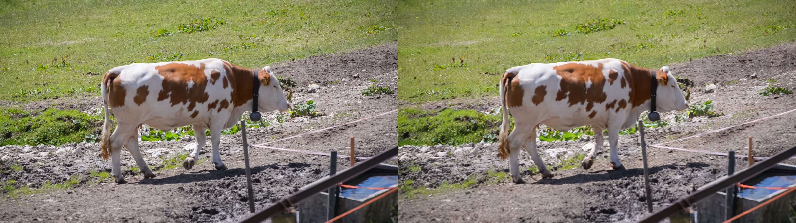
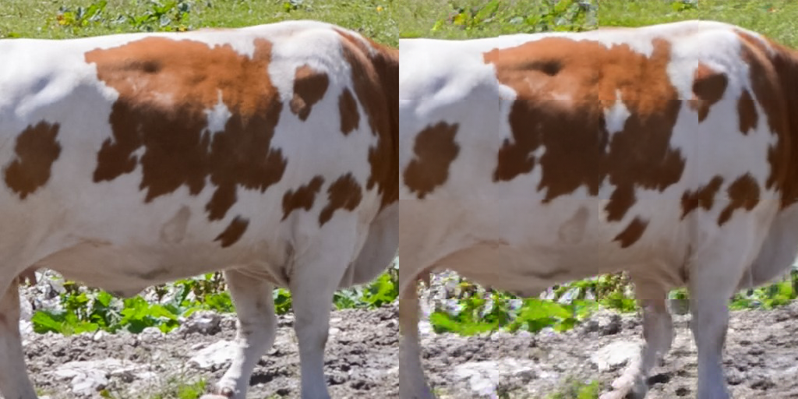
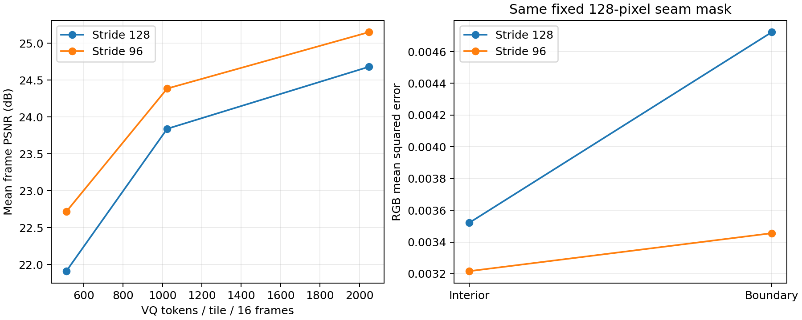

# 官方 AdapTok 原生 1080p 分块重建实测

本实验完成 E0–E4。仅推理，没有训练、微调、反向传播、配置覆盖或模型结构修改。
结论限于 DAVIS2017 cows、goat、parkour 各 64 帧，共 192 帧；时间窗口独立，无跨窗口因果状态传递。
官方来源：[源码](https://github.com/VisionXLab/AdapTok)、[预训练模型](https://huggingface.co/yeahhhh326/AdapTok)。

## 版本与不可变性

- 基于 CP main `534696b2f78b7e1bc74bf5c5eefe83e88f41b864`，分支 `experiment/original-adaptok-1080p`。
- 官方源码 Commit：`a72076cf6474f930a181aa78971de70d65289b49`，子模块 tracked 文件未修改。
- HF Revision：`c514b22615a140c06f4c9792e93cbef9e5c79f32`，严格调用原生 `AdapTok.from_pretrained(local_dir)`，不传配置覆盖。
- config.json SHA256：`7ebf3ed0bb451b39424a2c89154da95f542ce12559175061ef94702e7e01bc4c`。
- model.safetensors SHA256：`be5432949a87dee253c86f7ccb87bb5370b435ed180f8cda546b09d6a63c8cdd`，已与官方 LFS 哈希核验。
- State SHA256 前/后：`fe53e98b82a3fe2ae2c5b478c8f103880b0abae13e62af1fd5fc804e3729a57f` / `fe53e98b82a3fe2ae2c5b478c8f103880b0abae13e62af1fd5fc804e3729a57f`。
- 输入 `16×128×128`，Codebook `8192`，Latent `2048`，时间组 `4×512`。
- 参数量 `195,059,872`（含 checkpoint 中原生 prior；没有调用 prior/scorer/IPAL）。推理 `torch.float32`，无 AMP、TF32 关闭。
- GPU `NVIDIA H100 PCIe`；Python `3.10.12`；PyTorch `2.5.1+cu121`；CUDA runtime `12.1`。完整驱动和依赖见 environment.json、requirements-lock.txt。
- 环境 `.venv-adaptok-official` 独立安装；未修改 `.venv-native`、系统 CUDA 和旧实验。

## 数据与指标口径

| 内容 ID | 原生尺寸 | 帧索引 / 帧数 | FPS | 全序列来源 SHA256 |
|---|---|---|---|---|
| DAVIS2017:cows | 1920×1080 | 0–63 / 64 | 30 (nominal) | `2feb11444bbce2e0f6142decc858c51ec5b77d6da3315d6c5dae7949944ce1d7` |
| DAVIS2017:goat | 1920×1080 | 0–63 / 64 | 30 (nominal) | `65aca645620871b3e4dce7834fa4c932b0239bfa474f0836198bd99e8abb705e` |
| DAVIS2017:parkour | 1920×1080 | 0–63 / 64 | 30 (nominal) | `5124a8b3486193380a6d2343e4c28f8233c1a8fa7df4ec030cce8ac3488ce3cd` |

真实来源路径及逐文件哈希位于 input_manifest.json，均从 `data/manifests/cpat_test.json` 读取，未按名称猜路径。
直接复用 CP 的 `cp_adaptok.data.read_video`：OpenCV 解码、BGR→RGB、float32 /255，既不整帧 Resize，也不裁剪。
在原 `.venv-native` 只读重读相同 12 个时间窗口后，RGB float32 SHA256 全部一致；LPIPS-Alex、DISTS 校准权重和 AlexNet/VGG16 骨干文件 SHA256 全部一致。
版本和证据见 cp_input_parity.json、metric_manifest.json、absolute_quality_comparison.json。
原图与重建都在完整 RGB 1080×1920 上计算指标，LPIPS 输入 [-1,1]，DISTS 使用 CP 相同 [0,1] 预处理与 alpha/beta，MS-SSIM data_range=1。
LPIPS-VGG 对齐官方评估的 normalize=True 语义。DISTS 内部标准多尺度处理与 CP 完全相同，未在实验层缩小输入。

每 16 帧独立调用官方 encode_eval、decode_eval。尾窗重复最后真实帧，仅真实帧参与指标与 FPS 分母；纯功能测试覆盖 1、15、16、17、33 帧。
无重叠：反射补到底部 1152，15×9=135 Tile；stride96：补至1088×1952，20×11=220 Tile。
位置固定跨所有帧；默认 Batch=4。无重叠直接写回，重叠采用半像素采样 sin² 的可分权重，全图有效像素权重严格大于零，最后裁回 1080×1920。

## E0 一致性与 E1 单视频

真实 Tile 原生接口对照最大绝对误差 `0.0`；重复 VQ 编码完全一致；State 哈希相同。
K512/1024/2048 分别原生调用分组 Mask，保留 `[128]*4`、`[256]*4`、`[512]*4`，各预算独立解码与官方原生调用误差为零。
同一 Tile 在 Batch1 与 Batch4 的最大数值差为 `1.49011612e-06`，来自浮点批量计算；Token 分配定义不变。
该 Tile PSNR `30.0834` dB。单 Tile 结果只用于接口验收。

首条 cows 的首 16 帧无重叠全 Token：

| K / Tile / 16帧 | PSNR逐帧均值 dB | PSNR全局MSE dB | MS-SSIM | LPIPS-Alex | LPIPS-VGG | DISTS |
|---|---|---|---|---|---|---|
| 2048 | 24.7416 | 24.5214 | 0.881629 | 0.137686 | 0.222521 | 0.038017 |





原始及重建视频在 no_overlap、overlap 与各完整测试视频目录中；reconstructed_videos 为完整串接视频。
视频采用 libx264rgb CRF0 无损 RGB 保存，浮点输出仅为显示量化到 uint8，指标在量化和写盘前计算。
这些观看用视频不是模型熵编码码流，所有本实验 bpp 均为 null，quality_only=true。

## E3/E4 完整 192 帧 Token 消融

无重叠 stride128：

| K / Tile / 16帧 | PSNR逐帧均值 dB | PSNR全局MSE dB | MS-SSIM | LPIPS-Alex | LPIPS-VGG | DISTS |
|---|---|---|---|---|---|---|
| 512 | 21.9112 | 21.7433 | 0.725616 | 0.277776 | 0.388315 | 0.113106 |
| 1024 | 23.8409 | 23.6468 | 0.818708 | 0.218456 | 0.332443 | 0.088415 |
| 2048 | 24.6811 | 24.4485 | 0.848823 | 0.198488 | 0.310520 | 0.080662 |

重叠融合 stride96：

| K / Tile / 16帧 | PSNR逐帧均值 dB | PSNR全局MSE dB | MS-SSIM | LPIPS-Alex | LPIPS-VGG | DISTS |
|---|---|---|---|---|---|---|
| 512 | 22.7178 | 22.5291 | 0.762154 | 0.252121 | 0.356073 | 0.104175 |
| 1024 | 24.3863 | 24.1855 | 0.837071 | 0.204631 | 0.309157 | 0.083288 |
| 2048 | 25.1504 | 24.9076 | 0.862205 | 0.187007 | 0.289341 | 0.075927 |

各 Tile 的所有预算共享同一次完整 Encoder/VQ 输出，不切 `tokens[:K]`。
逐帧回退计数（如有则保留原值）：`{'final_1080p': {'512->1024': {'psnr_worse_frames': 0, 'total_frames': 192}, '1024->2048': {'psnr_worse_frames': 0, 'total_frames': 192}}, 'token_ablation/overlap': {'512->1024': {'psnr_worse_frames': 0, 'total_frames': 192}, '1024->2048': {'psnr_worse_frames': 0, 'total_frames': 192}}}`。
逐帧 CSV、逐视频 CSV 以及视频等权均值都已保存。PSNR逐帧均值是 dB 的算术平均；全局 PSNR = -10log10(全部完整帧的平均 MSE)，两列分别报告，不混用。
三条视频帧数相等，因此这次逐帧均值与逐视频等权均值相同；代码保留两种汇总。

## E2 空间边界诊断

固定边界 Mask 为内部 x/y = 128n 处 `[line−2,line+2)` 的 4 像素条带并集，排除图像外缘。
两种 stride 都用这同一个 Mask，便于比较对原始135块拼缝的修复；它不把 stride96 所有块边缘都当作独立硬拼缝。
边界 PSNR 与非边界 PSNR 由各自区域的聚合 MSE 计算；区域纹理不同，因此差值不是孤立的因果边界效应。

| Stride | K | 边界 MSE | 非边界 MSE | MSE差值 | 边界PSNR dB | 非边界PSNR dB |
|---|---|---|---|---|---|---|
| 128 | 512 | 0.0087582 | 0.0065669 | 0.0021914 | 20.5758 | 21.8264 |
| 128 | 1024 | 0.0055955 | 0.0042399 | 0.0013557 | 22.5216 | 23.7265 |
| 128 | 2048 | 0.0047222 | 0.0035209 | 0.0012014 | 23.2585 | 24.5335 |
| 96 | 512 | 0.0058851 | 0.0055674 | 0.0003177 | 22.3025 | 22.5435 |
| 96 | 1024 | 0.0040441 | 0.0038005 | 0.0002436 | 23.9318 | 24.2016 |
| 96 | 2048 | 0.0034556 | 0.0032164 | 0.0002392 | 24.6147 | 24.9262 |

全 Token overlap 的平均逐帧 PSNR 差值为 `+0.4693` dB；真实 Tile 数从135增加到220，增加62.96%。不预设重叠方案必然更好。



## 耗时与显存

独立单预算 Benchmark：全 Token、三个真实视频各连续16帧，每种 stride 共48帧，单独进程仅加载 tokenizer，指标网络不驻留：

| 测量 | 真实帧 | NN FPS (CUDA) | NN FPS (wall) | 计算 FPS | 含读写 FPS | 计算均值ms/帧 | P50 | P95 | 峰值 allocated / reserved MiB |
|---|---|---|---|---|---|---|---|---|---|
| Benchmark stride128 | 48 | 1.570 | 1.569 | 1.558 | 0.965 | 641.74 | 641.91 | 642.13 | 2909.6 / 3460.0 |
| Benchmark stride96 | 48 | 0.975 | 0.975 | 0.970 | 0.707 | 1030.71 | 1035.48 | 1042.75 | 3147.2 / 3460.0 |

质量评估进程中的计时与驻留显存另列，便于核查完整消融：

| 测量 | 真实帧 | NN FPS (CUDA) | NN FPS (wall) | 计算 FPS | 含读写 FPS | 计算均值ms/帧 | P50 | P95 | 峰值 allocated / reserved MiB |
|---|---|---|---|---|---|---|---|---|---|
| no_overlap | 16 | 1.590 | 1.590 | 1.580 | 0.951 | 632.77 | 632.77 | 632.77 | 3045.0 / 3504.0 |
| overlap | 16 | 0.972 | 0.971 | 0.966 | 0.687 | 1034.86 | 1034.86 | 1034.86 | 3282.9 / 6932.0 |
| final_1080p | 192 | 1.565 | 1.564 | 1.554 | 0.958 | 643.51 | 643.17 | 653.18 | 3874.1 / 7696.0 |
| token_ablation/overlap | 192 | 0.960 | 0.959 | 0.955 | 0.690 | 1047.57 | 1046.65 | 1067.54 | 4375.4 / 9220.0 |

CUDA Events 与显式 synchronize 同时记录 Encode/Decode，wall 包含接口内部 CPU 分派。神经网络 FPS 分别提供 event 和 wall 两种口径。
Event elapsed 包含接口时间线上主机分派造成的间隙，不等于内核活跃时间或实测 FLOPs。
计算 FPS 包含分块、CPU→GPU、Encode、Decode、拼接、分配与分派开销；完整流水线再加视频读取、原图/重建视频写盘和样图 PNG 写盘。
指标计算时间独立记录于 latency.json 的 metrics_ms，全部 FPS 都不含指标计算。
前三批真实 Tile 预热、模型加载和 CUDA 初始化均不计入稳态计时。全部速度以真实源视频帧数计算，未用 Tile FPS 代替。
no_overlap/overlap 为各一个16帧窗口的独立单预算实测，因此其 P50/P95 只有一个窗口样本；final 两行各12个窗口，按窗口平均每帧延迟计算分位数，不冒充逐帧在线尾延迟。
完整多预算运行的每预算成本由实测分量相加，完整 Encoder/读取/共享开销均全额归该预算，不能当作额外独立单预算吞吐测量。
峰值 allocated 在每窗重建前 reset，重建后立即读取，排除感知指标的激活峰值；指标模型权重仍驻留，故不是孤立 tokenizer 进程的最小显存。
reserved 与 all_budgets_compute_wall_ms 也完整保存；多预算峰值包含三个重建缓冲区，不将它解释为单预算最小内存。

## 与封存 CP B0/B1 的同样本绝对画质比较

| 模型 | Token 单位 | PSNR逐帧均值 dB | LPIPS-Alex | DISTS |
|---|---|---|---|---|
| B0 | 128/frame | 15.5409 | 0.530907 | 0.620137 |
| B0 | 512/frame | 15.5500 | 0.528132 | 0.620859 |
| B0 | 1024/frame | 15.5489 | 0.527691 | 0.620860 |
| B0 | 2048/frame | 15.5463 | 0.528547 | 0.620796 |
| B1 | 128/frame | 15.6188 | 0.532474 | 0.622403 |
| B1 | 512/frame | 15.6263 | 0.529508 | 0.623288 |
| B1 | 1024/frame | 15.6289 | 0.529122 | 0.622898 |
| B1 | 2048/frame | 15.6343 | 0.529417 | 0.623105 |
| Official stride128 | 512/tile/native-window | 21.9112 | 0.277776 | 0.113106 |
| Official stride128 | 1024/tile/native-window | 23.8409 | 0.218456 | 0.088415 |
| Official stride128 | 2048/tile/native-window | 24.6811 | 0.198488 | 0.080662 |
| Official stride96 | 512/tile/native-window | 22.7178 | 0.252121 | 0.104175 |
| Official stride96 | 1024/tile/native-window | 24.3863 | 0.204631 | 0.083288 |
| Official stride96 | 2048/tile/native-window | 25.1504 | 0.187007 | 0.075927 |

全 Token 的逐视频拆分：

| 视频 | 模型 | PSNR dB | LPIPS-Alex | DISTS |
|---|---|---|---|---|
| DAVIS2017:cows | B0 | 14.9885 | 0.528494 | 0.632846 |
| DAVIS2017:cows | B1 | 15.0121 | 0.531341 | 0.634880 |
| DAVIS2017:cows | Official stride128 | 23.8519 | 0.157805 | 0.045543 |
| DAVIS2017:cows | Official stride96 | 24.3440 | 0.149530 | 0.043638 |
| DAVIS2017:goat | B0 | 15.5692 | 0.547808 | 0.618098 |
| DAVIS2017:goat | B1 | 15.6334 | 0.550851 | 0.620199 |
| DAVIS2017:goat | Official stride128 | 24.6853 | 0.241690 | 0.099628 |
| DAVIS2017:goat | Official stride96 | 25.2072 | 0.223018 | 0.088318 |
| DAVIS2017:parkour | B0 | 16.0813 | 0.509339 | 0.611445 |
| DAVIS2017:parkour | B1 | 16.2573 | 0.506059 | 0.614234 |
| DAVIS2017:parkour | Official stride128 | 25.5060 | 0.195970 | 0.096815 |
| DAVIS2017:parkour | Official stride96 | 25.9000 | 0.188472 | 0.095825 |

只复用封存 B0/B1 validation.json，不调用 DCVC 或修改历史结果。
CP 的 Token 单位为每完整帧，官方为每 Tile / 16帧；两者 Token 分配、表示、时间上下文和真实码率不同。
例如无重叠K2048平均有135×2048/16=17,280 VQ Token/源帧，重叠则为28,160，不能把表中相同K理解为同表示成本。这只是Token计数，未换算为bpp。
这是绝对重建质量比较，不能称为同码率公平 RD 比较，也不能据此声称压缩效率超过 CP。

## 研究问题与边界

**Q1**：可以。真实16帧 Tile 的官方接口、确定性与权重不可变性均通过；单 Tile PSNR 仅为一致性例证。

**Q2**：三条封存视频192帧、无训练、无整帧降采样下，无重叠全 Token 平均 PSNR 为 24.6811 dB，LPIPS-Alex 0.198488、DISTS 0.080662；可用程度取决于目标应用，需结合原生样图与逐视频结果判断。

**Q3**：边界与非边界误差、overlap 质量变化及62.96%的 Tile 增量均在上表实测；全 Token 平均 PSNR 差值 +0.4693 dB，LPIPS-Alex 差值 -0.011481，DISTS 差值 -0.004735。不能只凭一个指标断言所有视频受益。

**Q4**：有效改善。无重叠512→1024→2048的平均PSNR为21.9112→23.8409→24.6811 dB；重叠为22.7178→24.3863→25.1504 dB。逐帧回退计数如实保留，未强制单调。

**Q5**：以独立单预算 Benchmark 表为实际 tokenizer 资源测量：每种 stride 三个16帧窗口、共48帧；平均/P50/P95、NN/计算/读写FPS和显存均实测。固定135/220块代价显著，不能用128像素 Tile 的速度作部署承诺。

**Q6**：同帧、同 RGB、同感知权重下，官方无重叠全Token相对CP B0/B1全预算平均PSNR分别提高9.1348/9.0468 dB，感知指标见完整表和逐视频表；优势不等于同码率压缩优势。

**Q7**：建议下一研究重点优先放在跨空间块共享上下文，保留已实现的平滑overlap作为边界对照：它以62.96%更多Tile换取0.4693dB，说明简单融合有收益，但成本显著。跨块共享能否减少冗余仍是待验证假设。原生高分辨率Encoder/Decoder需要训练及新的受控实验，排在该诊断之后，本实验没有证明其优劣。

测量支持继续将官方 AdapTok 作为高分辨率研究的基础对照与诊断工具；是否作为部署主路线，需要更广视频内容、实际熵码流、同码率对比及跨块共享的成本实验。
本次只有3条DAVIS序列、192帧，名义30FPS，无音频、无跨窗状态、无重训练，不能泛化到任意1080p视频或长期时序一致性，也没有测量公平RD。

## 复现

```bash
bash experiments/original_adaptok_1080p/setup.sh
.venv-adaptok-official/bin/python -m experiments.original_adaptok_1080p.download_checkpoint --output checkpoints/original_adaptok_official/c514b22615a140c06f4c9792e93cbef9e5c79f32
bash experiments/original_adaptok_1080p/run.sh verify --output results/original_adaptok_1080p/verification
bash experiments/original_adaptok_1080p/run.sh suite
.venv-adaptok-official/bin/python -m experiments.original_adaptok_1080p.benchmark
.venv-native/bin/python -m experiments.original_adaptok_1080p.verify_cp_inputs
.venv-adaptok-official/bin/python -m experiments.original_adaptok_1080p.report
OMP_NUM_THREADS=4 .venv-adaptok-official/bin/python -m pytest experiments/original_adaptok_1080p/tests -q
```

单视频：`run.sh evaluate --input /absolute/path/video.mp4 --frames 17 --stride 96 --budgets 512 1024 2048 --output results/original_adaptok_1080p/custom_run`。
YUV 另需 `--raw-width 1920 --raw-height 1080 --fps 30 --raw-pixel-format yuv420p --raw-color-range limited --raw-color-matrix bt709`，按源真实色彩元数据填写，不能猜测；与 CP MP4 的 OpenCV 路径不同，明确记录转换规则。
重复同配置复用已完成窗口；不同输入 SHA256、预算或配置拒绝覆盖，崩溃遗留尝试保留独立目录。操作与验证日志见 original_adaptok_1080p_work_log.md。

## 测试与最终验收

机器验收：`True`，见acceptance.json。新增测试（含真实GPU一致性）：`38 passed in 17.46s`；原CP相关回归：`17 passed in 5.86s`。
真实17帧GPU重建只对16+1帧计分，整理后的代码与早期首窗指标最大绝对差`0.0`。
6项行为变异全部被有效测试杀死；未将收集错误算作成功。radon/coverage/AST审计见quality_audit.json；crapper/dryer/mutator专用工具不可用，明确使用替代工具。
已核验18个完整视频均为1920×1080、64真实帧；原CP代码、训练配置、子模块及历史B0/B1结果保持不变。
