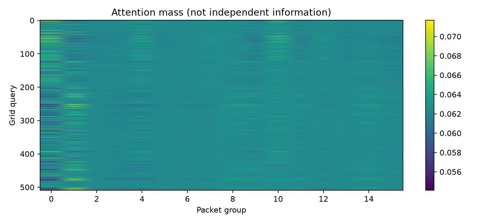
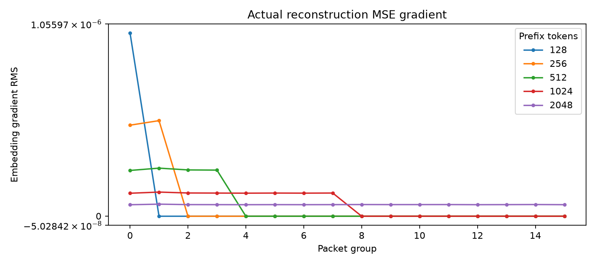
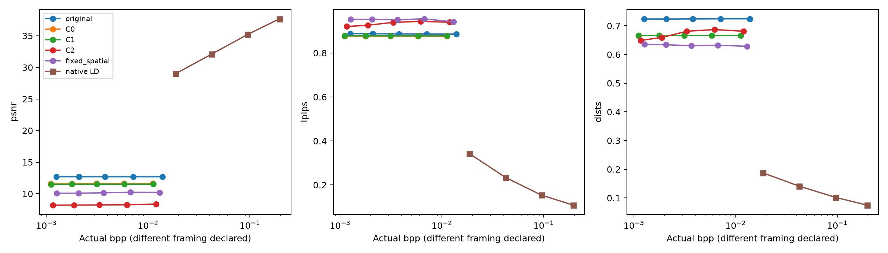

# Prefix Information Utilization 专项验收报告

实际执行了诊断、代码重构、五组训练目标消融、三组 Decoder 消融、有限原生分辨率训练、五条独立1080p序列的真实码流及四个原生LD QP对照。**工程链路通过，研究效果未通过。默认保留原版全局 Softmax；本轮不发布新质量有效模型，不启动大规模正式长训或实时性能推广。**

Nested C1 的2048/128平均PSNR差只有0.022217 dB；区间为正但幅度很小，不能称为显著渐进提升。新聚合器C2的差为0.163736 dB，却以大幅降低基础质量、恶化LPIPS/DISTS为代价，且后缀内容干预不支持有效信息恢复。0.5 dB目标未达到。

## 1. 版本、模型与数据

审查HEAD：`b6dba05933f52dba919438d2af8c1b6e086d14eb`，起始工作区干净。A/B实现提交 `77f5eef`；结果元数据记录各次运行的Git SHA、dirty状态和生产源码SHA256。本报告生成时HEAD为`1a8d73e8ac611ca04c8c6408c1a1ff08b36cec02`，源码SHA256为`3cd225359d08e5b2cd72c2867f664ede273f8d4b6f4bebe496e884bf81f421ee`，最终文档提交在其后。

分析主基线为上轮最终离散模型 `results/optimization_20261115/auxiliary/latest.pt`，SHA256 `856145d2d7e265184f4072559492f2dc5e1d8c9d03e9596f02be0c1465fa8757`，stage3熵/Scorer已训练300步，表示来自此前1000步模型。时间更新的`capacity/learned_512/latest.pt`也实际诊断（256原像素crop、2帧），用于避免遗漏新资产；它不是已验证正式收敛模型。没有使用continuous checkpoint生成码流。原四个候选及四个原始权重的哈希复核均未改变，见`acceptance/original_assets_unchanged.json`；新模型哈希见`checkpoint_manifest.json`。

使用现有Python3.12、PyTorch2.9.1/cu130、H100 PCIe 80GB及官方LD/DMCI权重。没有更改上游CUDA、网络调度或Packet格式。设备未承诺独占。

固定片段训练：MCL-JCV01，源16帧范围内固定seed19取得4帧，256 crop，保留原像素。选择与门槛判断只使用这个固定片段和独立Beauty验证。此后不再根据新增测试调参。

测试：BasketballDrive及官方DAVIS val中的blackswan、bmx-trees、breakdance、camel，共5条独立序列，每条8帧，均1920×1080、没有resize。新增4条通过HTTP range提取、ZIP CRC和SHA核验；与8条官方train内容ID分离。DAVIS图像序列fps取名义30，Basketball取50。只覆盖40帧、5条序列，不能代表完整数据集泛化。

## 2. 实测诊断与根因边界

A主诊断为原生1080p Basketball前4帧，五档真实离散ID；干预共享同一个FrozenFrameContext，每帧只提交一次正常K_ref。替换来源是同一片段另一帧在同一旧历史下的独立诊断编码，不进入正常因果流；相邻帧相关性是该对照的限制。常量控制在所有帧固定合法Code 0，不根据当前视频选码。全部ΔLatent/ΔImage定义为相对正常同长度输出的RMSE。

| 帧型 | 组内Code最少 | 组内Code最多 | 平均组Perplexity | Code输出Embedding方差 | 组内Cosine | Attention/Query范数 |
| --- | --- | --- | --- | --- | --- | --- |
| I | 36 | 49 | 28.490690 | 0.003915 | 0.913117 | 0.408300 |
| P | 50 | 95 | 64.738550 | 0.000302 | 0.993285 | 0.468825 |

Code统计使用共享VQ的project_out输出，明确不含Decoder Position Embedding；另存positioned方差与position cosine。Encoder固定Query仍可导致Code随位置变化，所以仅有不同ID、Perplexity或Embedding方差不能证明视频信息不同。P/P的同位置ID变化与I/P切换分别解释；新补充诊断`acceptance/diagnostics_measured`另标记同帧型比较并记录pre-VQ有效秩。

主根因判断为**多因素共同作用**：Token内容具有高度公共分量，序列没有形成可验证的互补组织；Decoder对P后缀真实内容极弱敏感，固定查询/位置/历史的联合先验占主导；全局归一化稀释单Token梯度是重要限制。不能由这些数据独立量化“固定Query”和“历史”各自的图像贡献。相邻预算在共享前缀上的梯度余弦约0.999，不支持“梯度冲突”为此次主要原因。去除跨组Softmax仍失败，说明归一化并非唯一根因。

## 3. Decoder内容依赖与无内容对照

| 帧型 | 干预 | PSNR | LPIPS | DISTS | ΔImage RMSE | ΔLatent RMSE |
| --- | --- | --- | --- | --- | --- | --- |
| I | original | 12.292028 | 0.814646 | 0.613307 | 0.000000 | 0.000000 |
| I | other_frame | 12.279427 | 0.813190 | 0.613067 | 0.000810 | 0.000918 |
| I | shuffle | 12.261215 | 0.814786 | 0.613467 | 0.002734 | 0.003095 |
| I | constant | 11.609303 | 0.811579 | 0.616216 | 0.049954 | 0.075858 |
| I | all_constant | 11.517260 | 0.835593 | 0.612463 | 0.071026 | 0.101363 |
| P | original | 12.564575 | 0.833620 | 0.675138 | 0.000000 | 0.000000 |
| P | other_frame | 12.564325 | 0.833582 | 0.675169 | 5.142e-05 | 0.000672 |
| P | shuffle | 12.564627 | 0.833616 | 0.675177 | 4.151e-05 | 0.000507 |
| P | constant | 12.515571 | 0.835023 | 0.673564 | 0.003551 | 0.072361 |
| P | all_constant | 12.512172 | 0.834922 | 0.673409 | 0.003847 | 0.078200 |

这些是K=2048诊断，不能纳入正式RD。other_frame/shuffle/constant仅替换K_ref之后；all_constant有意替换全部ID为固定Code 0，单独检验无Token内容。P帧同片段跨帧或打乱后缀时图像变化约4e-5至7e-5；固定Code 0仍能引起约0.003–0.004的图像RMSE，说明Decoder不是完全不读取内容，但正常后缀缺乏有益增量方向。I帧对常量内容显著敏感，不等于后缀组织正确。此前“每帧首码”自适应常量对照未作为最终无内容证据，其原结果保留在`diagnostics/per_frame_constant_control`。所有K及same_frame/base_only完整记录保存在`diagnostics/token_interventions.json`和CSV。

## 4. 注意力与真实位置梯度

旧聚合器新增半段Token获得约0.5注意力总质量，各组近似均匀；这会同时重新分配旧Token权重，不能视为新增信息的独立贡献。固定Query、out(attended)、FFN范数、无位置对照、前缀Grid变化和每个Grid Query的组分布均保存于`attention_mass.json`。

下表为诊断第2个P帧（frame2）的**实际重建MSE autograd Embedding梯度RMS**。未接收位置梯度为0是正确边界；最大预算中单Token梯度约为基础预算的1/16。Query及VQ输入梯度遵循现有VQ的straight-through估计，Embedding梯度来自真实下游重建计算图，均不是从注意力权重推算。完整逐组梯度、方向余弦另见`gradient_by_group.json`。

| 组 | K128 | K256 | K512 | K1024 | K2048 |
| --- | --- | --- | --- | --- | --- |
| 1 | 1.056e-06 | 5.243e-07 | 2.636e-07 | 1.324e-07 | 6.623e-08 |
| 2 | 0.000000 | 5.510e-07 | 2.773e-07 | 1.393e-07 | 6.964e-08 |
| 3 | 0.000000 | 0.000000 | 2.666e-07 | 1.339e-07 | 6.697e-08 |
| 4 | 0.000000 | 0.000000 | 2.653e-07 | 1.332e-07 | 6.665e-08 |
| 5 | 0.000000 | 0.000000 | 0.000000 | 1.325e-07 | 6.627e-08 |
| 6 | 0.000000 | 0.000000 | 0.000000 | 1.334e-07 | 6.674e-08 |
| 7 | 0.000000 | 0.000000 | 0.000000 | 1.325e-07 | 6.630e-08 |
| 8 | 0.000000 | 0.000000 | 0.000000 | 1.333e-07 | 6.668e-08 |
| 9 | 0.000000 | 0.000000 | 0.000000 | 0.000000 | 6.717e-08 |
| 10 | 0.000000 | 0.000000 | 0.000000 | 0.000000 | 6.688e-08 |
| 11 | 0.000000 | 0.000000 | 0.000000 | 0.000000 | 6.679e-08 |
| 12 | 0.000000 | 0.000000 | 0.000000 | 0.000000 | 6.704e-08 |
| 13 | 0.000000 | 0.000000 | 0.000000 | 0.000000 | 6.650e-08 |
| 14 | 0.000000 | 0.000000 | 0.000000 | 0.000000 | 6.670e-08 |
| 15 | 0.000000 | 0.000000 | 0.000000 | 0.000000 | 6.733e-08 |
| 16 | 0.000000 | 0.000000 | 0.000000 | 0.000000 | 6.654e-08 |




## 5. Nested训练的实际消融

| 方案 | 更新 | 帧次 | 训练Base | 训练Max-Base | 1080p验证Base | 1080p验证Max | 验证增益 |
| --- | --- | --- | --- | --- | --- | --- | --- |
| B0 | 100 | 400 | 35.061085 | 0.010313 | 12.702395 | 12.747984 | 0.045589 |
| B1 | 100 | 400 | 35.024544 | 0.012573 | 12.677095 | 12.723620 | 0.046525 |
| B2 | 100 | 400 | 34.992004 | 0.009758 | 12.676868 | 12.726530 | 0.049662 |
| B3 | 100 | 400 | 34.972369 | 0.014929 | 12.659508 | 12.716979 | 0.057471 |
| scheduled | 100 | 400 | 35.019470 | 0.013368 | 12.695813 | 12.740202 | 0.044388 |

B0为旧2–4档采样与双向约束；B1强制端点+随机中间档，保留旧约束；B2增加显式曝光均衡权重（端点0.6、中间1.8）；B3使用单向detach-low约束、margin=0；scheduled前半程等权，后半程曝光均衡。每组相同初始化、数据、100更新、lr=3e-4、骨干和离散VQ。实际预算监督次数保存在comparison.json，等步数不冒充完全等FLOPs。所有分支共享一次完整Encoder/VQ；每档绝对失真仍被监督。为隔离表示问题，训练失真为MSE，VQ权重0.1、单调项0.1，感知训练项及estimated-rate项为0；本轮未完成非零码率权重的联合RD优化。

固定片段PSNR可约35 dB但增益只有0.010–0.015 dB，因此未通过进入正式长训的质量门槛。B4的detached-low残差L2与普通高预算MSE实际值和梯度等价，未发现独立辅助作用，未添加重复目标；证据见`incremental_alignment_equivalence.json`。

## 6. 全局Softmax与共享增量聚合

| 方案 | 更新 | 训练Base | 训练Max | 训练差 | 验证Base | 验证Max | 验证差 |
| --- | --- | --- | --- | --- | --- | --- | --- |
| C0 | 100 | 35.057933 | 35.072219 | 0.014286 | 12.713922 | 12.758643 | 0.044721 |
| C1 | 100 | 34.997824 | 35.013686 | 0.015862 | 12.671033 | 12.725195 | 0.054162 |
| C2 | 100 | 32.180534 | 32.096011 | -0.084523 | 12.109761 | 11.892270 | -0.217491 |

C0为旧聚合+旧目标，C1为旧聚合+Nested均衡/单向目标，C2仅替换聚合方式并采用同一C1目标。三者同一离散初始化、相同100更新和相同片段；GPU bf16不承诺跨进程逐位一致，B0/C0及B3/C1重复测量的小差异均保留。

C2的每个原Packet组使用完全共享的q/kv/out/FFN和194参数内容/顺序gate，累加attention值后进入同一Grid/Latent/LD Decoder。gate为2*sigmoid/sqrt(max_groups)，初始化alpha=1/4，分组尺寸取配置而不硬编码128。没有额外Encoder、增强Decoder、残差流、连续发送特征或预算专属参数。显式迁移仅新增gate.weight/bias，所有可复用参数枚举在migration.json；完整合成后strict=True加载，optimizer未恢复。

不同Model ID绑定`global_softmax_v1`与`shared_progressive_v2`；历史默认配置字段不改变旧身份字节。标准加载和收流严格校验，未添加静默兼容fallback。

## 7. 独立1080p绝对质量与真实RD

每条序列独立重置收发状态，EncodeOnce、真实rANS Packet、离散ID lookup、完整LD/DMCI和K_ref闭环，实际header/CRC/rANS/application length framing均计入码率。全部模型的熵表重新使用相同8条官方train中的32帧、512 crop作加一平滑多项式MLE，没有使用验证/测试Token；原checkpoint不变。Scorer未随这些表示重新拟合，预测仅保留为接口标签，未用于RD选择或准确率声明。FixedSpatial为已有独立训练对照，优化历史不同，不能把它当作唯一结构差异的严格消融。

| 模型 | K | PSNR | MS-SSIM | LPIPS | DISTS | MSE | 实际bpp | 实际kbps |
| --- | --- | --- | --- | --- | --- | --- | --- | --- |
| original | 128 | 12.697560 | 0.370583 | 0.888144 | 0.723678 | 0.054553 | 0.001259 | 88.198000 |
| original | 256 | 12.694819 | 0.370754 | 0.887397 | 0.723483 | 0.054583 | 0.002095 | 146.720000 |
| original | 512 | 12.693668 | 0.370832 | 0.886676 | 0.723867 | 0.054600 | 0.003782 | 264.652000 |
| original | 1024 | 12.694743 | 0.370873 | 0.886101 | 0.724248 | 0.054587 | 0.007134 | 498.992000 |
| original | 2048 | 12.694768 | 0.370933 | 0.885798 | 0.724315 | 0.054586 | 0.013853 | 968.868000 |
| C0 | 128 | 11.601921 | 0.348674 | 0.876495 | 0.665853 | 0.071786 | 0.001109 | 78.268000 |
| C0 | 256 | 11.608243 | 0.348680 | 0.876314 | 0.665991 | 0.071697 | 0.001779 | 125.482000 |
| C0 | 512 | 11.616871 | 0.348471 | 0.876433 | 0.665969 | 0.071552 | 0.003124 | 220.426000 |
| C0 | 1024 | 11.613582 | 0.348513 | 0.876233 | 0.666053 | 0.071606 | 0.005820 | 410.752000 |
| C0 | 2048 | 11.616698 | 0.348456 | 0.876146 | 0.666148 | 0.071552 | 0.011204 | 790.770000 |
| C1 | 128 | 11.495743 | 0.348849 | 0.878418 | 0.666045 | 0.073586 | 0.001112 | 78.426000 |
| C1 | 256 | 11.507715 | 0.348837 | 0.878276 | 0.666155 | 0.073403 | 0.001783 | 125.756000 |
| C1 | 512 | 11.517303 | 0.348576 | 0.878326 | 0.666205 | 0.073239 | 0.003137 | 221.306000 |
| C1 | 1024 | 11.514710 | 0.348647 | 0.878082 | 0.666272 | 0.073281 | 0.005847 | 412.456000 |
| C1 | 2048 | 11.517959 | 0.348603 | 0.877982 | 0.666378 | 0.073226 | 0.011250 | 793.690000 |
| C2 | 128 | 8.201230 | 0.328234 | 0.920354 | 0.648835 | 0.161719 | 0.001163 | 81.722000 |
| C2 | 256 | 8.209479 | 0.328123 | 0.926316 | 0.659265 | 0.161322 | 0.001879 | 131.796000 |
| C2 | 512 | 8.235599 | 0.326375 | 0.939196 | 0.681020 | 0.160247 | 0.003320 | 232.622000 |
| C2 | 1024 | 8.259141 | 0.322275 | 0.943692 | 0.686770 | 0.159469 | 0.006203 | 434.374000 |
| C2 | 2048 | 8.364966 | 0.318378 | 0.939865 | 0.681016 | 0.156192 | 0.011962 | 837.276000 |
| fixed_spatial | 128 | 10.088601 | 0.306691 | 0.953413 | 0.635270 | 0.116464 | 0.001269 | 89.344000 |
| fixed_spatial | 256 | 10.093539 | 0.306921 | 0.952716 | 0.633836 | 0.116301 | 0.002073 | 146.198000 |
| fixed_spatial | 512 | 10.151135 | 0.310247 | 0.951182 | 0.630930 | 0.114809 | 0.003669 | 260.044000 |
| fixed_spatial | 1024 | 10.235740 | 0.310034 | 0.955445 | 0.632028 | 0.112472 | 0.006703 | 477.946000 |
| fixed_spatial | 2048 | 10.215604 | 0.313263 | 0.941266 | 0.628548 | 0.112690 | 0.012991 | 928.052000 |

I/P分别及整体所有指标见`full_1080p/rd_by_frame_type.csv`，逐帧实际字节、状态指纹和缓存误差保存在各evaluation.json。Basketball旧基线128/2048实测13.0358/13.0067 dB，复现原问题。C0/C1的小片段过拟合使多场景平均质量退步，不能推荐这些checkpoint取代原模型。

## 8. 渐进收益及统计可靠性

| 模型 | Base PSNR | Max PSNR | 平均ΔPSNR | 中位ΔPSNR | 按序列bootstrap 95% CI | PSNR倒退帧比例 | 平均ΔLPIPS | 平均ΔDISTS |
| --- | --- | --- | --- | --- | --- | --- | --- | --- |
| original | 12.697560 | 12.694768 | -0.002792 | -0.000351 | [-0.017619, 0.010375] | 0.625000 | -0.002346 | 0.000637 |
| C0 | 11.601921 | 11.616698 | 0.014777 | 0.003811 | [0.009046, 0.020417] | 0.000000 | -0.000348 | 0.000295 |
| C1 | 11.495743 | 11.517959 | 0.022217 | 0.003784 | [0.014567, 0.029936] | 0.000000 | -0.000436 | 0.000333 |
| C2 | 8.201230 | 8.364966 | 0.163736 | 0.181611 | [0.046558, 0.308112] | 0.150000 | 0.019511 | 0.032181 |
| fixed_spatial | 10.088601 | 10.215604 | 0.127003 | 0.002779 | [0.004945, 0.276421] | 0.450000 | -0.012146 | -0.006722 |

采用独立视频为主要单位的2000次bootstrap，seed19，每次保留该视频全部连续帧。CI为5条序列的经验区间，样本小且没有多训练seed验证，不能视作完整benchmark结论。相邻预算全部gain、三指标的均值/中位/改善比例/倒退比例/区间在summary.json；不能把首尾都正误解为所有相邻档单调。单序列Beauty的CI为null。C1小幅正差不能替代同码率绝对质量；C2增加Token的正差同时伴随感知退步及严重基础损害，未满足信息利用门槛。

## 9. 新聚合器内容因果干预

Nested C1另作两帧原生1080p干预，同样固定Code 0。它的P帧同片段跨帧/打乱后缀只引起约9e-5/2e-5图像RMSE；I帧正常后缀也未优于全部对照。该小样本结果不支持把其0.022 dB解释为可靠的增量内容恢复。

| C1帧型 | 干预 | PSNR | LPIPS | DISTS | ΔImage RMSE |
| --- | --- | --- | --- | --- | --- |
| I | original | 13.329599 | 0.855184 | 0.573850 | 0.000000 |
| I | other_frame | 13.335438 | 0.855513 | 0.573933 | 0.000741 |
| I | shuffle | 13.355611 | 0.857099 | 0.574291 | 0.002654 |
| I | constant | 13.400528 | 0.960204 | 0.591728 | 0.076738 |
| I | all_constant | 13.127675 | 1.058701 | 0.595734 | 0.122151 |
| P | original | 13.214030 | 0.802260 | 0.601032 | 0.000000 |
| P | other_frame | 13.214266 | 0.802153 | 0.600835 | 9.159e-05 |
| P | shuffle | 13.214108 | 0.802270 | 0.601049 | 2.442e-05 |
| P | constant | 13.210596 | 0.801603 | 0.599394 | 0.002189 |
| P | all_constant | 13.210517 | 0.801515 | 0.599179 | 0.002335 |

C2结果如下：

| 帧型 | 干预 | PSNR | LPIPS | DISTS | ΔImage RMSE |
| --- | --- | --- | --- | --- | --- |
| I | original | 7.602554 | 1.183473 | 0.676379 | 0.000000 |
| I | other_frame | 7.612185 | 1.183648 | 0.675945 | 0.001873 |
| I | shuffle | 7.638173 | 1.185133 | 0.676672 | 0.007164 |
| I | constant | 11.017130 | 1.101607 | 0.632114 | 0.534495 |
| I | all_constant | 10.641539 | 1.116291 | 0.638345 | 0.554381 |
| P | original | 7.969629 | 0.899560 | 0.645203 | 0.000000 |
| P | other_frame | 7.968544 | 0.899808 | 0.645199 | 0.000193 |
| P | shuffle | 7.969651 | 0.899547 | 0.645215 | 5.132e-05 |
| P | constant | 7.965509 | 0.901778 | 0.645325 | 0.002236 |
| P | all_constant | 7.964503 | 0.901952 | 0.645713 | 0.002362 |

该表为C2同样的Basketball四帧诊断。I帧把后缀或全部ID改为常量可大幅改善PSNR，P帧打乱后缀几乎无效。相似公共分量按组累积导致K本身改变输出，不能把长度曲线改善当作内容恢复证据。C2没有通过采用门槛，保留为有证据的失败消融；原全局Softmax维持默认路径。

## 10. 原生LD与码率边界

| QP | 帧数 | PSNR | MS-SSIM | LPIPS | DISTS | bpp | kbps |
| --- | --- | --- | --- | --- | --- | --- | --- |
| 16 | 40 | 28.986635 | 0.897010 | 0.343123 | 0.187299 | 0.018582 | 1237.090000 |
| 32 | 40 | 32.119597 | 0.946719 | 0.233966 | 0.141020 | 0.042301 | 2804.056000 |
| 48 | 40 | 35.230423 | 0.973501 | 0.153704 | 0.102238 | 0.095463 | 6334.186000 |
| 63 | 40 | 37.692775 | 0.984929 | 0.108380 | 0.075055 | 0.195589 | 13094.570000 |

原生字节为SPS/IP，CP字节另含其应用framing，均明确列出，未假设物理网络头。四个QP的质量及码率区间与CP都不重叠，BD-rate=null，不作外推。CP间非单调曲线或无共同质量区间也返回不可计算；没有以排序掩盖质量倒退。绝对质量差距不能由更低bpp包装为压缩优势。



## 11. 实际训练量、门槛与性能边界

五个B组共500更新/2000帧次，三个C组共300更新/1200帧次。正式长训门槛失败后，只对C0/C1/C2各做512 crop×4帧、720原像素crop×8帧、原生1080×16帧三阶段，每阶段2更新，共18更新/168帧次，用8条官方train核对形状、梯度及基础闭环；每次实际选中的源/窗口在train.jsonl，不能声称18步覆盖全部训练集。总研究/原生检查818更新/3368帧次；另有CLI验收3更新/6帧次，不计入研究效果。所有正式消融teacher=none，未用异历史P latent。

没有因失败而无限加步数。正式512→720→1080大规模收敛、联合RD微调、多训练seed仍未执行。原生检查的微量更新没有加入最终等100步RD比较，也没有据此改选测试模型。

| 模型 | 编码全流程ms | 接收基础/提交ms | 已有基础后最大完整解码ms | 缓存追加/聚合ms | 缓存追加及完整后端ms | 最大缓存图像误差 |
| --- | --- | --- | --- | --- | --- | --- |
| original | 32.261357 | 14.164921 | 10.951615 | 1.163915 | 11.081834 | 0.000000 |
| C0 | 30.311815 | 14.055758 | 10.902272 | 1.090026 | 11.005005 | 0.000000 |
| C1 | 36.369912 | 16.451065 | 13.312839 | 1.803585 | 13.412181 | 0.000000 |
| C2 | 36.489596 | 16.580413 | 18.546789 | 4.134265 | 15.590428 | 0.000000 |
| fixed_spatial | 31.482235 | 14.488448 | 11.766601 | 1.244271 | 11.236493 | 0.000000 |

上述耗时取自实际RD评估，穿插感知网络且设备共享，不是独占暖机性能对照，不能相加或换算端到端FPS。固定100步的训练耗时分别见各summary.json。新缓存只投影新增组，单元行为检查直接计数KV调用；不会因显示多个K而重新编码。每个显示点仍需完整LD后端，未声称LD本身增量化。LearnedQuery/VQ/纯attention的无插桩分项及完整暖机FPS本轮未推广；coverage单帧benchmark只验证入口，其插桩FPS不引用为性能。

完整与缓存均按同一Packet顺序作FP64加法；实际C2两帧全部16档cache误差0。独立逆序加法诊断：FP64 Grid/Image最大差0；FP32 Grid差1.505e-6、图像差0.00373149，不能改用FP32作为严格默认。证据见`performance/accumulation_order.json`。这不是所有输入的误差上界。

## 12. 工程验收与质量工具

145项最终测试结果见`acceptance/pytest_final.log`；真实旧模型32帧流成功解码且保留Model ID `d31f2c342136a7ce4e38d654ebb79c1c`。新增Model ID拒绝错配，EncodeOnce前缀、仅已到达Token、统一Decoder、单次基础提交、增强不影响后续参考、缓存一致性及全视频固定常量Code均有行为测试。旧身份测试按新增默认字段的历史序列化规则更新，并由真实历史文件独立核验。

ub-mode的命名crapper/dryer/mutator不可用，替代为radon+coverage+AST相似度和隔离AST行为变异。覆盖率88.49%，最大生产复杂度9，CRAP≥10条目0，AST相似度≥0.8条目0。19/19关键行为变异被测试杀死，涵盖单向detach、端点、组softmax轴及追加顺序。详见`acceptance/quality_audit.json`。初次全套中旧预期哈希测试失败的日志也保留，没有隐瞒测试调整。工具插桩不进入性能结论。

## 13. 最终采用与未完成目标

工程实现正确：通过。训练能够更新并在固定片段收敛：通过局部证据，非正式多场景收敛。Token内容被有效利用：I帧有内容敏感性，P后缀及增量方向未通过。独立视频有效渐进质量：未通过，Nested只有约0.022 dB且绝对质量退步。端到端实时性能：本轮不作新达标声明。

采用可复现诊断、显式Nested/权重/单向约束、按序列统计及严格模型版本/缓存接口；它们均不等于推荐新checkpoint。全局Softmax继续作为默认模型，Nested保持研究配置，C2只保留必要失败消融。没有固定空间主方案、独立增强流、连续旁路、损害低预算来制造差值的训练目标或静默fallback。旧模型、数据和失败记录未删除。

## 14. 直接复现

在当前仓库及现有`.venv-native`、官方权重、原始视频可用的条件下运行：

```bash
cd /home/whisperliang/CP-AdapTok
.venv-native/bin/python -m scripts.diagnose_prefix_utilization
.venv-native/bin/python -m scripts.compare_prefix_training --steps 100
.venv-native/bin/python -m scripts.compare_prefix_decoders --steps 100
.venv-native/bin/python -m scripts.prepare_prefix_validation --sequences 4 --frames 16
.venv-native/bin/python -m scripts.run_prefix_validation --engineering-steps 2
.venv-native/bin/python -m scripts.measure_prefix_accumulation
.venv-native/bin/python -m scripts.verify_historical_stream \
  --source results/pretrained_long_eval/eval/basketball \
  --output results/prefix_utilization/acceptance/historical_stream.json
.venv-native/bin/python -m pytest cp_adaptok/tests -q
.venv-native/bin/python -m scripts.mutation_check --output results/prefix_utilization/acceptance/mutations
.venv-native/bin/python -m scripts.build_prefix_utilization_report
```

新实验均在`results/prefix_utilization`，checkpoint在本地保留；Git保存关键JSON/CSV/图、配置及报告，未将大权重或视频打入仓库。机器可读总表`summary.json`、操作记录`docs/prefix_utilization_work_log.md`以及独立训练/验证/干预原始记录可逐项审查。结果不支持的新方案没有被推荐为生产默认。
