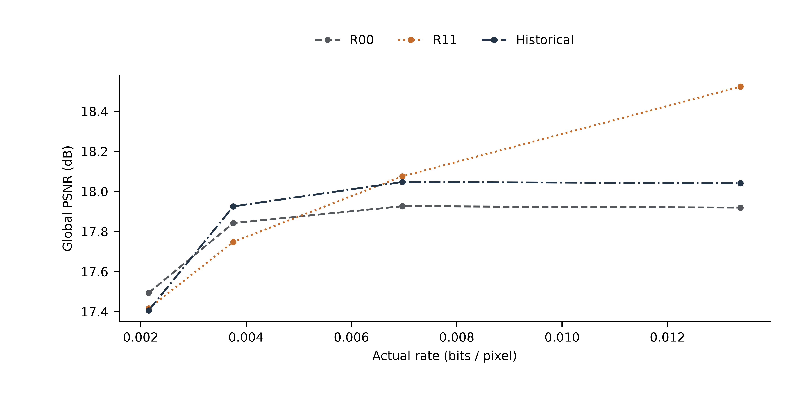
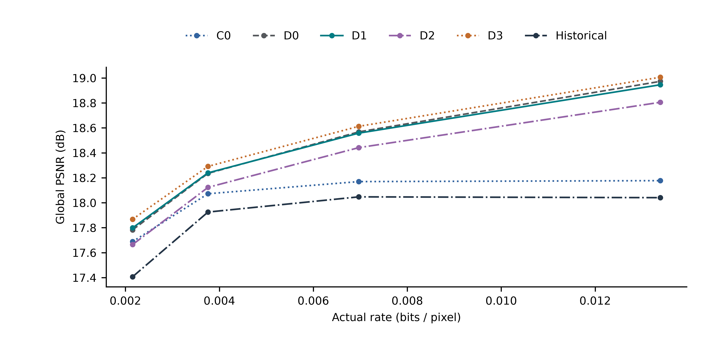
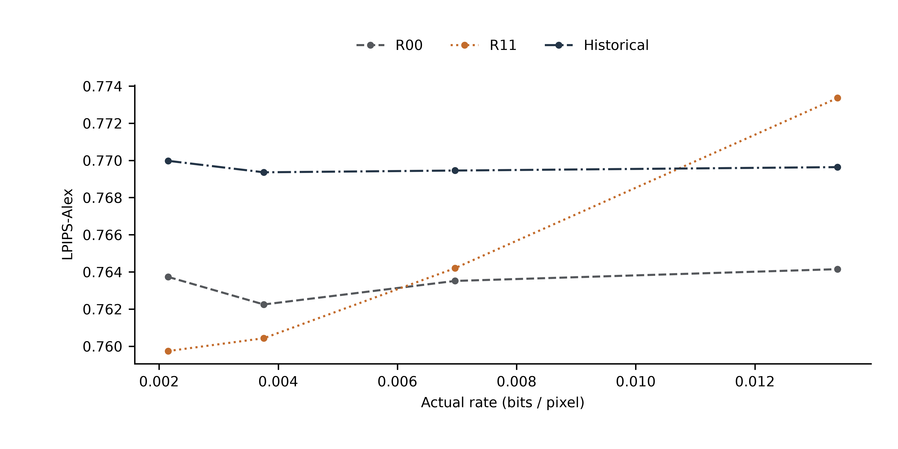
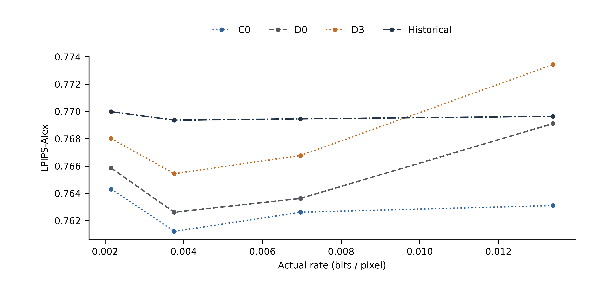
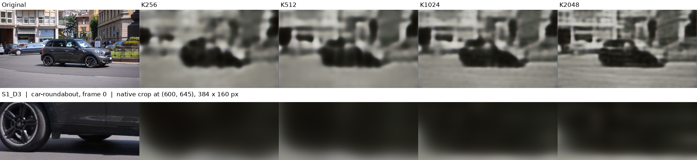
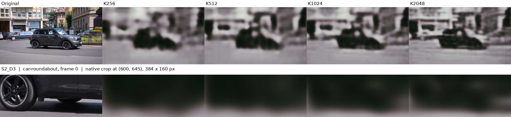

# AdapTok-HR 新增 Fine 后缀实验报告

300 步筛选选中了 **R11**。两种子均确认后缀携带画面内容。1000 步时 K2048 相对 K1024 的同状态增益依种子顺序为 **+0.354 / +0.312 dB**，独立闭环为 **+0.447 / +0.383 dB**。每个 K2048 码流包均为 3470 字节。

Decoder 阶段按预登记排序复验 **D3**。相对各自同步数对照 C0，K2048 的 PSNR 提高 +0.829 / +0.246 dB，LPIPS 变化 +0.0278 / +0.0103，最终未通过双种子综合画质门槛。两种子 64 帧 K2048 原路径的三次收发联合吞吐中位数分别为 26.43 / 26.38 FPS。

原结构对照的第一个种子使用 1 个后缀码字。第二个种子使用 5 个，也通过两类内容干预，同状态增益为 0.145 dB。R11 相对各自对照额外提高同状态预算增益 +0.356 / +0.167 dB。初始模型、数据与预算种子一起变化，本实验无法进一步区分三者的贡献。

R00 为 A1 对照，R10 加入局部空间残差，R01 加入训练期后缀监督，R11 同时启用两项。主实验基于 ab0b85b，固定共享球面码本、逐预算 VQ、四帧展开和 TBPTT2。K1024 已有 379 个 Fine 位置，干预仅作用于随后新增的 1024 个位置。

## 实际码流与内容干预

每个预算有独立的收发模型与闭环。另用同一 K2048 历史重放四档真实前缀。打乱后缀测位置贡献，同位置跨视频替换测内容相关性，所有干预沿用原参考。跨来源仅比较三源共有帧号。短验证为 24 帧，长验证为 174 帧，其中同位置跨视频替换使用 150 帧。

| 配置 | 步数 | 验证帧 | 后缀码数 / perplexity / 最大占比 | 置乱 ΔMSE | 跨视频 ΔMSE | 同向来源 | 同状态 ΔdB | 闭环 ΔdB |
|---|---:|---:|---:|---:|---:|---:|---:|---:|
| S1_R00 | 300 | 24 | 1 / 1.00 / 100.00% | 0.00000000 | 0.00000000 | 0/3 | +0.00187 | +0.00304 |
| S1_R01 | 300 | 24 | 1 / 1.00 / 100.00% | 0.00000000 | 0.00000000 | 0/3 | -0.00165 | -0.00597 |
| S1_R10 | 300 | 24 | 1166 / 12.27 / 38.46% | 0.00107643 | 0.00114847 | 3/3 | +0.13034 | +0.15074 |
| S1_R11 | 300 | 24 | 1996 / 224.96 / 7.90% | 0.00120559 | 0.00131056 | 3/3 | +0.15064 | +0.17777 |
| S1_R00 | 1000 | 174 | 1 / 1.00 / 100.00% | 0.00000000 | 0.00000000 | 0/3 | -0.00149 | -0.00707 |
| S1_R11 | 1000 | 174 | 3095 / 176.81 / 7.91% | 0.00160430 | 0.00176615 | 3/3 | +0.35413 | +0.44731 |
| S2_R00 | 1000 | 174 | 5 / 2.69 / 53.02% | 0.00070936 | 0.00068229 | 3/3 | +0.14519 | +0.16959 |
| S2_R11 | 1000 | 174 | 2938 / 131.16 / 5.27% | 0.00148152 | 0.00169161 | 3/3 | +0.31172 | +0.38328 |
| S1_C0 | 1300 | 174 | 2 / 1.00 / 100.00% | 0.00000004 | 0.00000004 | 1/3 | +0.00835 | +0.00753 |
| S1_D0 | 1300 | 174 | 2700 / 162.62 / 6.45% | 0.00146801 | 0.00159726 | 3/3 | +0.33739 | +0.40487 |
| S1_D1 | 1300 | 174 | 2709 / 161.62 / 6.34% | 0.00146187 | 0.00160292 | 3/3 | +0.32952 | +0.38765 |
| S1_D2 | 1300 | 174 | 2704 / 157.92 / 6.57% | 0.00137759 | 0.00153487 | 3/3 | +0.30703 | +0.36337 |
| S1_D3 | 1300 | 174 | 2718 / 162.63 / 6.36% | 0.00142077 | 0.00155205 | 3/3 | +0.33231 | +0.39333 |
| S2_C0 | 1300 | 174 | 9 / 3.21 / 41.83% | 0.00113025 | 0.00104410 | 3/3 | +0.24407 | +0.29568 |
| S2_D0 | 1300 | 174 | 2408 / 110.44 / 6.45% | 0.00137929 | 0.00149112 | 3/3 | +0.30082 | +0.36601 |
| S2_D3 | 1300 | 174 | 2415 / 107.31 / 6.85% | 0.00126505 | 0.00145512 | 3/3 | +0.30244 | +0.34975 |

### 同步数两因素对照

下表在另一因素固定时单独切换一项，均为首种子 300 步的配对差值。

| 新组 − 对照 | 同状态预算增益变化 (dB) | K2048 闭环 ΔPSNR | ΔLPIPS | ΔDISTS |
|---|---:|---:|---:|---:|
| R10 − R00 | +0.12847 | +0.21515 | -0.002201 | +0.001261 |
| R11 − R01 | +0.15229 | +0.13251 | +0.019137 | +0.001233 |
| R01 − R00 | -0.00352 | -0.05778 | -0.003309 | +0.001860 |
| R11 − R10 | +0.02030 | -0.14042 | +0.018029 | +0.001832 |

在本轮同步数的四组筛选中，保留原投影的 R00、R01 后缀均为单码。扣除 S32 投影的局部均值后，R10 和 R11 的真实后缀均通过了内容干预。因此局部空间分量在这个种子和训练长度下足以打破单码状态，尚不能把它推广为所有种子的唯一成因。前一轮已有冻结权重、连续旁路及预算感知和分层码本的独立对照。 [第一轮表征诊断与负结果](../../../docs/adaptok_hr_fine_recovery_report.md)

## 多预算独立闭环画质

| 配置 | 步数 | K | 全局 PSNR (dB) | LPIPS | DISTS | 边缘 MSE | 高频 L1 | 实际 bpp |
|---|---:|---:|---:|---:|---:|---:|---:|---:|
| 历史 HR | 1000 | 256 | 17.40682 | 0.769978 | 0.653209 | — | — | 0.00215278 |
| 历史 HR | 1000 | 512 | 17.92535 | 0.769361 | 0.643037 | — | — | 0.00375772 |
| 历史 HR | 1000 | 1024 | 18.04722 | 0.769455 | 0.640759 | — | — | 0.00696759 |
| 历史 HR | 1000 | 2048 | 18.04080 | 0.769639 | 0.641297 | — | — | 0.01338735 |
| S1_R00 | 300 | 256 | 15.34253 | 0.772725 | 0.700929 | 0.005061 | 0.041599 | 0.00215278 |
| S1_R00 | 300 | 512 | 15.34608 | 0.772655 | 0.701259 | 0.005064 | 0.041609 | 0.00375772 |
| S1_R00 | 300 | 1024 | 15.34570 | 0.772229 | 0.701339 | 0.005055 | 0.041564 | 0.00696759 |
| S1_R00 | 300 | 2048 | 15.34873 | 0.772638 | 0.701501 | 0.005041 | 0.041457 | 0.01338735 |
| S1_R01 | 300 | 256 | 15.29982 | 0.769541 | 0.703109 | 0.004946 | 0.039215 | 0.00215278 |
| S1_R01 | 300 | 512 | 15.30271 | 0.769199 | 0.703538 | 0.004951 | 0.039102 | 0.00375772 |
| S1_R01 | 300 | 1024 | 15.29692 | 0.768973 | 0.703988 | 0.004941 | 0.039004 | 0.00696759 |
| S1_R01 | 300 | 2048 | 15.29095 | 0.769329 | 0.703361 | 0.004925 | 0.038946 | 0.01338735 |
| S1_R10 | 300 | 256 | 15.35497 | 0.767822 | 0.711388 | 0.005178 | 0.043423 | 0.00215278 |
| S1_R10 | 300 | 512 | 15.35383 | 0.767976 | 0.711079 | 0.005192 | 0.043404 | 0.00375772 |
| S1_R10 | 300 | 1024 | 15.41315 | 0.768934 | 0.709092 | 0.005218 | 0.043512 | 0.00696759 |
| S1_R10 | 300 | 2048 | 15.56388 | 0.770437 | 0.702762 | 0.005223 | 0.043520 | 0.01338735 |
| S1_R11 | 300 | 256 | 15.15509 | 0.783523 | 0.711695 | 0.004730 | 0.037958 | 0.00215278 |
| S1_R11 | 300 | 512 | 15.16006 | 0.784101 | 0.711357 | 0.004701 | 0.037855 | 0.00375772 |
| S1_R11 | 300 | 1024 | 15.24569 | 0.785848 | 0.709288 | 0.004631 | 0.037808 | 0.00696759 |
| S1_R11 | 300 | 2048 | 15.42346 | 0.788466 | 0.704594 | 0.004634 | 0.038126 | 0.01338735 |
| S1_R00 | 1000 | 256 | 17.49439 | 0.783718 | 0.651129 | 0.002876 | 0.027619 | 0.00215278 |
| S1_R00 | 1000 | 512 | 17.84207 | 0.782644 | 0.642953 | 0.002879 | 0.027638 | 0.00375772 |
| S1_R00 | 1000 | 1024 | 17.92647 | 0.782205 | 0.640567 | 0.002876 | 0.027648 | 0.00696759 |
| S1_R00 | 1000 | 2048 | 17.91939 | 0.782357 | 0.640789 | 0.002882 | 0.027615 | 0.01338735 |
| S1_R11 | 1000 | 256 | 17.41652 | 0.787515 | 0.648431 | 0.003024 | 0.027174 | 0.00215278 |
| S1_R11 | 1000 | 512 | 17.74780 | 0.786767 | 0.640954 | 0.003014 | 0.027134 | 0.00375772 |
| S1_R11 | 1000 | 1024 | 18.07558 | 0.790341 | 0.635396 | 0.003007 | 0.027209 | 0.00696759 |
| S1_R11 | 1000 | 2048 | 18.52289 | 0.798579 | 0.622518 | 0.002978 | 0.027279 | 0.01338735 |
| S2_R00 | 1000 | 256 | 17.42094 | 0.763730 | 0.636676 | 0.003334 | 0.028680 | 0.00215278 |
| S2_R00 | 1000 | 512 | 17.80606 | 0.762248 | 0.631498 | 0.003277 | 0.028394 | 0.00375772 |
| S2_R00 | 1000 | 1024 | 17.97389 | 0.763514 | 0.628715 | 0.003277 | 0.028435 | 0.00696759 |
| S2_R00 | 1000 | 2048 | 18.14348 | 0.764148 | 0.625125 | 0.003281 | 0.028536 | 0.01338735 |
| S2_R11 | 1000 | 256 | 17.43754 | 0.759741 | 0.651545 | 0.003258 | 0.029263 | 0.00215278 |
| S2_R11 | 1000 | 512 | 17.75068 | 0.760431 | 0.648762 | 0.003176 | 0.028825 | 0.00375772 |
| S2_R11 | 1000 | 1024 | 18.02862 | 0.764203 | 0.643896 | 0.003153 | 0.028655 | 0.00696759 |
| S2_R11 | 1000 | 2048 | 18.41189 | 0.773361 | 0.629070 | 0.003163 | 0.028683 | 0.01338735 |
| S1_C0 | 1300 | 256 | 17.68832 | 0.775462 | 0.642080 | 0.002039 | 0.023809 | 0.00215278 |
| S1_C0 | 1300 | 512 | 18.07216 | 0.775763 | 0.632752 | 0.002046 | 0.023584 | 0.00375772 |
| S1_C0 | 1300 | 1024 | 18.16953 | 0.775401 | 0.630687 | 0.002042 | 0.023532 | 0.00696759 |
| S1_C0 | 1300 | 2048 | 18.17706 | 0.775329 | 0.631124 | 0.002037 | 0.023556 | 0.01338735 |
| S1_D0 | 1300 | 256 | 17.78270 | 0.789211 | 0.638315 | 0.002153 | 0.024193 | 0.00215278 |
| S1_D0 | 1300 | 512 | 18.23558 | 0.786696 | 0.628684 | 0.002108 | 0.023575 | 0.00375772 |
| S1_D0 | 1300 | 1024 | 18.56801 | 0.789083 | 0.620468 | 0.002093 | 0.023427 | 0.00696759 |
| S1_D0 | 1300 | 2048 | 18.97289 | 0.797971 | 0.605937 | 0.002124 | 0.023571 | 0.01338735 |
| S1_D1 | 1300 | 256 | 17.79859 | 0.789779 | 0.638206 | 0.002063 | 0.024018 | 0.00215278 |
| S1_D1 | 1300 | 512 | 18.23949 | 0.787151 | 0.628478 | 0.002045 | 0.023604 | 0.00375772 |
| S1_D1 | 1300 | 1024 | 18.55803 | 0.790250 | 0.620542 | 0.002038 | 0.023507 | 0.00696759 |
| S1_D1 | 1300 | 2048 | 18.94567 | 0.800078 | 0.606434 | 0.002061 | 0.023608 | 0.01338735 |
| S1_D2 | 1300 | 256 | 17.66476 | 0.802099 | 0.634076 | 0.001730 | 0.019193 | 0.00215278 |
| S1_D2 | 1300 | 512 | 18.12318 | 0.797519 | 0.623113 | 0.001721 | 0.018999 | 0.00375772 |
| S1_D2 | 1300 | 1024 | 18.44174 | 0.799602 | 0.615079 | 0.001716 | 0.019020 | 0.00696759 |
| S1_D2 | 1300 | 2048 | 18.80511 | 0.807390 | 0.600781 | 0.001744 | 0.019301 | 0.01338735 |
| S1_D3 | 1300 | 256 | 17.86760 | 0.797921 | 0.632947 | 0.001787 | 0.019665 | 0.00215278 |
| S1_D3 | 1300 | 512 | 18.29155 | 0.794101 | 0.622611 | 0.001765 | 0.019270 | 0.00375772 |
| S1_D3 | 1300 | 1024 | 18.61256 | 0.795866 | 0.614402 | 0.001762 | 0.019221 | 0.00696759 |
| S1_D3 | 1300 | 2048 | 19.00589 | 0.803121 | 0.599636 | 0.001799 | 0.019521 | 0.01338735 |
| S2_C0 | 1300 | 256 | 17.25947 | 0.764301 | 0.630026 | 0.002485 | 0.024138 | 0.00215278 |
| S2_C0 | 1300 | 512 | 17.82158 | 0.761211 | 0.620546 | 0.002464 | 0.024217 | 0.00375772 |
| S2_C0 | 1300 | 1024 | 18.08383 | 0.762617 | 0.614190 | 0.002473 | 0.024367 | 0.00696759 |
| S2_C0 | 1300 | 2048 | 18.37950 | 0.763105 | 0.605523 | 0.002471 | 0.024515 | 0.01338735 |
| S2_D0 | 1300 | 256 | 17.08603 | 0.765857 | 0.630572 | 0.002458 | 0.024234 | 0.00215278 |
| S2_D0 | 1300 | 512 | 17.62662 | 0.762617 | 0.621316 | 0.002418 | 0.024126 | 0.00375772 |
| S2_D0 | 1300 | 1024 | 17.94974 | 0.763628 | 0.613584 | 0.002419 | 0.024229 | 0.00696759 |
| S2_D0 | 1300 | 2048 | 18.31575 | 0.769112 | 0.599756 | 0.002433 | 0.024473 | 0.01338735 |
| S2_D3 | 1300 | 256 | 17.57311 | 0.768017 | 0.620389 | 0.002133 | 0.022523 | 0.00215278 |
| S2_D3 | 1300 | 512 | 17.97601 | 0.765442 | 0.611037 | 0.002106 | 0.022272 | 0.00375772 |
| S2_D3 | 1300 | 1024 | 18.27544 | 0.766771 | 0.602520 | 0.002113 | 0.022396 | 0.00696759 |
| S2_D3 | 1300 | 2048 | 18.62519 | 0.773429 | 0.588573 | 0.002140 | 0.022696 | 0.01338735 |

## 双种子与采用条件

按每个种子的同步数对照逐档保护 K256、K512、K1024，所有预算按相同输入帧 SHA256 配对。晚期取每源从帧 48 开始的相同帧。PSNR 容差 0.05 dB，LPIPS 与 DISTS 容差各 0.005。

| 种子 | 内容 | 同状态 ≥0.10 dB | 闭环增益 | 感知随预算改善 | 绝对三指标 | 低预算及晚期 | 包长 |
|---|---:|---:|---:|---:|---:|---:|---:|
| 1 | 通过 | 通过 | 通过 | 未过 | 未过 | 未过 | 通过 |
| 2 | 通过 | 通过 | 通过 | 未过 | 未过 | 未过 | 通过 |

### 低预算及晚期相对同种子对照的差值

| 种子 | 预算 / 帧段 | ΔPSNR | ΔLPIPS | ΔDISTS |
|---|---|---:|---:|---:|
| 1 | 256 | -0.07788 | +0.003798 | -0.002698 |
| 1 | 512 | -0.09427 | +0.004123 | -0.001999 |
| 1 | 1024 | +0.14912 | +0.008136 | -0.005170 |
| 1 | late_2048 | +0.54347 | +0.021994 | -0.012020 |
| 2 | 256 | +0.01660 | -0.003989 | +0.014869 |
| 2 | 512 | -0.05538 | -0.001816 | +0.017264 |
| 2 | 1024 | +0.05472 | +0.000689 | +0.015181 |
| 2 | late_2048 | +0.23813 | +0.005479 | +0.013350 |

## 冻结 Train 首帧的早期表征

同一 bear I 帧、K2048，从真实离散前向取梯度范数。后缀监督梯度包含配置权重。

| 配置 | 步 | 新增位置码数 | 位置平均余弦 | 重建梯度 | 辅助梯度 |
|---|---:|---:|---:|---:|---:|
| S1_R00 | 0 | 7 | 0.984116 | 0.0001601104 | 0 |
| S1_R00 | 10 | 1 | 0.989710 | 4.905876e-05 | 0 |
| S1_R00 | 25 | 1 | 0.995476 | 5.292542e-05 | 0 |
| S1_R00 | 100 | 1 | 0.985498 | 0.0001003553 | 0 |
| S1_R00 | 300 | 1 | 0.983529 | 0.0002524611 | 0 |
| S1_R00 | 1000 | 1 | 0.984754 | 0.0002720871 | 0 |
| S1_R01 | 0 | 7 | 0.984116 | 0.0001601104 | 0.0005504083 |
| S1_R01 | 10 | 1 | 0.989653 | 4.898869e-05 | 0.0005402454 |
| S1_R01 | 25 | 1 | 0.995366 | 5.357943e-05 | 0.0005406105 |
| S1_R01 | 100 | 1 | 0.983665 | 0.0001030677 | 0.0005395421 |
| S1_R01 | 300 | 1 | 0.973588 | 0.000263665 | 0.0005353809 |
| S1_R10 | 0 | 741 | -0.000412 | 0.0001571624 | 0 |
| S1_R10 | 10 | 760 | -0.000362 | 5.132552e-05 | 0 |
| S1_R10 | 25 | 737 | -0.000264 | 5.246408e-05 | 0 |
| S1_R10 | 100 | 418 | 0.001676 | 0.000120096 | 0 |
| S1_R10 | 300 | 155 | 0.010220 | 0.000308648 | 0 |
| S1_R11 | 0 | 741 | -0.000412 | 0.0001571624 | 0.0005632837 |
| S1_R11 | 10 | 754 | -0.000258 | 5.034494e-05 | 0.0005674157 |
| S1_R11 | 25 | 727 | -0.000061 | 5.123255e-05 | 0.0005550725 |
| S1_R11 | 100 | 573 | 0.000373 | 0.000143387 | 0.0005057761 |
| S1_R11 | 300 | 388 | 0.002260 | 0.0009254544 | 0.0004851729 |
| S1_R11 | 1000 | 318 | 0.000314 | 0.0007583999 | 0.0004498592 |
| S2_R00 | 0 | 8 | 0.981757 | 0.0003671879 | 0 |
| S2_R00 | 10 | 1 | 0.988378 | 0.000267381 | 0 |
| S2_R00 | 25 | 1 | 0.992775 | 0.0002076727 | 0 |
| S2_R00 | 100 | 1 | 0.987114 | 0.0002279417 | 0 |
| S2_R00 | 300 | 1 | 0.975031 | 0.0002641892 | 0 |
| S2_R00 | 1000 | 4 | 0.848611 | 0.0005944069 | 0 |
| S2_R11 | 0 | 753 | 0.000452 | 0.0003391123 | 0.0005725751 |
| S2_R11 | 10 | 747 | 0.000666 | 0.0002040327 | 0.000569681 |
| S2_R11 | 25 | 683 | 0.000372 | 0.0002144494 | 0.0005586464 |
| S2_R11 | 100 | 500 | -0.000073 | 0.0001495438 | 0.0005023127 |
| S2_R11 | 300 | 317 | 0.000901 | 0.0004343548 | 0.0004905198 |
| S2_R11 | 1000 | 256 | 0.000251 | 0.0007028944 | 0.0004460114 |

## 匹配 Decoder 消融

各组从同种子第 1000 步的共同父模型起步，再走相同的 300 次更新。C0 同步续训 R00。第一种子选中 D3，第二种子复验该方案和 D0。

| 种子 | 模型 | K2048 PSNR | LPIPS | DISTS | 内容门槛 | 采用门槛 | 未过项目 |
|---|---|---:|---:|---:|---:|---:|---|
| 1 | D0 | 18.97289 | 0.797971 | 0.605937 | True | False | perception_with_budget, absolute_quality, protected |
| 1 | D1 | 18.94567 | 0.800078 | 0.606434 | True | False | perception_with_budget, absolute_quality, protected |
| 1 | D2 | 18.80511 | 0.807390 | 0.600781 | True | False | perception_with_budget, absolute_quality, protected |
| 1 | D3 | 19.00589 | 0.803121 | 0.599636 | True | False | perception_with_budget, absolute_quality, protected |
| 2 | D0 | 18.31575 | 0.769112 | 0.599756 | True | False | perception_with_budget, absolute_quality, protected |
| 2 | D3 | 18.62519 | 0.773429 | 0.588573 | True | False | perception_with_budget, absolute_quality, protected |

下表给出 D3 相对同种子同步数 C0 的逐档差值。晚期 K2048 只比较第 48 帧起的相同画面。

| 种子 | 预算 / 帧段 | ΔPSNR (dB) | ΔLPIPS | ΔDISTS |
|---|---|---:|---:|---:|
| 1 | 256 | +0.17928 | +0.022458 | -0.009133 |
| 1 | 512 | +0.21940 | +0.018338 | -0.010141 |
| 1 | 1024 | +0.44303 | +0.020465 | -0.016285 |
| 1 | late_2048 | +0.86845 | +0.039773 | -0.030836 |
| 2 | 256 | +0.31364 | +0.003716 | -0.009637 |
| 2 | 512 | +0.15443 | +0.004231 | -0.009510 |
| 2 | 1024 | +0.19161 | +0.004154 | -0.011669 |
| 2 | late_2048 | +0.19920 | +0.005961 | -0.016679 |

双种子的整体画质门槛未同时满足。此处结束模型扩展，后面的吞吐数字为所测模型原路径。

### 选中方案 D3 的 K2048 绝对画质差值

| 种子 | 对照 | ΔPSNR (dB) | ΔLPIPS | ΔDISTS |
|---|---|---:|---:|---:|
| 1 | 同步数 C0 | +0.82883 | +0.027792 | -0.031488 |
| 1 | 历史 HR | +0.96509 | +0.033482 | -0.041661 |
| 2 | 同步数 C0 | +0.24568 | +0.010324 | -0.016951 |
| 2 | 历史 HR | +0.58439 | +0.003789 | -0.052724 |

### 同种子各项 Decoder 改动相对 D0 的代价和收益

每行比较同一 1300 步、K2048、同一验证帧。延迟差取两组独立 64 帧实测的平均每帧差值。正的延迟差表示增加耗时。

| 种子 | 改动 | ΔPSNR (dB) | ΔLPIPS | ΔDISTS | Δ边缘 MSE | Δ高频 L1 | Δ接收 ms | Δ联合 ms | Δ参数量 |
|---|---|---:|---:|---:|---:|---:|---:|---:|---:|
| 1 | D1 | -0.027214 | +0.002107 | +0.000496 | -0.000063 | +0.000037 | +0.383 | +0.831 | +7056 |
| 1 | D2 | -0.167780 | +0.009419 | -0.005156 | -0.000380 | -0.004271 | -0.058 | -0.055 | +0 |
| 1 | D3 | +0.033002 | +0.005150 | -0.006301 | -0.000325 | -0.004050 | +0.356 | +0.764 | +7056 |
| 2 | D3 | +0.309433 | +0.004316 | -0.011183 | -0.000293 | -0.001776 | +0.233 | +0.434 | +7056 |

### 原图平坦区域的额外高频误差

在完整 174 帧的 K2048 独立闭环包上重新解码，逐帧重建 MSE 与已封存值一致。原图 3×3 邻域各 RGB 通道的极差均不超过 2 个 8-bit 灰阶时，记为平坦像素。以反射边界 3×3 均值滤波测量重建误差的高频分量，并统计任一通道误差超过 4 个灰阶的比例。这项描述性指标用于检查平坦区域的噪声和伪纹理，选模沿用预登记规则。

| 种子 | 配置 | 原图平坦像素占比 | 平坦区高频 MAE (RGB 0–1) | 超过 4 灰阶的平坦像素 |
|---|---|---:|---:|---:|
| 1 | C0 | 10.27% | 0.0232944 | 96.710% |
| 1 | D0 | 10.27% | 0.0229973 | 95.760% |
| 1 | D1 | 10.27% | 0.0231569 | 96.834% |
| 1 | D2 | 10.27% | 0.0189359 | 91.595% |
| 1 | D3 | 10.27% | 0.0190136 | 90.918% |
| 2 | C0 | 10.27% | 0.0251113 | 96.485% |
| 2 | D0 | 10.27% | 0.0257365 | 93.574% |
| 2 | D3 | 10.27% | 0.0231176 | 93.485% |

### Decoder 起点的原生 BF16 复核

第一版残差掩码将参考特征提升为 FP32，零初始化时第二帧已出现像素差异。保留了该轮的两个完整训练和一个中断训练，其结果排除在选模和所有表格之外。修正后从相同的第 1000 步父检查点重跑全部续训。每个分叉在首个新增更新前均以真实包在四档预算验证连续 I/P 帧，传输 ID、RGB 和 BF16 参考特征逐位一致。 [首次失败原始记录](evidence/superseded_bf16_reference.json)

## 原生重建目检

在第一种子 1000 步的 car-roundabout 第 0 帧，R11 的 K2048 重建比 K1024 更容易辨认车身与背景建筑的轮廓。对照同一区域的原始像素，车门把手和车窗边框仍然模糊。这个观察限于展示帧；量化对照使用完整三源及四档码率。

在首种子 1300 步的同一帧，D3 的高预算轮廓比 K256 清楚，仍看不到原图的后轮辐条和车门饰线。按相同坐标放大检查，车身暗部可见细密的规则纹理。逐像素对照了五列图的裁剪，均与对应原生 PNG 的同一区域一致。完整 174 帧的平坦区误差与 LPIPS 列在表中。

第二种子 D3 的同一区域也保留了低频轮廓，原图可辨的辐条在 K2048 仍然缺失。暗部裁剪可见小尺度网点，路面和建筑的色调与原图有差异。两种子使用同一显示范围、同一帧和同一原像素裁剪。

## 单 H100 原生收发实测

同一 car-roundabout 连续 64 帧，两个独立模型，包含发送端打包及本地解码、接收端解析及解码。排除读盘、H2D、指标和校验开销。每个包验证 RGB、参考特征和第 33 帧的独立重置。

| 配置 | 步 | K | Encoder / Sender / Receiver FPS | 联合 FPS | P50 / P95 ms | 峰值 MiB | 参数量 | 64 帧字节 |
|---|---:|---:|---:|---:|---:|---:|---:|---:|
| S1_C0 | 1300 | 256 | 122.42 / 45.10 / 72.76 | 27.84 | 34.91 / 40.14 | 492.0 | 1618137 | 35712 |
| S1_C0 | 1300 | 512 | 123.15 / 46.12 / 74.44 | 28.48 | 35.00 / 35.58 | 492.1 | 1618137 | 62336 |
| S1_C0 | 1300 | 1024 | 123.00 / 44.84 / 72.01 | 27.63 | 36.10 / 36.75 | 492.1 | 1618137 | 115584 |
| S1_C0 | 1300 | 2048 | 122.69 / 43.95 / 70.73 | 27.11 | 36.81 / 37.19 | 492.2 | 1618137 | 222080 |
| S1_D0 | 1300 | 256 | 122.56 / 46.38 / 75.11 | 28.67 | 34.84 / 35.12 | 492.0 | 1618137 | 35712 |
| S1_D0 | 1300 | 512 | 122.51 / 45.99 / 74.53 | 28.44 | 35.11 / 35.31 | 492.1 | 1618137 | 62336 |
| S1_D0 | 1300 | 1024 | 122.42 / 44.72 / 71.90 | 27.57 | 36.19 / 36.50 | 492.1 | 1618137 | 115584 |
| S1_D0 | 1300 | 2048 | 122.15 / 43.80 / 70.36 | 26.99 | 36.94 / 37.24 | 492.2 | 1618137 | 222080 |
| S1_D1 | 1300 | 256 | 120.82 / 42.68 / 65.28 | 25.81 | 38.63 / 39.85 | 492.1 | 1625193 | 35712 |
| S1_D1 | 1300 | 512 | 120.98 / 42.29 / 65.23 | 25.66 | 38.89 / 39.86 | 492.1 | 1625193 | 62336 |
| S1_D1 | 1300 | 1024 | 122.26 / 43.90 / 69.64 | 26.93 | 37.09 / 37.34 | 492.2 | 1625193 | 115584 |
| S1_D1 | 1300 | 2048 | 121.93 / 42.96 / 68.51 | 26.40 | 37.82 / 38.12 | 492.2 | 1625193 | 222080 |
| S1_D2 | 1300 | 256 | 120.65 / 44.29 / 70.16 | 27.15 | 34.82 / 41.09 | 492.0 | 1618137 | 35712 |
| S1_D2 | 1300 | 512 | 122.09 / 45.80 / 74.15 | 28.31 | 35.14 / 36.16 | 492.1 | 1618137 | 62336 |
| S1_D2 | 1300 | 1024 | 122.34 / 44.75 / 71.82 | 27.57 | 36.23 / 36.48 | 492.1 | 1618137 | 115584 |
| S1_D2 | 1300 | 2048 | 122.04 / 43.79 / 70.64 | 27.03 | 36.94 / 37.20 | 492.2 | 1618137 | 222080 |
| S1_D3 | 1300 | 256 | 121.94 / 44.94 / 71.12 | 27.54 | 35.69 / 41.17 | 492.1 | 1625193 | 35712 |
| S1_D3 | 1300 | 512 | 122.18 / 44.61 / 71.62 | 27.49 | 36.09 / 37.92 | 492.1 | 1625193 | 62336 |
| S1_D3 | 1300 | 1024 | 122.24 / 43.90 / 69.72 | 26.94 | 37.02 / 37.56 | 492.2 | 1625193 | 115584 |
| S1_D3 | 1300 | 2048 | 121.97 / 43.03 / 68.64 | 26.45 | 37.74 / 38.17 | 492.2 | 1625193 | 222080 |
| S1_R00 | 1000 | 256 | 122.43 / 44.90 / 71.59 | 27.59 | 36.12 / 36.78 | 492.0 | 1618137 | 35712 |
| S1_R00 | 1000 | 512 | 122.53 / 44.74 / 71.20 | 27.48 | 36.32 / 36.70 | 492.1 | 1618137 | 62336 |
| S1_R00 | 1000 | 1024 | 121.87 / 43.05 / 67.93 | 26.35 | 37.48 / 38.53 | 492.1 | 1618137 | 115584 |
| S1_R00 | 1000 | 2048 | 121.95 / 41.90 / 65.88 | 25.61 | 38.28 / 42.89 | 492.2 | 1618137 | 222080 |
| S1_R00 | 300 | 256 | 123.28 / 46.60 / 75.37 | 28.79 | 34.71 / 34.96 | 492.0 | 1618137 | 35712 |
| S1_R00 | 300 | 512 | 123.31 / 46.28 / 74.78 | 28.59 | 34.94 / 35.24 | 492.1 | 1618137 | 62336 |
| S1_R00 | 300 | 1024 | 122.83 / 44.40 / 70.71 | 27.27 | 36.17 / 37.86 | 492.1 | 1618137 | 115584 |
| S1_R00 | 300 | 2048 | 122.93 / 44.03 / 70.68 | 27.13 | 36.75 / 37.09 | 492.2 | 1618137 | 222080 |
| S1_R01 | 300 | 256 | 122.49 / 45.27 / 72.15 | 27.82 | 35.11 / 38.75 | 492.0 | 1618137 | 35712 |
| S1_R01 | 300 | 512 | 123.10 / 45.98 / 74.00 | 28.36 | 35.22 / 35.48 | 492.1 | 1618137 | 62336 |
| S1_R01 | 300 | 1024 | 122.79 / 44.67 / 71.29 | 27.46 | 36.33 / 36.96 | 492.1 | 1618137 | 115584 |
| S1_R01 | 300 | 2048 | 122.74 / 43.77 / 70.22 | 26.96 | 37.05 / 37.31 | 492.2 | 1618137 | 222080 |
| S1_R10 | 300 | 256 | 121.06 / 43.83 / 69.07 | 26.82 | 36.98 / 40.18 | 492.0 | 1618137 | 35712 |
| S1_R10 | 300 | 512 | 122.06 / 44.56 / 71.09 | 27.39 | 36.42 / 36.83 | 492.1 | 1618137 | 62336 |
| S1_R10 | 300 | 1024 | 121.98 / 43.39 / 68.63 | 26.58 | 37.58 / 37.91 | 492.1 | 1618137 | 115584 |
| S1_R10 | 300 | 2048 | 121.69 / 42.49 / 67.38 | 26.06 | 38.34 / 38.63 | 492.2 | 1618137 | 222080 |
| S1_R11 | 1000 | 256 | 122.35 / 46.21 / 74.31 | 28.49 | 35.07 / 35.29 | 492.0 | 1618137 | 35712 |
| S1_R11 | 1000 | 512 | 122.38 / 45.84 / 73.74 | 28.27 | 35.34 / 35.56 | 492.1 | 1618137 | 62336 |
| S1_R11 | 1000 | 1024 | 122.18 / 44.58 / 71.13 | 27.41 | 36.43 / 36.77 | 492.1 | 1618137 | 115584 |
| S1_R11 | 1000 | 2048 | 121.32 / 43.55 / 70.01 | 26.85 | 37.15 / 37.42 | 492.2 | 1618137 | 222080 |
| S1_R11 | 300 | 256 | 122.76 / 46.21 / 74.45 | 28.51 | 35.00 / 35.42 | 492.0 | 1618137 | 35712 |
| S1_R11 | 300 | 512 | 122.86 / 45.98 / 74.04 | 28.37 | 35.20 / 35.41 | 492.1 | 1618137 | 62336 |
| S1_R11 | 300 | 1024 | 122.70 / 44.66 / 71.37 | 27.47 | 36.32 / 36.75 | 492.1 | 1618137 | 115584 |
| S1_R11 | 300 | 2048 | 122.44 / 43.61 / 70.28 | 26.91 | 37.06 / 37.34 | 492.2 | 1618137 | 222080 |
| S2_C0 | 1300 | 256 | 122.80 / 46.22 / 74.25 | 28.49 | 35.09 / 35.31 | 492.0 | 1618137 | 35712 |
| S2_C0 | 1300 | 512 | 120.53 / 41.86 / 65.11 | 25.48 | 39.14 / 41.94 | 492.1 | 1618137 | 62336 |
| S2_C0 | 1300 | 1024 | 123.09 / 44.61 / 71.35 | 27.45 | 36.37 / 36.91 | 492.1 | 1618137 | 115584 |
| S2_C0 | 1300 | 2048 | 123.05 / 43.78 / 69.86 | 26.91 | 37.04 / 37.72 | 492.2 | 1618137 | 222080 |
| S2_D0 | 1300 | 256 | 121.73 / 45.01 / 71.93 | 27.69 | 35.14 / 39.43 | 492.0 | 1618137 | 35712 |
| S2_D0 | 1300 | 512 | 122.55 / 45.83 / 73.89 | 28.29 | 35.27 / 35.71 | 492.1 | 1618137 | 62336 |
| S2_D0 | 1300 | 1024 | 122.52 / 44.58 / 71.36 | 27.44 | 36.32 / 37.09 | 492.1 | 1618137 | 115584 |
| S2_D0 | 1300 | 2048 | 122.28 / 43.65 / 70.08 | 26.90 | 37.11 / 37.56 | 492.2 | 1618137 | 222080 |
| S2_D3 | 1300 | 256 | 120.97 / 43.44 / 67.54 | 26.44 | 37.62 / 41.13 | 492.1 | 1625193 | 35712 |
| S2_D3 | 1300 | 512 | 122.15 / 45.08 / 72.03 | 27.73 | 35.97 / 36.54 | 492.1 | 1625193 | 62336 |
| S2_D3 | 1300 | 1024 | 122.10 / 43.89 / 69.55 | 26.91 | 37.08 / 37.62 | 492.2 | 1625193 | 115584 |
| S2_D3 | 1300 | 2048 | 122.01 / 43.27 / 68.95 | 26.59 | 37.57 / 37.83 | 492.2 | 1625193 | 222080 |
| S2_R00 | 1000 | 256 | 121.84 / 44.59 / 71.22 | 27.42 | 35.84 / 39.40 | 492.0 | 1618137 | 35712 |
| S2_R00 | 1000 | 512 | 122.99 / 45.99 / 74.22 | 28.39 | 35.18 / 35.42 | 492.1 | 1618137 | 62336 |
| S2_R00 | 1000 | 1024 | 122.76 / 44.76 / 71.47 | 27.52 | 36.26 / 36.84 | 492.1 | 1618137 | 115584 |
| S2_R00 | 1000 | 2048 | 122.59 / 43.68 / 70.25 | 26.94 | 37.03 / 37.49 | 492.2 | 1618137 | 222080 |
| S2_R11 | 1000 | 256 | 121.50 / 45.87 / 74.46 | 28.38 | 34.78 / 38.04 | 492.0 | 1618137 | 35712 |
| S2_R11 | 1000 | 512 | 122.52 / 46.29 / 75.02 | 28.62 | 34.90 / 35.10 | 492.1 | 1618137 | 62336 |
| S2_R11 | 1000 | 1024 | 122.39 / 45.01 / 72.40 | 27.76 | 35.97 / 36.33 | 492.1 | 1618137 | 115584 |
| S2_R11 | 1000 | 2048 | 122.17 / 44.03 / 71.19 | 27.21 | 36.70 / 36.98 | 492.2 | 1618137 | 222080 |

### K2048 同一 64 帧码流的三次联合吞吐

| 配置 / 步数 | 三次 FPS | 中位数 FPS |
|---|---|---:|
| S1_D3/1300 | 26.45 / 26.43 / 25.75 | 26.43 |
| S1_R11/1000 | 26.85 / 24.13 / 25.04 | 25.04 |
| S2_D3/1300 | 26.59 / 26.38 / 25.09 | 26.38 |
| S2_R11/1000 | 27.21 / 26.80 / 27.11 | 27.11 |

## 复现与工程验收

实机测试 93 项，通过断言捕获 35 个变异。复算 96 个优化器检查点 SHA256，重读 17472 个验证包并核对前缀、输入身份和因果链。
图表按种子和步数分别绘制。相邻视频帧有关联，报告给出原始逐帧值，统计单位保留到来源。全部验证限预先固定的三个 DAVIS 来源。封存 Test 未参与本轮选型。

训练数据清单身份为 `267d520759c0b7b07e7075921fbe2c9ad5978906275d0eb47641ccdf7ce3ec82`。从头实验的生产代码 SHA256 为 `a373c4eb50d76abdddcf5061349ab39e1fc2e5308c95b15489f9d2b7fe39a4f6`。每个实际检查点的权重、模型和码本指纹随证据归档。

[运行命令](README.md) · [工作日志](work_log.md) · [验收明细](evidence/acceptance.json) · [原始证据索引](evidence/archives.json)

## 实测曲线与原生重建

[全部曲线与单图 PDF、SVG](evidence/figures) · [对应的实测坐标](evidence/figures/plotted_values.json)

- [S1_C0_validation_1300_64 原生 1080p 四预算图](evidence/samples/S1_C0_validation_1300_64)
- [S1_D0_validation_1300_64 原生 1080p 四预算图](evidence/samples/S1_D0_validation_1300_64)
- [S1_D1_validation_1300_64 原生 1080p 四预算图](evidence/samples/S1_D1_validation_1300_64)
- [S1_D2_validation_1300_64 原生 1080p 四预算图](evidence/samples/S1_D2_validation_1300_64)
- [S1_D3_validation_1300_64 原生 1080p 四预算图](evidence/samples/S1_D3_validation_1300_64)
- [S1_R00_validation_1000_64 原生 1080p 四预算图](evidence/samples/S1_R00_validation_1000_64)
- [S1_R00_validation_300_8 原生 1080p 四预算图](evidence/samples/S1_R00_validation_300_8)
- [S1_R01_validation_300_8 原生 1080p 四预算图](evidence/samples/S1_R01_validation_300_8)
- [S1_R10_validation_300_8 原生 1080p 四预算图](evidence/samples/S1_R10_validation_300_8)
- [S1_R11_validation_1000_64 原生 1080p 四预算图](evidence/samples/S1_R11_validation_1000_64)
- [S1_R11_validation_300_8 原生 1080p 四预算图](evidence/samples/S1_R11_validation_300_8)
- [S2_C0_validation_1300_64 原生 1080p 四预算图](evidence/samples/S2_C0_validation_1300_64)
- [S2_D0_validation_1300_64 原生 1080p 四预算图](evidence/samples/S2_D0_validation_1300_64)
- [S2_D3_validation_1300_64 原生 1080p 四预算图](evidence/samples/S2_D3_validation_1300_64)
- [S2_R00_validation_1000_64 原生 1080p 四预算图](evidence/samples/S2_R00_validation_1000_64)
- [S2_R11_validation_1000_64 原生 1080p 四预算图](evidence/samples/S2_R11_validation_1000_64)
