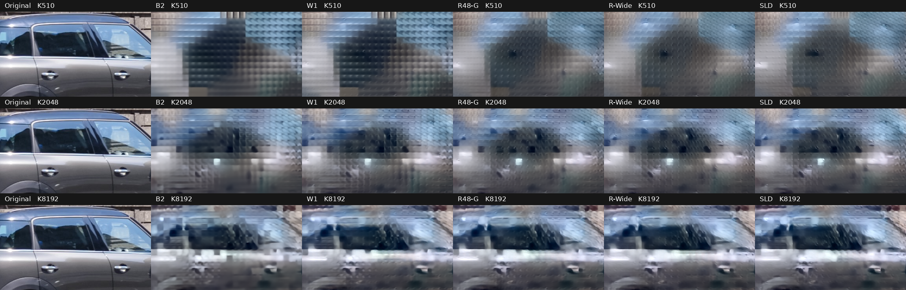

# AIP-VTok Sparse Latent Decoder Pilot

`experiment/aip-vtok-sparse-decoder` 从 `606216e` 出发。E2、E3 与 E4 各运行 seed=1 的 500 次更新。原生 1080p Validation 覆盖 174 帧及 car-roundabout 64 帧。逐帧记录 8700 行，Test 图像读取为 0。

## 无训练瓶颈诊断

| 方案 | K | 全局 PSNR dB | 帧均 PSNR dB | LPIPS | DISTS |
| --- | --- | --- | --- | --- | --- |
| O0 | 连续 | 34.266 | 34.519 | 0.23211 | 0.15345 |
| O1 | 连续 | 30.867 | 31.445 | 0.29472 | 0.17406 |
| O2 | 32640 | 27.637 | 28.157 | 0.33452 | 0.18304 |
| O3 | 8192 | 23.562 | 24.219 | 0.46497 | 0.24303 |
| O4 | 8192 | 23.956 | 24.534 | 0.39254 | 0.21938 |

O0 衡量冻结 RGB 解码器在完整对齐潜在输入下的表现。学习型解码器的理论画质上界需要独立证明。各项 PSNR 差值是基于全局 MSE 的对数测量，误差分量的线性归因需在误差域另行验证。

[完整 O0–O4、K510 二因子与历史核验](phase0_report.md)

## 同预算质量

FIXED 共用冻结 C1 A1/B2 的 I2048/P510 参考。五个恢复器的展示前缀均来自同一 A2/SP-1 包。CLOSED 按各方案自身配置独立推进参考，码流随历史变化。每帧在各端分别提交一次参考。

R48-G 在 W1 的 48 宽度主体输入中加入对齐后的 Gaussian base。R-Wide 用单尺度 88 宽度主体。SLD 融合 68×120 与 34×60 特征，以 sigmoid 门控修正强度。未传送的 104 个通道由模型预测，已收到的 FSQ 槽位保留整数解码值。

| 历史 | K | 方案 | 全局 PSNR dB | 帧均 PSNR dB | LPIPS | DISTS |
| --- | --- | --- | --- | --- | --- | --- |
| fixed_reference | 510 | B2 | 15.945 | 16.470 | 0.64763 | 0.37309 |
| fixed_reference | 2048 | B2 | 19.417 | 20.054 | 0.58290 | 0.33735 |
| fixed_reference | 8192 | B2 | 23.562 | 24.219 | 0.46497 | 0.24303 |
| fixed_reference | 510 | W1 | 16.023 | 16.543 | 0.59102 | 0.34873 |
| fixed_reference | 2048 | W1 | 19.752 | 20.346 | 0.51374 | 0.30115 |
| fixed_reference | 8192 | W1 | 23.956 | 24.534 | 0.39254 | 0.21938 |
| fixed_reference | 510 | R48-G | 17.041 | 17.540 | 0.60009 | 0.37571 |
| fixed_reference | 2048 | R48-G | 19.591 | 20.137 | 0.52876 | 0.31134 |
| fixed_reference | 8192 | R48-G | 24.040 | 24.608 | 0.38953 | 0.22345 |
| fixed_reference | 510 | R-Wide | 17.090 | 17.535 | 0.59903 | 0.39165 |
| fixed_reference | 2048 | R-Wide | 19.885 | 20.481 | 0.51480 | 0.31172 |
| fixed_reference | 8192 | R-Wide | 24.247 | 24.813 | 0.37852 | 0.21975 |
| fixed_reference | 510 | SLD | 17.175 | 17.673 | 0.59702 | 0.37977 |
| fixed_reference | 2048 | SLD | 19.862 | 20.467 | 0.51729 | 0.30396 |
| fixed_reference | 8192 | SLD | 24.117 | 24.699 | 0.38403 | 0.21829 |
| independent_closed | 510 | B2 | 15.433 | 15.949 | 0.64380 | 0.37536 |
| independent_closed | 2048 | B2 | 19.229 | 19.843 | 0.58782 | 0.33117 |
| independent_closed | 8192 | B2 | 23.453 | 24.102 | 0.46596 | 0.24137 |
| independent_closed | 510 | W1 | 15.837 | 16.374 | 0.59198 | 0.34926 |
| independent_closed | 2048 | W1 | 19.731 | 20.333 | 0.51201 | 0.29453 |
| independent_closed | 8192 | W1 | 23.966 | 24.554 | 0.39443 | 0.21692 |
| independent_closed | 510 | R48-G | 15.769 | 16.211 | 0.59941 | 0.37810 |
| independent_closed | 2048 | R48-G | 18.917 | 19.381 | 0.52951 | 0.31256 |
| independent_closed | 8192 | R48-G | 23.993 | 24.554 | 0.39042 | 0.22445 |
| independent_closed | 510 | R-Wide | 15.352 | 15.831 | 0.60032 | 0.39360 |
| independent_closed | 2048 | R-Wide | 19.643 | 20.175 | 0.53010 | 0.31457 |
| independent_closed | 8192 | R-Wide | 24.222 | 24.773 | 0.38722 | 0.22223 |
| independent_closed | 510 | SLD | 16.753 | 17.244 | 0.60051 | 0.38347 |
| independent_closed | 2048 | SLD | 19.865 | 20.461 | 0.52005 | 0.30542 |
| independent_closed | 8192 | SLD | 24.170 | 24.764 | 0.38649 | 0.21978 |

下面比较相近参数量的 SLD 与 R-Wide。负的 LPIPS 或 DISTS 差值表示 SLD 的该项指标更好。

| 历史 | K | SLD − R-Wide PSNR dB | Δ LPIPS | Δ DISTS |
| --- | --- | --- | --- | --- |
| fixed_reference | 510 | +0.08505 | -0.00201 | -0.01188 |
| fixed_reference | 1024 | -0.04025 | -0.00367 | -0.01024 |
| fixed_reference | 2048 | -0.02360 | +0.00249 | -0.00776 |
| fixed_reference | 4096 | -0.11918 | +0.00567 | -0.00749 |
| fixed_reference | 8192 | -0.13056 | +0.00551 | -0.00145 |
| independent_closed | 510 | +1.40080 | +0.00019 | -0.01013 |
| independent_closed | 1024 | +0.27967 | -0.01399 | -0.01228 |
| independent_closed | 2048 | +0.22134 | -0.01005 | -0.00915 |
| independent_closed | 4096 | -0.07508 | -0.00331 | -0.00748 |
| independent_closed | 8192 | -0.05283 | -0.00072 | -0.00245 |

[全预算 Validation、64 帧、晚期和 I/P 汇总](pilot_metrics.csv) · [逐帧记录](pilot_per_frame.csv)

## 训练与梯度

E2/E3/E4 共用 W1 的 Train 划分、500 个更新的实际监督帧和裁剪种子。每次以首帧启动 I/P/P/P，统一复用 W1 的按帧型预算采样和损失。AdamW 的学习率为 0.001，梯度裁剪阈值为 1.0。损失权重为 L1 1.0、MSE 1.0、BT.709 色度 0.20、LPIPS 0.15、anchor 0.05、reference 0.15。W1 的原始窗口计划含最长 26 帧前置因果历史。E1 的权重用于本轮同条件评估，训练参照保留历史差异。

下面的收敛指标使用冻结 Train holdout 的 6 个四帧窗口。训练损失为最后 50 步平均值。

| 方案 | 更新 | 更新用时 s | 末 50 步损失 | K2048 @0 | @100 | @300 | @500 |
| --- | --- | --- | --- | --- | --- | --- | --- |
| R48-G | 500 | 504.8 | 0.17934 | 18.710 | 18.842 | 19.223 | 19.161 |
| R-Wide | 500 | 476.4 | 0.17519 | 18.710 | 18.920 | 19.292 | 19.367 |
| SLD | 500 | 490.7 | 0.17638 | 18.710 | 18.800 | 19.201 | 19.329 |

每 50 步以恢复主体参数计算三个原始梯度范数、乘权重后的范数和两两余弦。晚期 DISTS 来自同一条 Validation 轨迹。每个架构仅有一个种子，梯度与 DISTS 的并列比较只支持描述性判断。

| 方案 | 加权 LPIPS/MSE 中位数 | 范围 | LPIPS/Anchor 负余弦 | 最坏晚期 ΔDISTS | 裁剪更新 |
| --- | --- | --- | --- | --- | --- |
| R48-G | 7.633 | 0.833–34.600 | 7/10 | +0.02787 | 0 |
| R-Wide | 6.226 | 0.999–15.476 | 7/10 | +0.05418 | 0 |
| SLD | 5.621 | 0.876–39.556 | 5/10 | +0.04412 | 0 |

加权梯度比的排序与最坏晚期 DISTS 增量的排序不同。R48-G 与 R-Wide 的 LPIPS/Anchor 负余弦占比相同，晚期 DISTS 恶化幅度有明显差异。各模型主体参数形状也不同，绝对梯度范数应结合本模型损失分量解读。

[冻结训练计划](pilot_plan.json) · [E2 训练](pilot_train_E2.json) · [E3 训练](pilot_train_E3.json) · [E4 训练](pilot_train_E4.json)

## 原 S2 门控

| 方案 | G1 | G2 | G3 | G4 | G5 | G6 | G7 | 总判定 |
| --- | --- | --- | --- | --- | --- | --- | --- | --- |
| R48-G | 失败 | 通过 | 失败 | 失败 | 通过 | 通过 | 通过 | 失败 |
| R-Wide | 失败 | 失败 | 通过 | 失败 | 通过 | 通过 | 通过 | 失败 |
| SLD | 通过 | 失败 | 通过 | 失败 | 通过 | 通过 | 通过 | 失败 |

门限和判定函数沿用原 S2。G3 同时要求全局与帧均 PSNR 降幅不超过 0.10 dB。G4 对全部五档要求 LPIPS 和 DISTS 增量均不超过 +0.005。下表是相对同扫描、同量化器 B2 的 CLOSED 晚期差值。

| 方案 | K | Δ 全局 PSNR | Δ 帧均 PSNR | Δ LPIPS | Δ DISTS | 参考 RMS |
| --- | --- | --- | --- | --- | --- | --- |
| R48-G | 510 | +0.252 | +0.249 | -0.01620 | +0.02640 | 0.4686 |
| R48-G | 1024 | -0.223 | -0.222 | -0.02614 | +0.02426 | 0.4686 |
| R48-G | 2048 | -0.278 | -0.277 | -0.04066 | +0.02787 | 0.4686 |
| R48-G | 4096 | +0.545 | +0.546 | -0.06346 | +0.02394 | 0.4686 |
| R48-G | 8192 | +0.586 | +0.587 | -0.08360 | -0.00068 | 0.4686 |
| R-Wide | 510 | -0.095 | -0.098 | -0.00025 | +0.05418 | 0.4646 |
| R-Wide | 1024 | +0.419 | +0.421 | -0.00565 | +0.03207 | 0.4646 |
| R-Wide | 2048 | +0.394 | +0.394 | -0.03115 | +0.03937 | 0.4646 |
| R-Wide | 4096 | +1.073 | +1.074 | -0.06750 | +0.02668 | 0.4646 |
| R-Wide | 8192 | +0.805 | +0.807 | -0.08300 | -0.00318 | 0.4646 |
| SLD | 510 | +1.195 | +1.193 | -0.02127 | +0.04412 | 0.4879 |
| SLD | 1024 | +0.684 | +0.685 | -0.03456 | +0.01776 | 0.4879 |
| SLD | 2048 | +0.611 | +0.611 | -0.05932 | +0.02122 | 0.4879 |
| SLD | 4096 | +0.982 | +0.983 | -0.08374 | +0.01388 | 0.4879 |
| SLD | 8192 | +0.731 | +0.732 | -0.09215 | -0.00704 | 0.4879 |

[所有门控的实测值、裕量和阈值](pilot_gates.json)

## 因果历史对晚期增益的影响

以下为 car-roundabout 第 48–63 帧中，CLOSED 相对 B2 的差值减去 FIXED 相对 B2 的差值。该配对差值衡量闭环历史及其后续码流对观测到的架构收益的影响。三个模型都已在 FIXED 下出现晚期 DISTS 大幅恶化，独立历史改变其幅度。

| 方案 | K | PSNR 增益变化 dB | LPIPS 差值变化 | DISTS 差值变化 |
| --- | --- | --- | --- | --- |
| R48-G | 510 | -0.89304 | +0.02076 | -0.00440 |
| R48-G | 1024 | -0.62881 | +0.00861 | +0.01351 |
| R48-G | 2048 | -0.49549 | +0.00694 | +0.01222 |
| R48-G | 4096 | -0.10095 | +0.00466 | +0.00863 |
| R48-G | 8192 | +0.00418 | +0.00720 | +0.00454 |
| R-Wide | 510 | -1.38487 | +0.03520 | -0.00280 |
| R-Wide | 1024 | -0.10552 | +0.03506 | +0.01550 |
| R-Wide | 2048 | -0.07737 | +0.03272 | +0.01274 |
| R-Wide | 4096 | +0.10512 | +0.02060 | +0.00636 |
| R-Wide | 8192 | +0.01691 | +0.02085 | +0.00492 |
| SLD | 510 | -0.15734 | +0.01979 | -0.00404 |
| SLD | 1024 | +0.16745 | +0.00799 | +0.01112 |
| SLD | 2048 | +0.16672 | +0.00194 | +0.00673 |
| SLD | 4096 | +0.14676 | -0.00228 | +0.00186 |
| SLD | 8192 | +0.11099 | +0.00380 | +0.00103 |

## 效率与负载

NVIDIA H100 PCIe，原生 1080p，B=1，FP32。每个帧型与预算组合预热 5 次，同步计时 30 次。端到端含发送和接收两端参考提交。

| 方案 | 参数 | 恢复 MMACs | 恢复 p50 ms | RGB 解码 p50 ms | 编码 p50 ms | 选点量化 p50 ms | 端到端 p50/p95 ms | 峰值 MiB |
| --- | --- | --- | --- | --- | --- | --- | --- | --- |
| B2 | 0 | 5.03 | 1.360 | 12.94 | 24.72 | 0.384 | 60.84/60.92 | 976 |
| W1 | 49312 | 298.00 | 2.205 | 12.93 | 24.73 | 0.387 | 63.39/63.47 | 976 |
| R48-G | 61600 | 348.14 | 8.209 | 12.93 | 24.78 | 0.387 | 81.65/81.73 | 3971 |
| R-Wide | 91640 | 605.34 | 2.287 | 12.92 | 24.72 | 0.384 | 63.54/63.75 | 976 |
| SLD | 91560 | 553.77 | 2.649 | 12.93 | 24.72 | 0.384 | 64.65/64.74 | 976 |

表中数据来自 P 帧 K2048。MACs 覆盖恢复网络卷积与公共高斯卷积，FLOPs 约为其两倍。恢复计时还包括整数解码、掩码和画布构造、插值、融合与观测覆盖。

I 帧在 K510 显示时仍需传送 I2048 的参考联合前缀，共 2048 个符号。P 帧的参考仅需 P510，任何显示档都已包含该前缀。账本使用 16 bit/符号、模拟封装开销和 Train 经验熵估算。

[每个帧型和预算的同步延迟及负载账本](pilot_latency.json)

## 原生 1080p 重建对照

car-roundabout 第 55 帧（从 0 计数），FIXED。全部图块截取相同原生 RGB 区域。

## 决策

1. 24D 截断是显著瓶颈，独立配对效应为 -3.40 dB。K8192 空间稀疏化的配对效应为 -4.07 dB，A2 量化也有显著代价。

2. K510 的 PSNR 差距以扫描效应为主。共享历史下 A2 的扫描效应为 -1.49 dB，两种扫描下 A2 的量化效应分别为 +0.05 和 +0.07 dB。独立历史使 Q4−Q1 再变化 -0.51 dB。SP-1 仍有 K510 感知指标优势。

3. 以各档 B2 为基线，将 R48-G 的 FIXED PSNR 增益除以 E2/E3/E4 中最佳增益。R48-G 在正增益档的最佳全局 PSNR 增益中的占比中位数为 66%。R48-G 的 CLOSED PSNR 在 K1024 和 K2048 下降。与 W1 的差距还涉及两套训练历史。

4. R-Wide 与 SLD 的容量匹配误差为 0.087%。按 PSNR、LPIPS、DISTS 的顺序，SLD 领先 R-Wide 的预算档数在 FIXED 为 1/2/5，在 CLOSED 为 3/4/5。每项均比较五档。

5. 参数匹配对照检验的是 SLD 整体架构的收益，包含多尺度、融合和置信门控。SLD 的 K510 PSNR 优势从 FIXED 的 +0.085 dB 扩大到 CLOSED 的 +1.401 dB。同码流 DISTS 在五档均优于 R-Wide，PSNR 与 LPIPS 则随预算而变化。现有 Pilot 证据不足以确定优胜架构。

6. 按五档 LPIPS、DISTS 的最小门槛裕量，R48-G 最接近晚期感知门槛，其最小裕量为 -0.02287。

7. 原门控要求七项全部通过。本轮停在 500 步，暂缓 2000-step 训练。

8. K510 的扫描可单独研究。当前放行条件应优先处理晚期感知失败。

**下一轮唯一建议**　只在 SLD 上做 LPIPS=0.10 单变量诊断，复用 seed=1、四帧 500 步协议，复查 G2/G4。

## 复现与审计

联合测试通过 352 项，覆盖 T1–T15。冻结资产清单 SHA256 为 `57403f63f0a0ac1cc35be23f815ab687cb422052c3c2908e3f572f7fde6f7be9`。SHA256 覆盖原基础权重、Alignment、Projector、W1、划分、两种扫描、校准和感知权重。

[复现命令与工作记录](../../../docs/aip_vtok_sparse_decoder_report.md) · [测试证据](phase1_tests.json) · [模型结构](phase1_architectures.json) · [输入清单](provenance.json)
