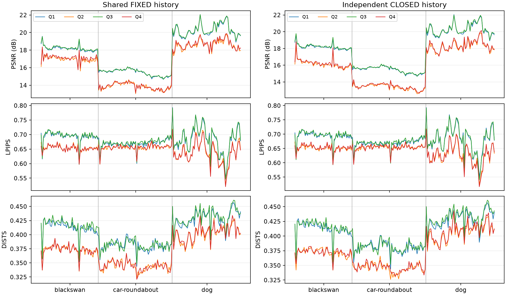

# Phase 0 · 无训练信息瓶颈诊断

原生 1080p、174 帧 Validation，A2/SP-1 与 C1 扫描均来自冻结 Train 资产。FIXED 全部使用 C1 A1/B2 的 I2048/P510 历史，CLOSED 按各组自身的码流推进参考。

## 通道、量化与空间采样

O0 解码完整 128D aligned latent。O1 保留未量化的 24D 并补零。O2 对同一 24D 的全部 32640 个符号做 A2 FSQ。O3 是 SP-1 与 σ=1.5 高斯。O4 加载原 W1。

| 方案 | K | 帧型 | 全局 PSNR dB | 帧均 PSNR dB | LPIPS | DISTS | 潜在 MSE |
| --- | --- | --- | --- | --- | --- | --- | --- |
| O0 | 连续 | all | 34.266 | 34.519 | 0.23211 | 0.15345 | 0.000000 |
| O0 | 连续 | I | 37.118 | 37.122 | 0.20066 | 0.15247 | 0.000000 |
| O0 | 连续 | P | 34.192 | 34.426 | 0.23323 | 0.15349 | 0.000000 |
| O1 | 连续 | all | 30.867 | 31.445 | 0.29472 | 0.17406 | 0.553183 |
| O1 | 连续 | I | 34.167 | 34.447 | 0.23773 | 0.15769 | 0.445692 |
| O1 | 连续 | P | 30.785 | 31.338 | 0.29676 | 0.17464 | 0.557022 |
| O2 | 32640 | all | 27.637 | 28.157 | 0.33452 | 0.18304 | 0.574970 |
| O2 | 32640 | I | 27.283 | 27.433 | 0.34624 | 0.18534 | 0.467370 |
| O2 | 32640 | P | 27.650 | 28.183 | 0.33410 | 0.18296 | 0.578813 |
| O3 | 510 | all | 15.945 | 16.470 | 0.64763 | 0.37309 | 0.786750 |
| O3 | 510 | I | 15.341 | 15.752 | 0.66432 | 0.37991 | 0.663063 |
| O3 | 510 | P | 15.969 | 16.495 | 0.64703 | 0.37284 | 0.791167 |
| O3 | 1024 | all | 17.958 | 18.567 | 0.62079 | 0.37491 | 0.755104 |
| O3 | 1024 | I | 18.062 | 18.534 | 0.63109 | 0.39731 | 0.648128 |
| O3 | 1024 | P | 17.954 | 18.568 | 0.62042 | 0.37411 | 0.758924 |
| O3 | 2048 | all | 19.417 | 20.054 | 0.58290 | 0.33735 | 0.725109 |
| O3 | 2048 | I | 19.592 | 20.055 | 0.60127 | 0.35855 | 0.636697 |
| O3 | 2048 | P | 19.410 | 20.054 | 0.58225 | 0.33660 | 0.728266 |
| O3 | 4096 | all | 20.851 | 21.504 | 0.53640 | 0.29281 | 0.699831 |
| O3 | 4096 | I | 20.952 | 21.384 | 0.57607 | 0.30810 | 0.622404 |
| O3 | 4096 | P | 20.847 | 21.509 | 0.53499 | 0.29227 | 0.702596 |
| O3 | 8192 | all | 23.562 | 24.219 | 0.46497 | 0.24303 | 0.670077 |
| O3 | 8192 | I | 23.516 | 23.821 | 0.52241 | 0.24982 | 0.602680 |
| O3 | 8192 | P | 23.564 | 24.233 | 0.46292 | 0.24279 | 0.672484 |
| O4 | 510 | all | 16.023 | 16.543 | 0.59102 | 0.34873 | 0.855002 |
| O4 | 510 | I | 15.376 | 15.785 | 0.59377 | 0.35659 | 0.879887 |
| O4 | 510 | P | 16.048 | 16.570 | 0.59092 | 0.34845 | 0.854113 |
| O4 | 1024 | all | 18.081 | 18.663 | 0.55959 | 0.34158 | 0.822471 |
| O4 | 1024 | I | 18.163 | 18.625 | 0.55367 | 0.36281 | 0.866358 |
| O4 | 1024 | P | 18.078 | 18.665 | 0.55981 | 0.34082 | 0.820904 |
| O4 | 2048 | all | 19.752 | 20.346 | 0.51374 | 0.30115 | 0.791343 |
| O4 | 2048 | I | 19.825 | 20.254 | 0.51713 | 0.32777 | 0.857752 |
| O4 | 2048 | P | 19.749 | 20.349 | 0.51361 | 0.30020 | 0.788972 |
| O4 | 4096 | all | 21.510 | 22.096 | 0.46217 | 0.25963 | 0.768066 |
| O4 | 4096 | I | 21.343 | 21.729 | 0.48145 | 0.28490 | 0.848517 |
| O4 | 4096 | P | 21.516 | 22.110 | 0.46148 | 0.25872 | 0.765192 |
| O4 | 8192 | all | 23.956 | 24.534 | 0.39254 | 0.21938 | 0.759009 |
| O4 | 8192 | I | 23.655 | 23.948 | 0.42722 | 0.23880 | 0.834624 |
| O4 | 8192 | P | 23.967 | 24.555 | 0.39131 | 0.21869 | 0.756308 |

四项差值按后者减前者计算。空间采样与学习恢复采用 K8192。这些差值用于配对诊断。O0 衡量冻结解码器在完整对齐潜在输入下的表现。

| 对照 | 帧型 | 全局 PSNR dB | 帧均 PSNR dB | LPIPS | DISTS |
| --- | --- | --- | --- | --- | --- |
| channel | all | -3.399 | -3.073 | 0.06262 | 0.02061 |
| channel | I | -2.950 | -2.675 | 0.03708 | 0.00522 |
| channel | P | -3.407 | -3.088 | 0.06353 | 0.02116 |
| quantization | all | -3.230 | -3.288 | 0.03980 | 0.00899 |
| quantization | I | -6.884 | -7.014 | 0.10851 | 0.02765 |
| quantization | P | -3.135 | -3.155 | 0.03734 | 0.00832 |
| spatial | all | -4.075 | -3.938 | 0.13045 | 0.05999 |
| spatial | I | -3.767 | -3.612 | 0.17616 | 0.06448 |
| spatial | P | -4.086 | -3.949 | 0.12882 | 0.05983 |
| learned | all | 0.394 | 0.315 | -0.07243 | -0.02365 |
| learned | I | 0.139 | 0.127 | -0.09519 | -0.01102 |
| learned | P | 0.403 | 0.322 | -0.07162 | -0.02410 |

## 与 a8474ee 的稠密对照

旧 A0/A2 和当前 O1/O2 使用相同 Validation 帧及全局 MSE 聚合。旧 P 帧参考来自稠密 A1，当前 P 帧参考来自稀疏 C1 前缀。整体数值不宜作为直接复现，I 帧没有此前 GOP 历史，表中给出其逐帧核验结果。

| 本轮 | 旧方案 | 全局 PSNR dB | 帧均 PSNR dB | LPIPS | DISTS | I 帧最大 RGB MSE 差 |
| --- | --- | --- | --- | --- | --- | --- |
| O1 | A0 | 31.217 | 31.877 | 0.28511 | 0.16812 | 0 |
| O2 | A2 | 28.202 | 28.674 | 0.32102 | 0.17446 | 0 |

## K510 量化器 × 扫描表

各单元使用同坐标同通道，每帧传输 510 个匹配自身量化器的 FSQ 符号。交互项为 (Q4 − Q3) − (Q2 − Q1)。CLOSED − FIXED 表示引入独立参考反馈后差值的变化。

在共享历史下，SP-1 的 PSNR 效应为 A1 -1.506 dB、A2 -1.487 dB。同一扫描下 A2 的 PSNR 效应为 +0.051 至 +0.070 dB。独立历史使 Q4 相对 Q1 的 PSNR 进一步变化 -0.512 dB。扫描对 PSNR 的影响最大，同时降低了 LPIPS 和 DISTS。量化和交互在总体感知指标上的效应较小。

### validation

| 历史 | 方案 | 帧型 | 帧数 | 全局 PSNR dB | 帧均 PSNR dB | LPIPS | DISTS |
| --- | --- | --- | --- | --- | --- | --- | --- |
| fixed_reference | Q1 | all | 174 | 17.381 | 17.877 | 0.68002 | 0.40626 |
| fixed_reference | Q1 | I | 6 | 17.522 | 17.933 | 0.71063 | 0.41744 |
| fixed_reference | Q1 | P | 168 | 17.376 | 17.875 | 0.67893 | 0.40586 |
| independent_closed | Q1 | all | 174 | 17.381 | 17.877 | 0.68002 | 0.40626 |
| independent_closed | Q1 | I | 6 | 17.522 | 17.933 | 0.71063 | 0.41744 |
| independent_closed | Q1 | P | 168 | 17.376 | 17.875 | 0.67893 | 0.40586 |
| fixed_reference | Q2 | all | 174 | 15.875 | 16.379 | 0.64842 | 0.37261 |
| fixed_reference | Q2 | I | 6 | 15.236 | 15.637 | 0.67301 | 0.37677 |
| fixed_reference | Q2 | P | 168 | 15.900 | 16.405 | 0.64754 | 0.37246 |
| independent_closed | Q2 | all | 174 | 15.349 | 15.854 | 0.64346 | 0.37403 |
| independent_closed | Q2 | I | 6 | 15.236 | 15.637 | 0.67301 | 0.37677 |
| independent_closed | Q2 | P | 168 | 15.353 | 15.862 | 0.64241 | 0.37393 |
| fixed_reference | Q3 | all | 174 | 17.432 | 17.937 | 0.68240 | 0.40855 |
| fixed_reference | Q3 | I | 6 | 17.697 | 18.129 | 0.70567 | 0.42558 |
| fixed_reference | Q3 | P | 168 | 17.423 | 17.930 | 0.68157 | 0.40795 |
| independent_closed | Q3 | all | 174 | 17.439 | 17.944 | 0.68185 | 0.40879 |
| independent_closed | Q3 | I | 6 | 17.697 | 18.129 | 0.70567 | 0.42558 |
| independent_closed | Q3 | P | 168 | 17.431 | 17.937 | 0.68100 | 0.40819 |
| fixed_reference | Q4 | all | 174 | 15.945 | 16.470 | 0.64763 | 0.37309 |
| fixed_reference | Q4 | I | 6 | 15.341 | 15.752 | 0.66432 | 0.37991 |
| fixed_reference | Q4 | P | 168 | 15.969 | 16.495 | 0.64703 | 0.37284 |
| independent_closed | Q4 | all | 174 | 15.433 | 15.949 | 0.64380 | 0.37536 |
| independent_closed | Q4 | I | 6 | 15.341 | 15.752 | 0.66432 | 0.37991 |
| independent_closed | Q4 | P | 168 | 15.436 | 15.956 | 0.64306 | 0.37519 |

| 帧型 | 历史 | 效应 | 全局 PSNR dB | 帧均 PSNR dB | LPIPS | DISTS |
| --- | --- | --- | --- | --- | --- | --- |
| all | fixed_reference | Q2 − Q1 · A1 扫描效应 | -1.506 | -1.499 | -0.03161 | -0.03365 |
| all | fixed_reference | Q4 − Q3 · A2 扫描效应 | -1.487 | -1.467 | -0.03477 | -0.03547 |
| all | fixed_reference | Q3 − Q1 · C1 量化效应 | 0.051 | 0.060 | 0.00238 | 0.00230 |
| all | fixed_reference | Q4 − Q2 · SP-1 量化效应 | 0.070 | 0.091 | -0.00079 | 0.00048 |
| all | fixed_reference | 扫描 × 量化交互 | 0.019 | 0.032 | -0.00317 | -0.00182 |
| all | fixed_reference | Q4 − Q1 · 联合差距 | -1.436 | -1.407 | -0.03239 | -0.03317 |
| all | independent_closed | Q2 − Q1 · A1 扫描效应 | -2.032 | -2.023 | -0.03656 | -0.03223 |
| all | independent_closed | Q4 − Q3 · A2 扫描效应 | -2.006 | -1.995 | -0.03805 | -0.03343 |
| all | independent_closed | Q3 − Q1 · C1 量化效应 | 0.058 | 0.067 | 0.00183 | 0.00253 |
| all | independent_closed | Q4 − Q2 · SP-1 量化效应 | 0.084 | 0.095 | 0.00033 | 0.00133 |
| all | independent_closed | 扫描 × 量化交互 | 0.026 | 0.028 | -0.00149 | -0.00120 |
| all | independent_closed | Q4 − Q1 · 联合差距 | -1.948 | -1.929 | -0.03623 | -0.03090 |
| all | closed_minus_fixed | Q2 − Q1 · A1 扫描效应 | -0.526 | -0.525 | -0.00495 | 0.00141 |
| all | closed_minus_fixed | Q4 − Q3 · A2 扫描效应 | -0.520 | -0.528 | -0.00328 | 0.00204 |
| all | closed_minus_fixed | Q3 − Q1 · C1 量化效应 | 0.007 | 0.007 | -0.00055 | 0.00023 |
| all | closed_minus_fixed | Q4 − Q2 · SP-1 量化效应 | 0.014 | 0.004 | 0.00112 | 0.00085 |
| all | closed_minus_fixed | 扫描 × 量化交互 | 0.006 | -0.003 | 0.00167 | 0.00062 |
| all | closed_minus_fixed | Q4 − Q1 · 联合差距 | -0.512 | -0.521 | -0.00383 | 0.00227 |
| I | fixed_reference | Q2 − Q1 · A1 扫描效应 | -2.285 | -2.297 | -0.03762 | -0.04067 |
| I | fixed_reference | Q4 − Q3 · A2 扫描效应 | -2.357 | -2.377 | -0.04135 | -0.04567 |
| I | fixed_reference | Q3 − Q1 · C1 量化效应 | 0.176 | 0.195 | -0.00496 | 0.00814 |
| I | fixed_reference | Q4 − Q2 · SP-1 量化效应 | 0.104 | 0.115 | -0.00869 | 0.00314 |
| I | fixed_reference | 扫描 × 量化交互 | -0.071 | -0.080 | -0.00373 | -0.00500 |
| I | fixed_reference | Q4 − Q1 · 联合差距 | -2.181 | -2.182 | -0.04631 | -0.03752 |
| I | independent_closed | Q2 − Q1 · A1 扫描效应 | -2.285 | -2.297 | -0.03762 | -0.04067 |
| I | independent_closed | Q4 − Q3 · A2 扫描效应 | -2.357 | -2.377 | -0.04135 | -0.04567 |
| I | independent_closed | Q3 − Q1 · C1 量化效应 | 0.176 | 0.195 | -0.00496 | 0.00814 |
| I | independent_closed | Q4 − Q2 · SP-1 量化效应 | 0.104 | 0.115 | -0.00869 | 0.00314 |
| I | independent_closed | 扫描 × 量化交互 | -0.071 | -0.080 | -0.00373 | -0.00500 |
| I | independent_closed | Q4 − Q1 · 联合差距 | -2.181 | -2.182 | -0.04631 | -0.03752 |
| I | closed_minus_fixed | Q2 − Q1 · A1 扫描效应 | 0.000 | 0.000 | 0.00000 | 0.00000 |
| I | closed_minus_fixed | Q4 − Q3 · A2 扫描效应 | 0.000 | 0.000 | 0.00000 | 0.00000 |
| I | closed_minus_fixed | Q3 − Q1 · C1 量化效应 | 0.000 | 0.000 | 0.00000 | 0.00000 |
| I | closed_minus_fixed | Q4 − Q2 · SP-1 量化效应 | 0.000 | 0.000 | 0.00000 | 0.00000 |
| I | closed_minus_fixed | 扫描 × 量化交互 | 0.000 | 0.000 | 0.00000 | 0.00000 |
| I | closed_minus_fixed | Q4 − Q1 · 联合差距 | 0.000 | 0.000 | 0.00000 | 0.00000 |
| P | fixed_reference | Q2 − Q1 · A1 扫描效应 | -1.477 | -1.470 | -0.03139 | -0.03340 |
| P | fixed_reference | Q4 − Q3 · A2 扫描效应 | -1.454 | -1.434 | -0.03454 | -0.03510 |
| P | fixed_reference | Q3 − Q1 · C1 量化效应 | 0.046 | 0.055 | 0.00264 | 0.00209 |
| P | fixed_reference | Q4 − Q2 · SP-1 量化效应 | 0.069 | 0.090 | -0.00051 | 0.00038 |
| P | fixed_reference | 扫描 × 量化交互 | 0.022 | 0.036 | -0.00314 | -0.00171 |
| P | fixed_reference | Q4 − Q1 · 联合差距 | -1.408 | -1.380 | -0.03190 | -0.03301 |
| P | independent_closed | Q2 − Q1 · A1 扫描效应 | -2.023 | -2.014 | -0.03652 | -0.03193 |
| P | independent_closed | Q4 − Q3 · A2 扫描效应 | -1.994 | -1.982 | -0.03794 | -0.03299 |
| P | independent_closed | Q3 − Q1 · C1 量化效应 | 0.054 | 0.062 | 0.00207 | 0.00233 |
| P | independent_closed | Q4 − Q2 · SP-1 量化效应 | 0.083 | 0.094 | 0.00065 | 0.00127 |
| P | independent_closed | 扫描 × 量化交互 | 0.029 | 0.032 | -0.00141 | -0.00106 |
| P | independent_closed | Q4 − Q1 · 联合差距 | -1.940 | -1.920 | -0.03587 | -0.03066 |
| P | closed_minus_fixed | Q2 − Q1 · A1 扫描效应 | -0.547 | -0.544 | -0.00513 | 0.00147 |
| P | closed_minus_fixed | Q4 − Q3 · A2 扫描效应 | -0.540 | -0.547 | -0.00340 | 0.00211 |
| P | closed_minus_fixed | Q3 − Q1 · C1 量化效应 | 0.008 | 0.007 | -0.00057 | 0.00024 |
| P | closed_minus_fixed | Q4 − Q2 · SP-1 量化效应 | 0.014 | 0.004 | 0.00116 | 0.00088 |
| P | closed_minus_fixed | 扫描 × 量化交互 | 0.007 | -0.004 | 0.00173 | 0.00064 |
| P | closed_minus_fixed | Q4 − Q1 · 联合差距 | -0.532 | -0.540 | -0.00397 | 0.00235 |

### horizon

| 历史 | 方案 | 帧型 | 帧数 | 全局 PSNR dB | 帧均 PSNR dB | LPIPS | DISTS |
| --- | --- | --- | --- | --- | --- | --- | --- |
| fixed_reference | Q1 | all | 64 | 15.406 | 15.422 | 0.66880 | 0.38022 |
| fixed_reference | Q1 | I | 2 | 15.446 | 15.446 | 0.68249 | 0.38990 |
| fixed_reference | Q1 | P | 62 | 15.405 | 15.422 | 0.66836 | 0.37991 |
| independent_closed | Q1 | all | 64 | 15.406 | 15.422 | 0.66880 | 0.38022 |
| independent_closed | Q1 | I | 2 | 15.446 | 15.446 | 0.68249 | 0.38990 |
| independent_closed | Q1 | P | 62 | 15.405 | 15.422 | 0.66836 | 0.37991 |
| fixed_reference | Q2 | all | 64 | 13.825 | 13.841 | 0.65510 | 0.34437 |
| fixed_reference | Q2 | I | 2 | 13.221 | 13.225 | 0.67254 | 0.34606 |
| fixed_reference | Q2 | P | 62 | 13.846 | 13.861 | 0.65453 | 0.34431 |
| independent_closed | Q2 | all | 64 | 13.362 | 13.374 | 0.65328 | 0.34530 |
| independent_closed | Q2 | I | 2 | 13.221 | 13.225 | 0.67254 | 0.34606 |
| independent_closed | Q2 | P | 62 | 13.366 | 13.379 | 0.65266 | 0.34528 |
| fixed_reference | Q3 | all | 64 | 15.439 | 15.454 | 0.67162 | 0.38101 |
| fixed_reference | Q3 | I | 2 | 15.601 | 15.601 | 0.67763 | 0.40539 |
| fixed_reference | Q3 | P | 62 | 15.434 | 15.449 | 0.67142 | 0.38023 |
| independent_closed | Q3 | all | 64 | 15.450 | 15.465 | 0.67096 | 0.38128 |
| independent_closed | Q3 | I | 2 | 15.601 | 15.601 | 0.67763 | 0.40539 |
| independent_closed | Q3 | P | 62 | 15.445 | 15.461 | 0.67074 | 0.38050 |
| fixed_reference | Q4 | all | 64 | 13.853 | 13.868 | 0.65597 | 0.34439 |
| fixed_reference | Q4 | I | 2 | 13.324 | 13.329 | 0.66290 | 0.35312 |
| fixed_reference | Q4 | P | 62 | 13.871 | 13.886 | 0.65575 | 0.34411 |
| independent_closed | Q4 | all | 64 | 13.432 | 13.445 | 0.65333 | 0.34632 |
| independent_closed | Q4 | I | 2 | 13.324 | 13.329 | 0.66290 | 0.35312 |
| independent_closed | Q4 | P | 62 | 13.436 | 13.449 | 0.65302 | 0.34610 |

| 帧型 | 历史 | 效应 | 全局 PSNR dB | 帧均 PSNR dB | LPIPS | DISTS |
| --- | --- | --- | --- | --- | --- | --- |
| all | fixed_reference | Q2 − Q1 · A1 扫描效应 | -1.581 | -1.581 | -0.01370 | -0.03586 |
| all | fixed_reference | Q4 − Q3 · A2 扫描效应 | -1.586 | -1.586 | -0.01565 | -0.03662 |
| all | fixed_reference | Q3 − Q1 · C1 量化效应 | 0.033 | 0.032 | 0.00282 | 0.00079 |
| all | fixed_reference | Q4 − Q2 · SP-1 量化效应 | 0.028 | 0.027 | 0.00087 | 0.00002 |
| all | fixed_reference | 扫描 × 量化交互 | -0.005 | -0.005 | -0.00194 | -0.00077 |
| all | fixed_reference | Q4 − Q1 · 联合差距 | -1.553 | -1.554 | -0.01283 | -0.03584 |
| all | independent_closed | Q2 − Q1 · A1 扫描效应 | -2.045 | -2.048 | -0.01552 | -0.03492 |
| all | independent_closed | Q4 − Q3 · A2 扫描效应 | -2.018 | -2.020 | -0.01763 | -0.03495 |
| all | independent_closed | Q3 − Q1 · C1 量化效应 | 0.043 | 0.043 | 0.00215 | 0.00105 |
| all | independent_closed | Q4 − Q2 · SP-1 量化效应 | 0.070 | 0.071 | 0.00005 | 0.00102 |
| all | independent_closed | 扫描 × 量化交互 | 0.027 | 0.028 | -0.00210 | -0.00003 |
| all | independent_closed | Q4 − Q1 · 联合差距 | -1.974 | -1.977 | -0.01547 | -0.03390 |
| all | closed_minus_fixed | Q2 − Q1 · A1 扫描效应 | -0.463 | -0.467 | -0.00182 | 0.00093 |
| all | closed_minus_fixed | Q4 − Q3 · A2 扫描效应 | -0.432 | -0.434 | -0.00198 | 0.00167 |
| all | closed_minus_fixed | Q3 − Q1 · C1 量化效应 | 0.011 | 0.011 | -0.00066 | 0.00027 |
| all | closed_minus_fixed | Q4 − Q2 · SP-1 量化效应 | 0.042 | 0.044 | -0.00082 | 0.00100 |
| all | closed_minus_fixed | 扫描 × 量化交互 | 0.032 | 0.033 | -0.00016 | 0.00074 |
| all | closed_minus_fixed | Q4 − Q1 · 联合差距 | -0.421 | -0.423 | -0.00264 | 0.00193 |
| I | fixed_reference | Q2 − Q1 · A1 扫描效应 | -2.225 | -2.221 | -0.00995 | -0.04384 |
| I | fixed_reference | Q4 − Q3 · A2 扫描效应 | -2.276 | -2.272 | -0.01473 | -0.05227 |
| I | fixed_reference | Q3 − Q1 · C1 量化效应 | 0.155 | 0.155 | -0.00486 | 0.01550 |
| I | fixed_reference | Q4 − Q2 · SP-1 量化效应 | 0.104 | 0.104 | -0.00964 | 0.00707 |
| I | fixed_reference | 扫描 × 量化交互 | -0.051 | -0.051 | -0.00478 | -0.00843 |
| I | fixed_reference | Q4 − Q1 · 联合差距 | -2.122 | -2.117 | -0.01959 | -0.03677 |
| I | independent_closed | Q2 − Q1 · A1 扫描效应 | -2.225 | -2.221 | -0.00995 | -0.04384 |
| I | independent_closed | Q4 − Q3 · A2 扫描效应 | -2.276 | -2.272 | -0.01473 | -0.05227 |
| I | independent_closed | Q3 − Q1 · C1 量化效应 | 0.155 | 0.155 | -0.00486 | 0.01550 |
| I | independent_closed | Q4 − Q2 · SP-1 量化效应 | 0.104 | 0.104 | -0.00964 | 0.00707 |
| I | independent_closed | 扫描 × 量化交互 | -0.051 | -0.051 | -0.00478 | -0.00843 |
| I | independent_closed | Q4 − Q1 · 联合差距 | -2.122 | -2.117 | -0.01959 | -0.03677 |
| I | closed_minus_fixed | Q2 − Q1 · A1 扫描效应 | 0.000 | 0.000 | 0.00000 | 0.00000 |
| I | closed_minus_fixed | Q4 − Q3 · A2 扫描效应 | 0.000 | 0.000 | 0.00000 | 0.00000 |
| I | closed_minus_fixed | Q3 − Q1 · C1 量化效应 | 0.000 | 0.000 | 0.00000 | 0.00000 |
| I | closed_minus_fixed | Q4 − Q2 · SP-1 量化效应 | 0.000 | 0.000 | 0.00000 | 0.00000 |
| I | closed_minus_fixed | 扫描 × 量化交互 | 0.000 | 0.000 | 0.00000 | 0.00000 |
| I | closed_minus_fixed | Q4 − Q1 · 联合差距 | 0.000 | 0.000 | 0.00000 | 0.00000 |
| P | fixed_reference | Q2 − Q1 · A1 扫描效应 | -1.559 | -1.560 | -0.01383 | -0.03560 |
| P | fixed_reference | Q4 − Q3 · A2 扫描效应 | -1.563 | -1.564 | -0.01568 | -0.03612 |
| P | fixed_reference | Q3 − Q1 · C1 量化效应 | 0.029 | 0.028 | 0.00306 | 0.00031 |
| P | fixed_reference | Q4 − Q2 · SP-1 量化效应 | 0.025 | 0.024 | 0.00121 | -0.00021 |
| P | fixed_reference | 扫描 × 量化交互 | -0.004 | -0.003 | -0.00185 | -0.00052 |
| P | fixed_reference | Q4 − Q1 · 联合差距 | -1.534 | -1.536 | -0.01261 | -0.03581 |
| P | independent_closed | Q2 − Q1 · A1 扫描效应 | -2.039 | -2.043 | -0.01570 | -0.03464 |
| P | independent_closed | Q4 − Q3 · A2 扫描效应 | -2.009 | -2.012 | -0.01772 | -0.03440 |
| P | independent_closed | Q3 − Q1 · C1 量化效应 | 0.040 | 0.039 | 0.00238 | 0.00059 |
| P | independent_closed | Q4 − Q2 · SP-1 量化效应 | 0.069 | 0.070 | 0.00036 | 0.00083 |
| P | independent_closed | 扫描 × 量化交互 | 0.029 | 0.031 | -0.00202 | 0.00024 |
| P | independent_closed | Q4 − Q1 · 联合差距 | -1.970 | -1.973 | -0.01534 | -0.03381 |
| P | closed_minus_fixed | Q2 − Q1 · A1 扫描效应 | -0.480 | -0.482 | -0.00188 | 0.00096 |
| P | closed_minus_fixed | Q4 − Q3 · A2 扫描效应 | -0.447 | -0.448 | -0.00204 | 0.00172 |
| P | closed_minus_fixed | Q3 − Q1 · C1 量化效应 | 0.011 | 0.011 | -0.00068 | 0.00027 |
| P | closed_minus_fixed | Q4 − Q2 · SP-1 量化效应 | 0.044 | 0.045 | -0.00085 | 0.00104 |
| P | closed_minus_fixed | 扫描 × 量化交互 | 0.033 | 0.034 | -0.00017 | 0.00076 |
| P | closed_minus_fixed | Q4 − Q1 · 联合差距 | -0.436 | -0.437 | -0.00273 | 0.00200 |

### late

| 历史 | 方案 | 帧型 | 帧数 | 全局 PSNR dB | 帧均 PSNR dB | LPIPS | DISTS |
| --- | --- | --- | --- | --- | --- | --- | --- |
| fixed_reference | Q1 | all | 16 | 14.941 | 14.942 | 0.67955 | 0.38043 |
| fixed_reference | Q1 | P | 16 | 14.941 | 14.942 | 0.67955 | 0.38043 |
| independent_closed | Q1 | all | 16 | 14.941 | 14.942 | 0.67955 | 0.38043 |
| independent_closed | Q1 | P | 16 | 14.941 | 14.942 | 0.67955 | 0.38043 |
| fixed_reference | Q2 | all | 16 | 13.498 | 13.504 | 0.65812 | 0.34518 |
| fixed_reference | Q2 | P | 16 | 13.498 | 13.504 | 0.65812 | 0.34518 |
| independent_closed | Q2 | all | 16 | 12.997 | 13.003 | 0.65437 | 0.34683 |
| independent_closed | Q2 | P | 16 | 12.997 | 13.003 | 0.65437 | 0.34683 |
| fixed_reference | Q3 | all | 16 | 14.984 | 14.985 | 0.68194 | 0.38106 |
| fixed_reference | Q3 | P | 16 | 14.984 | 14.985 | 0.68194 | 0.38106 |
| independent_closed | Q3 | all | 16 | 14.991 | 14.993 | 0.68157 | 0.38236 |
| independent_closed | Q3 | P | 16 | 14.991 | 14.993 | 0.68157 | 0.38236 |
| fixed_reference | Q4 | all | 16 | 13.512 | 13.517 | 0.65942 | 0.34336 |
| fixed_reference | Q4 | P | 16 | 13.512 | 13.517 | 0.65942 | 0.34336 |
| independent_closed | Q4 | all | 16 | 13.078 | 13.085 | 0.65461 | 0.34687 |
| independent_closed | Q4 | P | 16 | 13.078 | 13.085 | 0.65461 | 0.34687 |

| 帧型 | 历史 | 效应 | 全局 PSNR dB | 帧均 PSNR dB | LPIPS | DISTS |
| --- | --- | --- | --- | --- | --- | --- |
| all | fixed_reference | Q2 − Q1 · A1 扫描效应 | -1.443 | -1.438 | -0.02143 | -0.03525 |
| all | fixed_reference | Q4 − Q3 · A2 扫描效应 | -1.472 | -1.468 | -0.02253 | -0.03770 |
| all | fixed_reference | Q3 − Q1 · C1 量化效应 | 0.043 | 0.043 | 0.00239 | 0.00063 |
| all | fixed_reference | Q4 − Q2 · SP-1 量化效应 | 0.014 | 0.013 | 0.00129 | -0.00182 |
| all | fixed_reference | 扫描 × 量化交互 | -0.029 | -0.030 | -0.00110 | -0.00245 |
| all | fixed_reference | Q4 − Q1 · 联合差距 | -1.429 | -1.425 | -0.02013 | -0.03707 |
| all | independent_closed | Q2 − Q1 · A1 扫描效应 | -1.944 | -1.939 | -0.02518 | -0.03360 |
| all | independent_closed | Q4 − Q3 · A2 扫描效应 | -1.913 | -1.907 | -0.02696 | -0.03549 |
| all | independent_closed | Q3 − Q1 · C1 量化效应 | 0.051 | 0.051 | 0.00201 | 0.00193 |
| all | independent_closed | Q4 − Q2 · SP-1 量化效应 | 0.082 | 0.082 | 0.00024 | 0.00004 |
| all | independent_closed | 扫描 × 量化交互 | 0.031 | 0.031 | -0.00177 | -0.00189 |
| all | independent_closed | Q4 − Q1 · 联合差距 | -1.862 | -1.857 | -0.02494 | -0.03357 |
| all | closed_minus_fixed | Q2 − Q1 · A1 扫描效应 | -0.501 | -0.500 | -0.00375 | 0.00165 |
| all | closed_minus_fixed | Q4 − Q3 · A2 扫描效应 | -0.441 | -0.439 | -0.00443 | 0.00221 |
| all | closed_minus_fixed | Q3 − Q1 · C1 量化效应 | 0.008 | 0.008 | -0.00038 | 0.00130 |
| all | closed_minus_fixed | Q4 − Q2 · SP-1 量化效应 | 0.068 | 0.069 | -0.00105 | 0.00186 |
| all | closed_minus_fixed | 扫描 × 量化交互 | 0.060 | 0.061 | -0.00067 | 0.00056 |
| all | closed_minus_fixed | Q4 − Q1 · 联合差距 | -0.433 | -0.432 | -0.00481 | 0.00351 |
| P | fixed_reference | Q2 − Q1 · A1 扫描效应 | -1.443 | -1.438 | -0.02143 | -0.03525 |
| P | fixed_reference | Q4 − Q3 · A2 扫描效应 | -1.472 | -1.468 | -0.02253 | -0.03770 |
| P | fixed_reference | Q3 − Q1 · C1 量化效应 | 0.043 | 0.043 | 0.00239 | 0.00063 |
| P | fixed_reference | Q4 − Q2 · SP-1 量化效应 | 0.014 | 0.013 | 0.00129 | -0.00182 |
| P | fixed_reference | 扫描 × 量化交互 | -0.029 | -0.030 | -0.00110 | -0.00245 |
| P | fixed_reference | Q4 − Q1 · 联合差距 | -1.429 | -1.425 | -0.02013 | -0.03707 |
| P | independent_closed | Q2 − Q1 · A1 扫描效应 | -1.944 | -1.939 | -0.02518 | -0.03360 |
| P | independent_closed | Q4 − Q3 · A2 扫描效应 | -1.913 | -1.907 | -0.02696 | -0.03549 |
| P | independent_closed | Q3 − Q1 · C1 量化效应 | 0.051 | 0.051 | 0.00201 | 0.00193 |
| P | independent_closed | Q4 − Q2 · SP-1 量化效应 | 0.082 | 0.082 | 0.00024 | 0.00004 |
| P | independent_closed | 扫描 × 量化交互 | 0.031 | 0.031 | -0.00177 | -0.00189 |
| P | independent_closed | Q4 − Q1 · 联合差距 | -1.862 | -1.857 | -0.02494 | -0.03357 |
| P | closed_minus_fixed | Q2 − Q1 · A1 扫描效应 | -0.501 | -0.500 | -0.00375 | 0.00165 |
| P | closed_minus_fixed | Q4 − Q3 · A2 扫描效应 | -0.441 | -0.439 | -0.00443 | 0.00221 |
| P | closed_minus_fixed | Q3 − Q1 · C1 量化效应 | 0.008 | 0.008 | -0.00038 | 0.00130 |
| P | closed_minus_fixed | Q4 − Q2 · SP-1 量化效应 | 0.068 | 0.069 | -0.00105 | 0.00186 |
| P | closed_minus_fixed | 扫描 × 量化交互 | 0.060 | 0.061 | -0.00067 | 0.00056 |
| P | closed_minus_fixed | Q4 − Q1 · 联合差距 | -0.433 | -0.432 | -0.00481 | 0.00351 |

## 复现

`python scripts/aip_vtok/run_sparse_decoder.py phase0`

输入清单 SHA256 为 `57403f63f0a0ac1cc35be23f815ab687cb422052c3c2908e3f572f7fde6f7be9`。结果见 [资产清单](provenance.json) · [逐帧 CSV](phase0_per_frame.csv) · [诊断 JSON](phase0_diagnostics.json) · [归因 JSON](phase0_factorial.json)。
